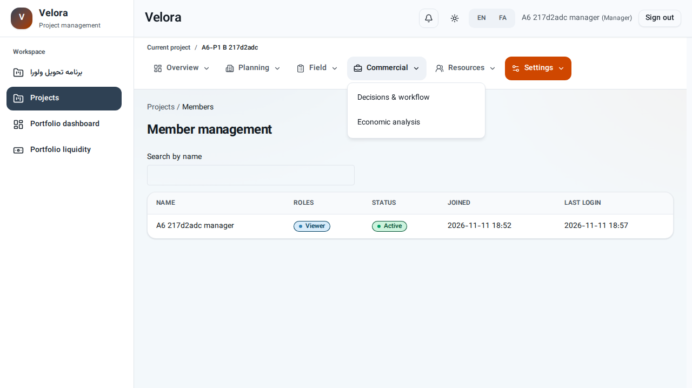
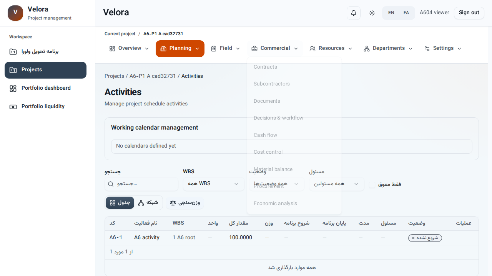

# مرور واقعی نقش‌ها در مرورگر — A.6.04

تاریخ: ۲۰ آبان ۱۴۰۵ / 2026-11-11. نسخه مبنا: `057d15c60c48522f482ac04646d0241e4d96b321`؛ درخت هنگام آزمون شامل تغییرات ثبت‌نشده این بازبینی بود.

**نتیجه نهایی ریزکار: پیاده‌سازی‌شده و تأیید فنی در مرورگر؛ A.6.04 تیک خورد.** اجرای کامل نهایی **۲۳/۲۳ موفق، بدون skip یا flaky** بود. چهار آزمون مستقل فیلتر ناوبری، TypeScript و ساخت نهایی وب نیز موفق شدند. این نتیجه به معنی امضای پذیرش کارفرما یا تأیید کانال فایل/ارسال پیام نیست.

پس از ثبت وضعیت، خود `http://localhost:5173/delivery-plan` نیز در مرورگر بررسی شد: A.6 دارای **۵/۵ ردیف تیک‌خورده** است، شمارنده کل **۲۵ پیاده‌سازی‌شده / ۶۴ نیازمند تکمیل** را نشان می‌دهد و فیلتر «نیازمند تکمیل» دیگر A.6 را نمایش نمی‌دهد. این بررسی بدون خطای runtime موفق شد.

## اصلاحات و شاهد نهایی

- منوی پروژه، علاوه بر capability، با همان مجوز مؤثر صفحات فیلتر می‌شود. مقصدهای بدون مجوز و گروه‌های خالی حذف می‌شوند؛ استثنای مشاهده سازمانی با همان قرارداد موجود حفظ شده است. قواعد خواندن در `apps/web/src/config/project-navigation-permissions.ts` هستند و مقصد ناشناخته خودکار مجاز نمی‌شود.
- نشست و زبان در SSR و نخستین render مرورگر از وضعیت یکسان شروع می‌شوند؛ اطلاعات ذخیره‌شده بعد از mount بازیابی و نشست با سرور اعتبارسنجی می‌شود. در اجرای نهایی هیچ خطای hydration در سناریوهای ۱۳ نقش یا دو زبان مسیر مدیر ثبت نشد.
- محیط جدا پیش از مرور، وابستگی‌های مسیرهای واقعی برنامه و ورودی‌های `react-dom/client` و `react-router/dom` را آماده می‌کند. تست‌ها وارد اسکن runtime نمی‌شوند. هیچ تعویض بسته به‌دلیل کشف دیرهنگام وابستگی یا خطای optimizer در اجرای نهایی ثبت نشد؛ مسیر admin نیز موفق شد.
- آزمون جدید، تغییر پروژه A به B و بازگشت، رد صریح `view_costs` و بازگرداندن ارث را در منو بررسی می‌کند؛ پاسخ مستقیم هزینه نیز به‌ترتیب 403 و 200 تأیید شد.

تصویر بالا برای مدیر A با نقش مشاهده‌گر در B است. فقط مقصدهای مجاز همان نقش در منوی بازرگانی مانده‌اند. [نتیجه ساختاریافته اجرای نهایی](evidence/A6-04-role-review-results.json) اجرای قدیمی و جدید را جدا نگه می‌دارد.

## روش و دامنه اجرا

Chromium واقعی با Playwright، Django واقعی و PostgreSQL جدا اجرا شدند. ورود از فرم واقعی انجام شد؛ پاسخ API یا DOM جعل نشد. پایگاه و API/Web فعال توسعه تغییر نکردند. تنظیمات آزمون شامل audit همگام، وظایف eager و cache محلی مستقل است؛ بنابراین این بررسی کارکرد worker یا rate limiter چندپردازشی را اثبات نمی‌کند.

پایگاه اجرای نهایی: `velora_a6_p1_e2e_1794422884_512850`، ساخته‌شده توسط همین بررسی و بدون نشست متصل هنگام استفاده مجدد. کاربران، پروژه‌ها و گزارش روزانه ساختگی بودند. فایل موقت حساب‌ها و توکن‌ها در پایان حذف شد؛ مدرک اشتراکی شامل رمز یا توکن نیست.

هر یک از ۱۳ نقش پیش‌فرض، هفت حوزه فعالیت‌ها، هزینه‌ها، اسناد، قراردادها، تدارکات، تخصیص منابع انسانی و گزارش روزانه را در مرورگر باز کرد: **۹۱ جفت نقش/حوزه**. پاسخ مستقیم سرور کنار رفتار رابط سنجیده شد. صفحه اعضا و پروژه‌ای که کاربر عضو آن نبود نیز برای هر نقش بررسی شد.

نقش‌ها: `project_manager`، `planning_engineer`، `site_supervisor`، `field_supervisor`، `finance_manager`، `procurement_officer`، `document_controller`، `viewer`، `executive_approver`، `project_controls`، `site_specialist`، `supervisor_consultant`، `hr_officer`.

موارد مکمل:

- مسیر مدیر در فارسی و انگلیسی: ساخت عضویت چندنقشی، انتخاب رد/اعطا/ارث، لغو عضویت و تاریخچه قبل/بعد.
- مدیر A با نقش صرفاً مشاهده‌گر در B، و عضو غیرفعال: نداشتن کنترل مدیریت اعضا و رد درخواست مستقیم نوشتن.
- کاربر دارای فقط ویرایش فعالیت: ذخیره واقعی از فرم، مشاهده نام جدید و بررسی مقدار ذخیره‌شده؛ حذف و تأیید اندازه‌گیری با درخواست مستقیم رد شدند.
- حساب‌های سازمانی admin، HR، superuser، staff و visitor: تفکیک مدیریت حساب سازمان از نوشتن در پروژه بدون عضویت.

## نقص B01 در مرور اولیه و رفع آن

**نیازمندی:** A6-R34 / سناریوی ۳ داستان کاربری ۴ در [spec.md](../../specs/048-a6-p4-module-access/spec.md): «منو و دکمه با اختیار پروژه و نقش فعلی یکی می‌شوند».

**انتظار:** مشاهده‌گر فاقد `view_costs`، `view_contracts` و `view_documents` نباید از منو به‌عنوان مسیر مجاز به این حوزه‌ها هدایت شود؛ مقصد غیرمجاز باید مخفی یا غیرقابل اقدام باشد. کنترل مستقل سرور نیز باید باقی بماند.

**مشاهده واقعی:** با حساب `A604 viewer`، در پروژه A و صفحه فعالیت‌ها، بازکردن منوی Commercial این لینک‌های فعال را نشان داد: Contracts، Subcontractors، Documents، Decisions & workflow، Cash flow، Cost control، Material balance، Procurement و Economic analysis. پیوند Cost control یک `a` فعال به مسیر هزینه همان پروژه بود. این مشاهده از کلیک واقعی روی منو به دست آمد.

در همان اجرای نقش مشاهده‌گر، درخواست مستقیم `costs/summary/`، `documents/` و `contracts/` پاسخ **403** داشت و کنترل‌های نوشتن مربوط نمایش داده نشدند. بنابراین B01 شاهد ناهماهنگی ناوبری با اختیار نقش است؛ از این مشاهده نشت داده یا موفقیت نوشتن ممنوع استنتاج نمی‌شود.

**علت در نسخه قبل:** `useProjectNavigation` اقلام را فقط بر اساس capability پروژه می‌ساخت و مجوز مؤثر عضو در این ساخت دخیل نبود. [useNavigation.ts](../../apps/web/src/components/navigation/hooks/useNavigation.ts) اکنون `usePermission` و فیلتر مجوز مقصد را نیز اعمال می‌کند. کنترل مستقل سرور دست‌نخورده است.

**وضعیت: رفع شد.** بررسی منوی همه ۱۳ نقش، مسیرهای عمومی مجاز مدیر سازمان، تغییر پروژه و استثناهای رد/ارث در اجرای کامل نهایی موفق شدند. تیک A.6.04 بر اساس همین شاهد ثبت شد.

## سابقه اجرا و حدود اثبات

اجرای اولیه پیش از رفع مشکلات ۲۲ سناریو داشت: **۲۰ موفق و ۲ ناموفق**. هر ۱۳ سناریوی نقش پروژه، دو زبان مسیر مدیر، مرز عضو غیرفعال/پروژه دیگر و بررسی‌های HR، superuser، staff و visitor موفق بودند.

یکی از دو شکست، خطای assertion آزمون بود: نام فعالیت در دکمه‌ای جست‌وجو شده بود که فقط کد فعالیت را نمایش می‌دهد. assertion به نام نمایان و مقدار ذخیره‌شده در API اصلاح شد؛ بازآزمایی مستقل **۱ موفق** داشت و ذخیره مجاز و رد حذف/تأیید را اثبات کرد.

مسیر admin در نخستین بازدید صفحه کاربران با خطای hook در React و در بازآزمایی با پاسخ **504 Outdated Optimize Dep** متوقف شد. این مشکل محیط آزمون با اسکن مسیرهای runtime و آماده‌سازی ورودی‌های React پیش از اولین مرور اصلاح شد؛ در اجرای نهایی، ورود admin، نمایش مدیریت حساب، بازشدن فرم کاربر جدید و رد نوشتن در پروژه بدون عضویت همگی موفق شدند.

جمع‌بندی قدیمی ۲۱ سناریوی تأییدشده و یک admin تأییدنشده، صرفاً سابقه پیش از اصلاح است. **اجرای کامل نهایی ۲۳ موفق و صفر ناموفق داشت**؛ شامل آزمون جدید تغییر پروژه و مجوز. [رکورد نتایج بدون اطلاعات ورود](evidence/A6-04-role-review-results.json) تاریخچه و نتیجه نهایی را جدا نگه می‌دارد.

در مرور اولیه ۱۳ نقش، ۱۳۰ پیام hydration mismatch ثبت شده بود. پس از اصلاح آغاز نشست و زبان، عدد اجرای نهایی **صفر** است و تست‌ها دیگر این خطاها را از نتیجه runtime مستثنی نمی‌کنند.

این مرور جایگزین ماتریس جامع همه عملیات در همه ۲۹ حوزه، دانلود واقعی فایل، ارسال واقعی دعوت/بازیابی یا پذیرش کارفرما نیست. محدودیت‌های [بسته پذیرش](../../specs/050-a6-p6-delivery-acceptance/evidence/package.md) با موفقیت سناریوهای منتخب بسته نمی‌شوند.

## بازتولید

دستور اجرای کامل و شرح دامنه: [ROLE_REVIEW.md](../../e2e/a6-p1/ROLE_REVIEW.md). تست‌ها در [a6-role-review.e2e.spec.ts](../../e2e/tests/a6-role-review.e2e.spec.ts) و [a6-p6-manager-path.e2e.spec.ts](../../e2e/tests/a6-p6-manager-path.e2e.spec.ts) هستند. نتایج خام و تصاویر ساختگی در `test-results/a6-role-review-initial/` و نتایج بازآزمایی در `test-results/a6-role-review/` قرار دارند و در Git ثبت نمی‌شوند.

برای بازتولید B01 در مرورگر: با یک عضو فعال دارای نقش `viewer` وارد شوید، فعالیت‌های پروژه را باز کنید، منوی بازرگانی را باز کنید و فعال بودن لینک هزینه/اسناد/قرارداد را با نداشتن مجوز آن‌ها مقایسه کنید.
