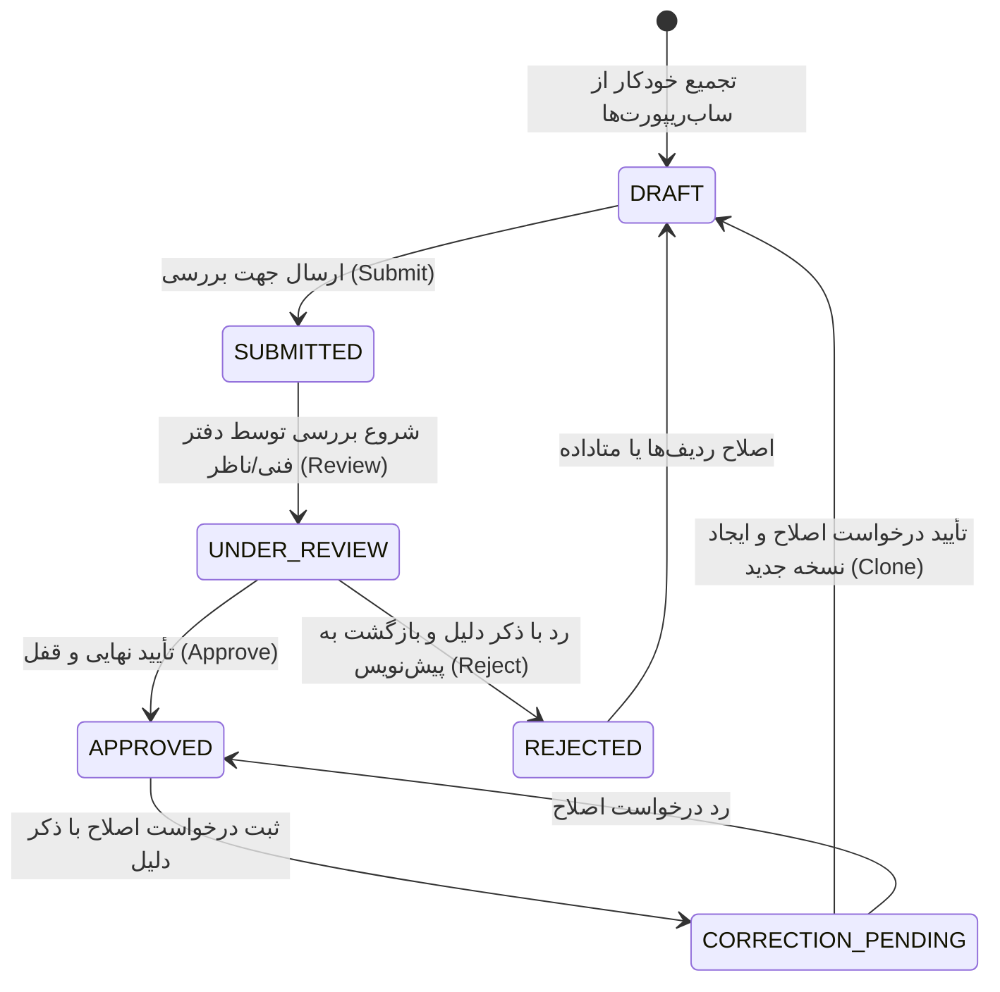

# جریان کاربری و درخت تصمیم گزارشات روزانه (Daily Reports User Flow)

این سند نقشه تعاملی، درخت تصمیم، مجوزهای دسترسی، و جریان‌های چرخه حیات گزارش روزانه پروژه را به‌صورت یکپارچه و فشرده پوشش می‌دهد.

---

## ۱. نمای کلی مسیر و دسترسی‌ها

| صفحه / نما | مسیر URL | کامپوننت فرانت‌اند | مجوز مورد نیاز | توضیحات |
| :--- | :--- | :--- | :--- | :--- |
| **لیست گزارشات روزانه** | `/projects/:projectId/daily-reports` | `DailyReportsListPage` | `view_reports` | مشاهده تقویم/لیست روزانه، فیلتر بازه زمانی و وضعیت |
| **مشاهده گزارش روزانه** | `/projects/:projectId/daily-reports/:reportId` | `DailyReportViewPage` | `view_reports` | مشاهده تب‌های تجمیعی، خروجی PDF، تاریخچه نسخه‌ها |
| **ویرایش گزارش روزانه** | `/projects/:projectId/daily-reports/:reportId/edit` | `DailyReportEditPage` | `edit_reports` | ویرایش هدر، شرایط جوی، یادداشت‌ها و بررسی تب‌ها |
| **درخواست اصلاح گزارش قفل** | مودال روی نمای مشاهده گزارش | `CorrectionRequestModal` | `edit_reports` | ثبت درخواست ویرایش برای گزارش‌های وضعیت `APPROVED` |

> **نکته معماری (اسپک 028)**: دکمه «گزارش جدید» به صورت دستی از لیست گزارشات حذف شده است. گزارش روزانه پروژه به‌صورت خودکار بر اساس تاریخ و از تجمیع ساب‌ریپورت‌های دیسیپلین‌ها (ابنیه، برق، مکانیک و...) تولید می‌شود (`/daily-reports/by-date/`).

---

## ۲. چرخه حیات و ماشین وضعیت گزارش روزانه (Lifecycle State Machine)

### عملیات‌های چرخه وضعیت:
1. **ارسال (Submit)**:
   - اندپوینت: `POST /api/v1/projects/{projectId}/daily-reports/{reportId}/submit/`
   - وضعیت: انتقال از `DRAFT` یا `REJECTED` به `SUBMITTED`.
   - دسترسی: نقش ناظر/سرپرست کارگاه (`edit_reports`).
2. **بررسی (Review)**:
   - اندپوینت: `POST /api/v1/projects/{projectId}/daily-reports/{reportId}/review/`
   - وضعیت: انتقال به `UNDER_REVIEW`.
   - دسترسی: دفتر فنی یا مهندس مقیم (`approve_reports`).
3. **تأیید نهایی و قفل (Approve)**:
   - اندپوینت: `POST /api/v1/projects/{projectId}/daily-reports/{reportId}/approve/`
   - اثر: قفل شدن گزارش (`is_locked=True`). داده‌ها به عنوان مبنای پیشرفت فیزیکی دوره‌ای و گزارشات هفتگی/ماهانه معتبر شناخته می‌شوند.
4. **رد (Reject)**:
   - اندپوینت: `POST /api/v1/projects/{projectId}/daily-reports/{reportId}/reject/`
   - نیاز به ثبت `rejection_reason`. انتقال به `REJECTED`.
5. **درخواست اصلاح (Correction Request)**:
   - اندپوینت: `POST /api/v1/projects/{projectId}/daily-reports/{reportId}/correction-requests/`
   - برای گزارش‌های `APPROVED`. با تأیید مدیر، یک کلون جدید در وضعیت `DRAFT` با حفظ شماره نسخه ایجاد می‌شود.

---

## ۳. سکشن‌های فرم گزارش روزانه (Report Sections Grid Pattern)

گزارش روزانه کل شامل ۷ سکشن تب‌بندی‌شده بر اساس استاندارد فرم شیراز است:

| تب / سکشن | اقلام اطلاعاتی | قوانین ویرایش در حالت تجمیعی (اسپک 028) |
| :--- | :--- | :--- |
| **هدر و آب‌وهوا (`weather`)** | دمای حداقل/حداکثر، شرایط جوی ۵ حالته، شیفت کاری، وضعیت کارگاه (فعال/غیرفعال) | مستقیماً توسط مدیر کارگاه قابل ویرایش و Override است. |
| **فعالیت‌های روزانه (`activities`)** | WBS، جبهه کاری، مقدار اجرا، واحد، درصد روز، پیمانکار، تصاویر | از ساب‌ریپورت‌ها تجمیع می‌شود؛ ویرایش دستی قفل است (ارجاع به ساب‌ریپورت). |
| **نیروی انسانی (`labor`)** | نیروی ستادی (۳۴ شغل) و مستقیم (۳۲ شغل)، ساعات کارکرد، غیبت | تجمیع کلیدمحور از ساب‌ریپورت‌های واحدهای فعال کارگاه. |
| **ماشین‌آلات (`equipment`)** | نوع دستگاه، تعداد، ساعات کارکرد و توقف، علت توقف | تجمیع ساعتی و علل توقف تجهیزات. |
| **مصالح کارگاه (`materials`)** | نوع مصالح، واحد، مقدار ورودی، مقدار مصرفی، محل مصرف | ارزیابی مشورتی با حواله‌های انبار (`reconciliation`). |
| **بتن‌ریزی (`concrete-logs`)** | محل بتن‌ریزی، رده بتن، حجم، آزمایشگاه، شماره تراک | لاگ تخصصی احجام بتن‌ریزی سازه. |
| **حوادث و توقفات (`incidents`)** | نوع حادثه، HSE، دستورکار کارگاهی، موانع کاری، اقدام اصلاحی | ثبت رخدادهای ایمنی و کیفی سایت. |

---

## ۴. الگوی عملیات ردیف‌های درون‌جدولی و همگام‌سازی آفلاین

تمامی جداول فرزند فرم گزارش از یک الگوی تعاملی استاندارد پیروی می‌کنند:
- **افزودن / ویرایش / حذف ردیف**:
  - در حالت آنلاین: ارسال درخواست فوری به ساب‌ریسورس مربوطه (`/activities/`, `/labor/`, ...)
  - در حالت آفلاین: ثبت در صف لوکال (`syncPendingQueue`) با کلید کلاینت `client_id` (UUIDv4)
- **خطای همگام‌سازی و تلاش مجدد (Retry Sync)**:
  - در صورت قطعی شبکه یا خطای سرور، ردیف با نشانگر زرد/قرمز «همگام‌نشده» علامت‌گذاری شده و کنترل «تلاش مجدد» (`onRetryRow`) فعال می‌شود.
  - همگام‌سازی دسته‌ای آفلاین با اندپوینت `/daily-reports/sync-batch/` انجام می‌گیرد.
