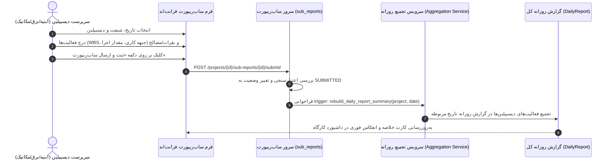

# جریان کاربری و درخت تصمیم ساب‌ریپورت‌های دیسیپلین (Discipline Sub-Reports User Flow)

این سند نقشه تعاملی، درخت تصمیم و فرآیند ثبت و ارسال گزارش‌های تخصصی واحدها/دیسیپلین‌های مختلف (ابنیه، مکانیک، برق، تأسیسات و...) را تبیین می‌کند.

---

## ۱. نمای کلی مسیر و نقش‌ها

| صفحه / نما | مسیر URL | کامپوننت فرانت‌اند | مجوز مورد نیاز | توضیحات |
| :--- | :--- | :--- | :--- | :--- |
| **لیست ساب‌ریپورت‌های پروژه** | `/projects/:projectId/sub-reports` | `ProjectSubReportsPage` | `view_reports` | مشاهده کارت‌ها/ردیف‌های ساب‌ریپورت به تفکیک واحد و تاریخ |
| **ثبت ساب‌ریپورت دیسیپلین جدید** | `/projects/:projectId/sub-reports/new` | `DisciplineSubReportNewPage` | `edit_reports` | ورود احجام کاری، پرسنل، مصالح و تصاویر اختصاصی واحد |
| **ویرایش ساب‌ریپورت** | `/projects/:projectId/sub-reports/:subReportId/edit` | `DisciplineSubReportEditPage` | `edit_reports` | اصلاح مقادیر تا قبل از تأیید نهایی |

---

## ۲. دیسیپلین‌های تحت پوشش (Disciplines Enum)

بر اساس استاندارد فرم‌های شیراز، دیسیپلین‌های زیر ساب‌ریپورت اختصاصی دارند:
1. **ابنیه و سازه (`CIVIL`)**: کارهای بتنی، آرماتوربندی، قالب‌بندی، سفت‌کاری و نازک‌کاری.
2. **تأسیسات برقی (`ELECTRICAL`)**: لوله‌گذاری برق، سیم‌کشی، سینی کابل، تابلوهای برق، کابل‌کشی و روشنایی.
3. **تأسیسات مکانیکی (`MECHANICAL`)**: لوله‌کشی آب و فاضلاب، آتش‌نشانی، کانال‌کشی و موتورخانه.
4. **لوله‌کشی و تأسیسات بهداشتی (`PLUMBING`)**
5. **سرمایش و گرمایش (`HVAC`)**
6. **نازک‌کاری و معماری (`FINISHING`)**

---

## ۳. فرآیند تعاملی ثبت و تجمیع خودکار (Auto-Rollup Interaction)

---

## ۴. ارتباط با لاگ جامع فعالیت‌های کارگاه (`navigate-activity-log`)

- **مسیر**: `/projects/:projectId/activity-log`
- **کامپوننت**: `ProjectActivityLogPage`
- **توضیح**: این نما مستقیماً شیت `ACTIVITY` در بانک جامع داده‌های شیراز را منعکس می‌کند.
- تمام رکوردهای فعالیت تاییدشده از ساب‌ریپورت‌های ابنیه، برق، مکانیک و غیره در این پایگاه اطلاعاتی تجمیع شده و امکان فیلتر بر اساس:
  - بازه زمانی (`date_from`, `date_to`)
  - دیسیپلین (`discipline`)
  - پیمانکار (`contractor`)
  - کد WBS و موقعیت بلوک/طبقه
  را فراهم می‌سازد.
