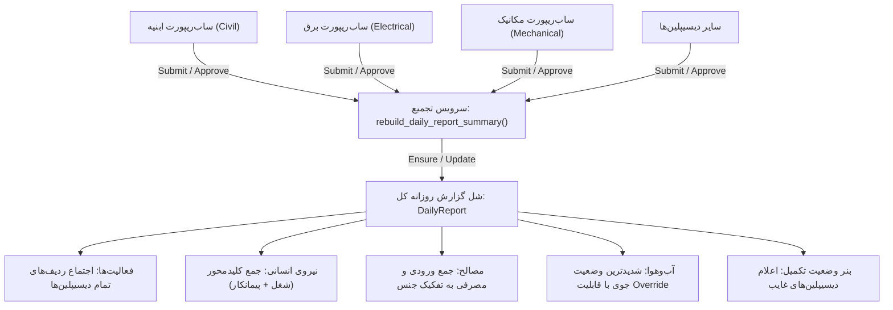

# سند مشخصات فنی اتمیک: موتور تجمیع خودکار ساب‌ریپورت‌ها در گزارش جامع روزانه
**شناسه سند:** `SPEC-06-AUTO-DAILY-ROLLUP`  
**حوزه:** تجمیع خودکار و گزارشات تجمیعی (Auto-Aggregation & Rollup - اسپک 028)  
**اسناد مرجع:** `02-.../spec.md`, `02-.../data-model.md`, `02-.../daily-report-summary-api.md`, `02-.../daily-report-summary-ui.md`

---

## ۱. هدف و دامنه
این سند تمامی نیازمندی‌ها، منطق کسب‌وکار، معماری سرویس `rebuild_daily_report_summary` و سناریوهای کاربری مربوط به تولید و به‌روزرسانی خودکار گزارش روزانه کل پروژه از تجمیع ساب‌ریپورت‌های دیسیپلین‌ها را مدون می‌سازد. مطابق این استاندارد، ایجاد گزارش روزانه پروژه دیگر به صورت فرم خام دستی نیست، بلکه از ترکیب داده‌های ساب‌ریپورت‌ها حاصل می‌شود.

---

## ۲. دیاگرام گردش تجمیع خودکار

---

## ۳. داستان‌های کاربری اتمیک (Atomic User Stories)

### داستان کاربری US-AG-01: حذف دکمه ایجاد دستی گزارش و دسترسی با اندپوینت `by-date`
- **نقش و بیانیه:**
  > به عنوان **کاربر سامانه و مدیر پروژه**،  
  > می‌خواهم دکمه «گزارش جدید» به شکل سنتی حذف شده و دسترسی به گزارش روزانه از طریق انتخاب تاریخ در تقویم (`/daily-reports/by-date/`) صورت گیرد،  
  > تا هیچ کاربر کاربری نتواند گزارش روزانه خام و بی‌ارتباط با ساب‌ریپورت‌های دیسیپلین ایجاد کند.
- **پیش‌شرط‌ها:**
  - کاربر دارای دسترسی به پروژه باشد.
- **معیارهای پذیرش (Acceptance Criteria):**
  - **سناریو ۱ (حذف دکمه ایجاد جدید از لیست):**
    - *با فرض اینکه* کاربر صفحه `/projects/:projectId/daily-reports` را باز کند،
    - *هنگامی که* هدر صفحه بارگذاری می‌شود،
    - *آنگاه* دکمه «گزارش جدید» (New Report) در صفحه نمایش داده نشود و در صورت ارسال درخواست دستی `POST /api/v1/projects/{pk}/daily-reports/` بدون بدنه ساب‌ریپورت، پاسخ `400 Bad Request` بازگردد.
  - **سناریو ۲ (تضمین دسترسی به تاریخ با اندپوینت by-date):**
    - *با فرض اینکه* کاربر یک تاریخ مشخص (مثلاً `2026-10-22`) را در تقویم انتخاب کند،
    - *هنگامی که* فرانت‌اند درخواست `GET /api/v1/projects/{pk}/daily-reports/by-date/?date=2026-10-22` ارسال می‌کند،
    - *آنگاه* اگر گزارشی از قبل برای آن تاریخ وجود داشته باشد بازگردانده شود؛ و اگر وجود نداشته باشد، سرور در لحظه یک شل معتبر با `is_auto_summary=True` ایجاد کرده و با کد `200 OK` بازگرداند.
- **قرارداد API:**
  - `GET /api/v1/projects/{project_pk}/daily-reports/by-date/?date={YYYY-MM-DD}&shift={1|2|3}`

---

### داستان کاربری US-AG-02: تجمیع خودکار فعالیت‌ها، نیروی انسانی و مصالح (Auto-Rollup)
- **نقش و بیانیه:**
  > به عنوان **مدیر پروژه و مهندس دفتر فنی**،  
  > می‌خواهم با ارسال هر ساب‌ریپورت توسط سرپرستان واحدها، داده‌های آن در لحظه درون گزارش جامع روزانه تجمیع شوند،  
  > تا نیازی به تایپ و ورود دستی مجدد اطلاعات در گزارش کل نبوده و خطای انسانی در انتقال آمار به صفر برسد.
- **پیش‌شرط‌ها:**
  - حداقل یک ساب‌ریپورت در وضعیت `SUBMITTED` یا `APPROVED` برای تاریخ مورد نظر وجود داشته باشد.
- **معیارهای پذیرش (Acceptance Criteria):**
  - **سناریو ۱ (تجمیع اجتماع فعالیت‌ها - Union of Activities):**
    - *با فرض اینکه* ساب‌ریپورت ابنیه دارای ۳ ردیف و ساب‌ریپورت برق دارای ۲ ردیف باشد،
    - *هنگامی که* بازسازی تجمیع اجرا می‌شود،
    - *آنگاه* جدول فعالیت‌های گزارش روزانه کل شامل هر ۵ ردیف با قید دیسیپلین منبع باشد.
  - **سناریو ۲ (جمع کلیدمحور نیروی انسانی - Labor Aggregation by Key):**
    - *با فرض اینکه* ساب‌ریپورت ابنیه ۴ نفر آرماتوربند با پیمانکار A و ساب‌ریپورت برق ۲ نفر برق‌کار با پیمانکار B داشته باشد،
    - *هنگامی که* تجمیع انجام می‌شود،
    - *آنگاه* ردیف‌های مجزا به ازای هر ترکیب `(job_title, contractor)` ایجاد شده و در صورت یکسان بودن کلید، تعداد نفرات با هم جمع شوند.
  - **سناریو ۳ (محاسبه زمان تجمیع - Timestamp):**
    - *با فرض اینکه* عملیات بازسازی گزارش با موفقیت پایان پذیرد،
    - *هنگامی که* گزارش کل ذخیره می‌شود،
    - *آنگاه* فیلد `aggregated_at` با زمان جاری سرور (UTC) و تاریخ شمسی ثبت شود.

---

### داستان کاربری US-AG-03: قفل‌گذاری ردیف‌های مشتق‌شده (Read-Only Derived Rows)
- **نقش و بیانیه:**
  > به عنوان **توسعه‌دهنده نرم‌افزار و بازرس داده**،  
  > می‌خواهم ردیف‌های ایجادشده ناشی از تجمیع ساب‌ریپورت‌ها در گزارش کل قفل و غیرقابل ویرایش مستقیم باشند،  
  > تا یکپارچگی داده بین ساب‌ریپورت‌های مبدأ و گزارش تجمیعی حفظ شده و مغایرت رخ ندهد.
- **معیارهای پذیرش (Acceptance Criteria):**
  - **سناریو ۱ (ممانعت از افزودن دستی فعالیت در گزارش تجمیعی):**
    - *با فرض اینکه* گزارش دارای فلگ `is_auto_summary=True` باشد،
    - *هنگامی که* کلاینت درخواست `POST .../daily-reports/{id}/activities/` ارسال کند،
    - *آنگاه* سرور با خطای `400 derived_collection_read_only` درخواست را رد کرده و پیام دهد: «این ردیف‌ها از ساب‌ریپورت‌های دیسیپلین مشتق شده‌اند؛ لطفاً از طریق ساب‌ریپورت مربوطه اقدام نمایید».
  - **سناریو ۲ (حذف دکمه‌های Add/Delete ردیف در نمای فرانت‌اند):**
    - *با فرض اینکه* گزارش تجمیعی در فرانت‌اند نمایش داده شود،
    - *هنگامی که* کاربر به تب‌های فعالیت‌ها، مصالح یا نیروی انسانی نگاه می‌کند،
    - *آنگاه* دکمه‌های «افزودن ردیف» و سطل زباله «حذف ردیف» مخفی یا غیرفعال باشند.

---

### داستان کاربری US-AG-04: مدیریت شرایط جوی ترکیبی و قابلیت بازنویسی مدیر (Weather Override)
- **نقش و بیانیه:**
  > به عنوان **مدیر کارگاه و مهندس مقیم**،  
  > می‌خواهم سیستم به طور خودکار شرایط جوی را بر اساس شدیدترین وضعیت گزارش‌شده توسط دیسیپلین‌ها تنظیم کند، ولی به من امکان دهد در صورت لزوم آن را به‌طور دستی بازنویسی (Override) کنم،  
  > تا شرایط جوی نهایی کارگاه مطابق با واقعیت رسمی سایت تأیید گردد.
- **معیارهای پذیرش (Acceptance Criteria):**
  - **سناریو ۱ (انتخاب شدیدترین شرایط جوی بر اساس سلسله‌مراتب):**
    - *با فرض اینکه* ساب‌ریپورت ابنیه هوا را `cloudy` (ابری) و ساب‌ریپورت برق هوا را `rainy` (بارانی) ثبت کرده باشد،
    - *هنگامی که* تجمیع انجام می‌شود،
    - *آنگاه* بر اساس اولویت شدت (`clear < cloudy < rainy < snowy < stormy`)، وضعیت جوی گزارش کل به طور خودکار `rainy` شود.
  - **سناریو ۲ (اعمال بازنویسی دستی توسط مدیر - Manual Override):**
    - *با فرض اینکه* مدیر پروژه فیلد `weather_override` را با مقدار `stormy` و دمای خاص تنظیم کند،
    - *هنگامی که* تجمیع مجدد اجرا شود،
    - *آنگاه* سیستم مقدار دستی مدیر را بازنویسی نکرده و مقدار انتخابی مدیر را با برچسب `overridden_by_manager` حفظ کند.

---

### داستان کاربری US-AG-05: نمایش بنر نقص اطلاعات و دیسیپلین‌های غایب (Missing Disciplines Banner)
- **نقش و بیانیه:**
  > به عنوان **مسئول دفتر فنی و مدیر پروژه**،  
  > می‌خواهم در صورتی که برخی از واحدهای فعال پروژه (مثلاً برق یا مکانیک) هنوز ساب‌ریپورت روز جاری را ارسال نکرده باشند، یک هشدار صریح در بالای گزارش نمایش داده شود،  
  > تا مدیر قبل از تأیید نهایی بداند که کدام بخش‌های کارگاه هنوز گزارش خود را تحویل نداده‌اند.
- **معیارهای پذیرش (Acceptance Criteria):**
  - **سناریو ۱ (تشخیص و اعلام دیسیپلین‌های غایب):**
    - *با فرض اینکه* در پروژه دیسیپلین‌های فعال `[CIVIL, ELECTRICAL, MECHANICAL]` تعریف شده باشند و فقط ساب‌ریپورت `CIVIL` ارسال شده باشد،
    - *هنگامی که* گزارش کل رندر می‌شود،
    - *آنگاه* پاسخ API شامل فیلد `missing_disciplines: ["ELECTRICAL", "MECHANICAL"]` باشد و فرانت‌اند یک بنر نارنجی‌رنگ هشدار نقص گزارش همراه با اسامی واحدهای غایب نمایش دهد.
  - **سناریو ۲ (سبز شدن وضعیت پس از ارسال تمام ساب‌ریپورت‌ها):**
    - *با فرض اینکه* آخرین واحد غایب نیز ساب‌ریپورت خود را ارسال کند،
    - *هنگامی که* صفحه گزارش باز شود،
    - *آنگاه* بنر نقص پنهان شده و پیام سبز «تمام گزارش‌های دیسیپلین دریافت و تجمیع شدند» نمایش داده شود.

---

### داستان کاربری US-AG-06: به‌روزرسانی بلادرنگ بانک جامع فعالیت‌ها (`ACTIVITY` Master Log)
- **نقش و بیانیه:**
  > به عنوان **کارشناس برنامه‌ریزی و کنترل پروژه**،  
  > می‌خواهم با تأیید هر گزارش روزانه، کلیه رکوردهای فعالیت آن به صورت خودکار در بانک جامع داده‌های پروژه (معادل شیت ACTIVITY در فرم شیراز) ذخیره شوند،  
  > تا تاریخچه کل کارهای اجرایی پروژه در یک دیتابیس تخت و فیلترپذیر تجمیع شود.
- **معیارهای پذیرش (Acceptance Criteria):**
  - **سناریو ۱ (انعکاس فعالیت‌ها در اندپوینت activity-log):**
    - *با فرض اینکه* گزارشی تأیید شود،
    - *هنگامی که* کاربر صفحه `/projects/:projectId/activity-log` را فراخوانی کند،
    - *آنگاه* تمامی فعالیت‌های مندرج در گزارش روزانه به صورت سطرهای مستقل با تاریخ، دیسیپلین، جبهه کاری و مقدار قابل فیلتر و جستجو باشند.
