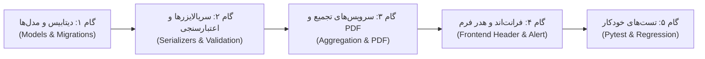

# سند نهایی گزارش شکاف‌ها و برنامه اقدام فنی: هدر گزارش روزانه و شرایط جوی
**شناسه سند هدف:** [`SPEC-01-DAILY-HEADER-WEATHER.md`](file:///home/hossein/Desktop/projects/building-management/reports_documentation/atomic-specs/SPEC-01-DAILY-HEADER-WEATHER.md)  
**اسناد مرجع همبسته:** [`SPEC-06-AUTO-DAILY-ROLLUP.md`](file:///home/hossein/Desktop/projects/building-management/reports_documentation/atomic-specs/SPEC-06-AUTO-DAILY-ROLLUP.md) و [`مستندات فرم‌های اکسل شیراز (FILE 4)`](file:///home/hossein/Desktop/projects/building-management/reports_documentation/01-core-requirements-and-excel-blueprints/مستندات%20فرم‌های%20اکسل%20شیراز%20(Shiraz%20Excel%20Forms%20Documentation).md)  
**تاریخ گزارش:** ۲ آبان ۱۴۰۵ (2026-10-22)  
**وضعیت:** مصوب و نهایی‌شده برای پیاده‌سازی (Ready for Implementation)

---

## ۱. خلاصه‌ی تصمیمات کلیدی مصوب (Approved Architecture Decisions)

با توجه به پاسخ‌ها و راهبری محصول، ۴ تصمیم بنیادین نهایی به شرح زیر ثبت گردید:

1. **معماری ایجاد گزارش: تجمیع خودکار از واحدهای تخصصی (Auto-Rollup Paradigm)**
   - قابلیت ایجاد دستی و مستقیم گزارش روزانه در صفحه `daily-reports` به طور کامل منسوخ و حذف‌شده باقی می‌ماند.
   - گزارش جامع روزانه منحصراً از طریق تجمیع خودکار ساب‌ریپورت‌های واحدهای تخصصی (ابنیه، برق، مکانیک و ...) در اندپوینت `/daily-reports/by-date/` ساخته و مدیریت می‌شود.
   - خطای `400 auto_summary_only` در درخواست مستقیم `POST /daily-reports/` و ریدایرکت صفحه فرانت‌اند به عنوان رفتار مورد تأیید باقی می‌ماند.

2. **معماری شیفت‌های کاری: گزینه الف (گزارش جامع ۲۴ ساعته کل روز — رویکرد اکسل شیراز)**
   - در هر روز تقویمی، **دقیقاً یک گزارش جامع ۲۴ ساعته** برای کل پروژه وجود دارد.
   - فیلد `shift` در هدر اصلی گزارش جامع ثابت و نشان‌دهنده پوشش تمام روز (`ReportShift.FULL`) است.
   - تفکیک شیفت‌های سه‌گانه (شیفت ۱ روز: ۷ الی ۱۷ / شیفت ۲ عصر: ۱۸ الی ۲۴ / شیفت ۳ شب: ۱ الی ۶) دقیقاً مطابق فرم اکسل شیراز، در **سطح ردیف‌ها** اعمال می‌شود:
     - ردیف‌های فعالیت اجرایی دارای فیلد شیفت عددی (`1`, `2`, `3`) هستند.
     - ردیف‌های نیروی انسانی دارای سه ستون مجزا (`shift_1_count`, `shift_2_count`, `shift_3_count`) برای ثبت نفرات فعال در هر شیفت هستند.
     - ردیف‌های ماشین‌آلات دارای شیفت کاری مربوطه هستند.

3. **استانداردسازی وضعیت‌های جوی: دقیقاً ۵ وضعیت رسمی**
   - حالات جوی به ۵ وضعیت استاندارد محدود می‌شوند:
     1. `clear` (آفتابی / صاف)
     2. `cloudy` (ابری)
     3. `rainy` (بارانی)
     4. `snowy` (برفی)
     5. `stormy` (طوفانی / گرد و غبار)
   - موارد مازاد و غیر منطبق فعلی (`sunny`, `partly_cloudy`, `foggy`) کاملاً از مدل داده، اینترفیس‌ها، جدول شدت آب‌وهوا و فرانت‌اند پاکسازی و نگاشت می‌شوند.

4. **تکمیل فیلدهای مفقوده هدر و اعتبارسنجی‌ها:**
   - فیلد `weather_impact_notes` به مدل، سریالایزر و خروجی PDF اضافه می‌شود.
   - فیلد `inactivity_reason` با ۵ گزینه استاندارد (`weather`, `holiday`, `strike_or_dispute`, `client_stop_order`, `safety_incident`) افزوده شده و در زمان غیرفعال بودن کارگاه (`site_status = inactive`) اجباری می‌شود (با خطای `inactivity_reason_required`).
   - اعتبارسنجی دمای کمینه و بیشینه (`temp_max >= temp_min`) با کلید استاندارد `temp_max` و کد `temp_max_must_be_gte_temp_min` بازنویسی شده و بازه دمای مجاز (-۴۰ تا +۶۰) اعمال می‌شود.
   - در زمان تعطیل بودن کارگاه، ثبت فعالیت با حجم $> 0$ مشمول هشدار تداخل و تأیید مضاعف کاربر در فرانت‌اند می‌گردد.

---

## ۲. ماتریس تطبیق نهایی مشخصات فنی و وضعیت فعلی کد

| بند مشخصات فنی | شرح الزام در SPEC-01 | پیاده‌سازی فعلی در کد | اقدام اصلاحی مصوب |
| :--- | :--- | :--- | :--- |
| **US-DR-01: سناریو ۱** | ۵ وضعیت جوی (`clear`, `cloudy`, `rainy`, `snowy`, `stormy`) | ۷ وضعیت در [`WeatherCondition`](file:///home/hossein/Desktop/projects/building-management/apps/api/core/field_reports/models.py#L22-L29) شامل `sunny`, `partly_cloudy`, `foggy` | تبدیل `sunny` به `clear`؛ حذف کامل `partly_cloudy` و `foggy` در بک‌اند و فرانت‌اند. |
| **US-DR-01: سناریو ۲** | اعتبارسنجی `temp_max >= temp_min` با خطای `temp_max_must_be_gte_temp_min` | خطای بدون کد متنی فارسی روی کلید `temp_min` در [`serializers.py`](file:///home/hossein/Desktop/projects/building-management/apps/api/core/field_reports/serializers.py#L494-L501) | اصلاح فیلد هدف به `temp_max`، افزودن کد خطای استاندارد و بررسی بازه ۴۰- تا ۶۰+. |
| **US-DR-01: سناریو ۳** | فیلد `weather_impact_notes` و نمایش در PDF | فیلد در مدل [`DailyReport`](file:///home/hossein/Desktop/projects/building-management/apps/api/core/field_reports/models.py#L94-L115) و خروجی [`pdf.py`](file:///home/hossein/Desktop/projects/building-management/apps/api/core/field_reports/pdf.py#L101-L114) غایب است | ایجاد فیلد متنی در مدل، ایجاد Migration، نمایش در هدر فرانت‌اند و جدول متادیتای PDF. |
| **US-DR-01: قانون تجاری** | بازه دمای معتبر (-۴۰ تا +۶۰) | بدون هیچ‌گونه اعتبارسنجی بازه | افزودن `MinValueValidator(-40)` و `MaxValueValidator(60)` در مدل و سریالایزر. |
| **US-DR-02: سناریو ۱** | شیفت‌های کاری ۱ تا ۳ | هدر دارای `day`/`night`/`full` در [`ReportShift`](file:///home/hossein/Desktop/projects/building-management/apps/api/core/field_reports/models.py#L8-L11) | مطابق گزینه الف: هدر تثبیت‌شده روی `full`؛ ردیف‌های فعالیت روی `shift_1`, `shift_2`, `shift_3`. |
| **US-DR-02: سناریو ۲** | الزامی بودن `inactivity_reason` در صورت `inactive` بودن سایت | فیلد `inactivity_reason` در سامانه وجود ندارد | تعریف فیلد در مدل با ۵ دلیل مجاز، اعتبارسنجی شرطی در سریالایزر و دراپ‌داون در UI. |
| **US-DR-02: سناریو ۳** | هشدار ثبت فعالیت اجرایی با حجم $> 0$ در روز تعطیل | هیچ هشداری وجود ندارد | افزودن Dialog هشدار و تأیید مضاعف در [`ActivityTab.tsx`](file:///home/hossein/Desktop/projects/building-management/apps/web/src/components/daily_reports/ActivityTab.tsx) زمان `site_status == 'inactive'`. |
| **US-DR-03: قید یکتایی** | یکتایی گزارش جاری فعال در هر روز | قید دیتابیس `(project, report_date, shift)` در [`0015...`](file:///home/hossein/Desktop/projects/building-management/apps/api/core/field_reports/migrations/0015_daily_report_gaps_fr_dr.py#L122-L125) | تثبیت قید یکتایی گزارش جاری روی `(project, report_date, shift)` با شیفت `full`. |
| **دسترسی‌های امنیتی** | ایجاد گزارش فقط با `edit_reports` | اکشن `POST by_date` در لیست `view_permission` قرار دارد | تفکیک مجوز در [`daily_report_views.py`](file:///home/hossein/Desktop/projects/building-management/apps/api/core/field_reports/daily_report_views.py#L118-L137): متد GET با `view_reports` و POST با `edit_reports`. |

---

## ۳. نقشه راه و مراحل گام‌به‌گام پیاده‌سازی (Implementation Steps)

این بخش پس از صدور دستور شروع کار توسط کاربر، به صورت خودکار و بدون شکستن تست‌های موجود اجرا خواهد شد:



### گام ۱: مدل داده و مایگریشن دیتابیس (Django Models & Schema)
1. ویرایش [`field_reports/models.py`](file:///home/hossein/Desktop/projects/building-management/apps/api/core/field_reports/models.py):
   - به‌روزرسانی `WeatherCondition`:
     ```python
     class WeatherCondition(models.TextChoices):
         CLEAR = 'clear', 'آفتابی / صاف'
         CLOUDY = 'cloudy', 'ابری'
         RAINY = 'rainy', 'بارانی'
         SNOWY = 'snowy', 'برفی'
         STORMY = 'stormy', 'طوفانی / گرد و غبار'
     ```
   - تعریف کلاس دلایل مجاز تعطیلی:
     ```python
     class InactivityReason(models.TextChoices):
         WEATHER = 'weather', 'نامساعد بودن شرایط جوی'
         HOLIDAY = 'holiday', 'تعطیل رسمی / تقویمی'
         STRIKE_OR_DISPUTE = 'strike_or_dispute', 'اختلاف یا اعتصاب'
         CLIENT_STOP_ORDER = 'client_stop_order', 'دستور توقف کارفرما / مشاور'
         SAFETY_INCIDENT = 'safety_incident', 'حادثه ایمنی'
     ```
   - افزودن فیلدهای جدید به `DailyReport`:
     ```python
     weather_impact_notes = models.TextField(blank=True, default='')
     inactivity_reason = models.CharField(
         max_length=30,
         choices=InactivityReason.choices,
         blank=True,
         default='',
     )
     ```
   - افزودن اعتبارسنج‌های بازه دما به `temp_max` و `temp_min`:
     `validators=[MinValueValidator(-40), MaxValueValidator(60)]`
2. اجرای `makemigrations` و `migrate` جهت ثبت در شِمای پایگاه داده PostgreSQL.

### گام ۲: سریالایزرها و منطق اعتبارسنجی (Serializers & API Validation)
1. ویرایش [`field_reports/serializers.py`](file:///home/hossein/Desktop/projects/building-management/apps/api/core/field_reports/serializers.py):
   - افزودن `weather_impact_notes` و `inactivity_reason` و `inactivity_reason_label` به فیلدهای `DailyReportHeaderSerializer` و `DailyReportDetailSerializer`.
   - بازنویسی متد `validate` در `DailyReportHeaderSerializer`:
     - اگر `temp_max < temp_min` باشد:
       ```python
       raise serializers.ValidationError({
           'temp_max': 'حداکثر دما نمی‌تواند کمتر از حداقل دما باشد.',
           'code': 'temp_max_must_be_gte_temp_min',
       })
       ```
     - اگر `site_status == SiteStatus.INACTIVE` باشد و `inactivity_reason` پر نشده باشد:
       ```python
       raise serializers.ValidationError({
           'inactivity_reason': 'در صورت تعطیل بودن کارگاه، ذکر دلیل الزامی است.',
           'code': 'inactivity_reason_required',
       })
       ```
     - اگر `temp_min` یا `temp_max` خارج از بازه ۴۰- تا ۶۰+ باشند، خطای مربوطه صادر شود.

### گام ۳: سرویس‌های تجمیع، خروجی PDF و سطوح دسترسی ویوها
1. ویرایش [`daily_report_aggregation.py`](file:///home/hossein/Desktop/projects/building-management/apps/api/core/field_reports/services/daily_report_aggregation.py):
   - اصلاح دیکشنری `WEATHER_SEVERITY` بر مبنای ۵ حالت جدید (`STORMY: 50, SNOWY: 40, RAINY: 30, CLOUDY: 20, CLEAR: 10`).
2. ویرایش [`daily_report_views.py`](file:///home/hossein/Desktop/projects/building-management/apps/api/core/field_reports/daily_report_views.py):
   - تفکیک مجوز اکشن `by_date`: در صورتی که درخواست با متد `POST` باشد، بررسی مجوز `edit_permission` (`edit_reports`) الزامی گردد.
3. ویرایش [`pdf.py`](file:///home/hossein/Desktop/projects/building-management/apps/api/core/field_reports/pdf.py):
   - اضافه کردن سطر «توضیحات شرایط جوی» (`weather_impact_notes`) و «علت تعطیلی کارگاه» (`inactivity_reason`) به جدول مشخصات سربرگ گزارش روزانه.

### گام ۴: رابط کاربری و فرانت‌اند (React Router & Tailwind)
1. ویرایش [`daily-reports.ts`](file:///home/hossein/Desktop/projects/building-management/apps/web/src/app/lib/api/daily-reports.ts):
   - اصلاح تایپ `WeatherCondition` به ۵ حالت استاندارد.
   - افزودن تایپ `InactivityReason` و لیبل‌های ۵ گانه آن.
   - اصلاح `WEATHER_META` با آیکون‌ها و لیبل‌های جدید:
     - `clear`: آفتابی / صاف ☀️
     - `cloudy`: ابری ☁️
     - `rainy`: بارانی 🌧️
     - `snowy`: برفی ❄️
     - `stormy`: طوفانی 🌩️
   - اضافه کردن `weather_impact_notes` و `inactivity_reason` به اینترفیس‌های `HeaderState`, `HeaderPayload`, `DailyReportDetail`.
2. ویرایش کامپوننت سربرگ [`ReportHeader.tsx`](file:///home/hossein/Desktop/projects/building-management/apps/web/src/components/daily_reports/ReportHeader.tsx):
   - حذف دکمه‌های شیفت از هدر گزارش کل (یا نمایش ثابت «تمام‌روز / ۲۴ ساعته») مطابق گزینه الف.
   - نمایش داینامیک فیلد انتخابی «علت تعطیلی کارگاه» به محض انتخاب وضعیت «تعطیل» (`inactive`).
   - افزودن فیلد متنی «توضیحات و اثرات شرایط جوی» (`weather_impact_notes`).
   - اضافه کردن محدودیت‌های `min="-40"` و `max="60"` و اعتبارسنجی کلاینتی دما.
3. ویرایش تب فعالیت‌ها [`ActivityTab.tsx`](file:///home/hossein/Desktop/projects/building-management/apps/web/src/components/daily_reports/ActivityTab.tsx):
   - در صورت `site_status === 'inactive'`، هنگام ثبت یا ویرایش ردیف با مقدار `quantity > 0`، یک Modal هشدار با متن «کارگاه در این تاریخ تعطیل ثبت شده است؛ آیا از ثبت فعالیت اجرایی اطمینان دارید؟» نمایش داده شود.

### گام ۵: آزمون‌های یکپارچه‌سازی و رگرسیون (Pytest)
1. ایجاد فایل تست جامع `test_spec_01_daily_header_weather.py`:
   - تست پذیرش ۵ حالت جوی و رد مقادیر نامعتبر.
   - تست خطای `temp_max_must_be_gte_temp_min` و اعتبارسنجی بازه دما.
   - تست اجباری بودن `inactivity_reason` با خطای `inactivity_reason_required`.
   - تست ذخیره و بازیابی `weather_impact_notes`.
   - تست امنیت: عدم امکان صدور POST توسط کاربر دارای دسترسی صرفاً `view_reports`.
   - اجرای کامل تست‌های موجود (`pytest apps/api/core/field_reports/tests`) جهت اطمینان از عدم بروز رگرسیون.

