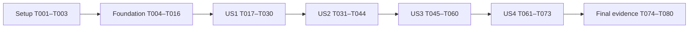

# Tasks: Restore Project from Archive — TDD

**Input**: Design documents in `specs/008-project-registration/restore-project-archive/`.
**Prerequisites**: [plan.md](plan.md), [spec.md](spec.md), [research.md](research.md), [data-model.md](data-model.md), [API contract](contracts/restore-api.md), [UI contract](contracts/restore-ui.md), [quickstart.md](quickstart.md), project constitution.
**Created**: 2026-10-16
**Tests**: Mandatory; user explicitly requested **Use TDD**.
**Status**: Implementation and convergence follow-up complete locally under `/speckit-implement`. All 85 scoped tasks (T001–T085) were executed; [verification.md](verification.md) records observed RED/GREEN, aggregate versus single-run results, the three unrelated baseline typecheck failures and unverified physical storage/CI/deployment boundaries. Checked markers do not imply deployment or a clean repository-wide pipeline.

## Format: `[ID] [P?] [Story] Description`

- Every actionable item has an unchecked checkbox, sequential task ID, exact repository-relative file path and a story label only in story phases.
- `[P]` means a specific same-checkpoint authoring wave in different files, after all stated prior gates; it does not authorize running whole story phases concurrently or editing shared files simultaneously.
- Paths in task descriptions are relative to the repository root. References such as [data-model.md](data-model.md) resolve in this feature directory. Proposed source/test files are created only in the implementation phase.
- Current migration leaf is `0014_reportexportversion`; T009 must recheck it before choosing the next number. Do not invent compatibility work if disposable old archived fixtures violate the new invariant.

## TDD execution rules

For each behavioral slice, write an assertion that demonstrates the missing requirement, run the narrow test and record the **observed** RED command/output, implement only what makes it pass, then record GREEN. Do not count syntax/import/collection errors or a route's absence alone as behavior-level RED. For already-correct behavior, keep the passing regression evidence and implement only the demonstrably missing part; never deliberately break code to manufacture RED.

RED waves below may author several independent test files, but complete the mapped test→minimal fix→GREEN slices incrementally; do not defer all evidence until the final phase. Refactor only after GREEN and rerun affected tests. Record evidence in `verification.md`; each completed marker means that task's deliverable and verification actually happened, not that an entire story or deployment is proven.

Use pytest with actual PostgreSQL, and true separate transactions for races. Use browser tests for user-visible behavior, with explicit mocked versus real API boundaries. Do not add tests that simply mirror implementation or spend effort on unrelated changes. Preserve pinned Django and existing dirty work.

## Phase 1: Setup (Shared Infrastructure)

**Goal**: Establish reproducible evidence and isolated fixtures without replacing the existing application or overwriting current work.
**Prerequisites**: None for T001; T002/T003 start only after T001.

- [X] T001 Record actual cwd/Git branch, current dirty and untracked files, parent artifact checksums, Python/Django pin and available PostgreSQL/Redis/storage in `specs/008-project-registration/restore-project-archive/verification.md`; identify disposable database targets and baseline test/typecheck failures without printing secrets or resetting shared data.
- [X] T002 [P] Prepare reusable authenticated actor, known-origin project and domain-snapshot helpers in `apps/api/core/projects/tests/archive_restore_helpers.py`, reusing existing conftest/factories; cover member/nonmember global admin, group-less superuser, editor/approver/viewer/outsider and second approver; archive fixtures through lifecycle actions once available, never invent legacy origin.
- [X] T003 [P] Create isolated frontend-only and real-service Playwright configurations in `e2e/playwright.restore.config.ts` and `e2e/playwright.restore.integration.config.ts`, plus scoped fixture helpers in `e2e/helpers/project-archive-restore.ts`; match the separate UI/integration specs, desktop/mobile and fa/en, preserve failure traces, explicitly start/reuse the appropriate services, and preserve existing dirty activation config/package/CI work.

---

## Phase 2: Foundational (Blocking Prerequisites)

**Goal**: Provide shared schema, archive occurrence tracking and a consistent locking boundary before any restoration story.
**Independent gate**: Schema/constraint forward-reverse checks and existing-writer race tests pass against PostgreSQL; no public restore action is delivered by this phase.
**TDD order**: T004/T005 RED → T006–T009 schema → T010 schema GREEN → T011–T014 writer fixes → T015/T016 GREEN. The two RED tasks may be authored in parallel after Setup; schema and writer mutations are sequential.

- [X] T004 [P] RED — Add behavioral schema/constraint and forward-reverse migration tests in `apps/api/core/projects/tests/test_project_archive_restore_migrations.py`: valid known-origin metadata, nullable pairing, archive invariant, nonnegative revision, immutable receipt uniqueness/audit link, actor deletion snapshots, and preservation of valid existing data; observe assertion failures rather than import/collection failures.
- [X] T005 [P] RED — Add real transactional stale-writer tests in `apps/api/core/projects/tests/test_project_archive_restore_concurrency.py` for lifecycle/archive versus PATCH, CR approval and delete; use independent connections, barriers and bounded joins to reproduce lost status/metadata updates and stale validation before introducing the shared Project lock.
- [X] T006 Implement Project metadata in `apps/api/core/projects/models.py` exactly as [data-model.md](data-model.md): “`archived_from_status`: nullable status value restricted to `active`, `suspended`, `completed`. Captured from the freshly locked row before each new archive. Retained after restoration until the next archive.” “`archive_cycle_id`: nullable UUID, generated anew for each successful archive. Retained after restoration so result context remains identifiable; previous successful cycles remain in receipts.” “`lifecycle_version`: non-negative big integer, default 0. Increment under the Project lock whenever supported writes change status, project name, project manager, scope description or contract amount. Also compare a canonical snapshot hash at confirmation; do not use timestamps as the sole revision.” Enforce “Origin and cycle are either both absent or both present; a present origin is one of the three allowed destinations.” and “`status=archived` requires both a valid origin and cycle.” Keep capability flags computed, not stored columns.
- [X] T007 Define ProjectArchiveRestore identity/context fields in `apps/api/core/projects/models.py` with these verbatim constraints: “`id`: UUID primary key; the stable public receipt identity.” “`project`: foreign key to Project, indexed. Use existing hard-delete semantics (`CASCADE` for dependent receipt); this feature does not introduce project recovery or change delete authorization. Audit project snapshot survives separately under existing AuditLog SET_NULL behavior.” “`archive_cycle_id`: UUID captured from Project at successful restore.” “`request_id`: UUID supplied for the confirmed attempt, scoped to this project.” “`request_fingerprint`: canonical SHA-256 digest over actor ID, project ID, cycle, target, confirmed version/snapshot hash and trimmed reason. Compare on replay; raw token encoding/timestamp is not the fingerprint.” “`confirmation_version`: Project version shown in preview.” “`actor`: nullable user FK with SET_NULL; identity is also captured below so later account deletion does not erase provenance.” Do not expose receipt writes publicly.
- [X] T008 Complete ProjectArchiveRestore business/audit fields and constraints in `apps/api/core/projects/models.py`: “`actor_snapshot`: minimal durable ID and display-name snapshot, without credentials or contact information.” “`project_snapshot`: project ID, code and name at the event, without copying all project data.” “`reason`: trimmed nonempty text. Restore does not inherit CR's ten-character minimum; normal request size limits still apply.” “`from_status`: fixed `archived`.” “`to_status`: one of the three allowed targets.” “`restored_at`: timezone-aware occurrence time; use the paired audit row's creation timestamp to keep one event time.” “`audit_log`: one-to-one FK to AuditLog, required; PROTECT deletion of that audit while its receipt exists.” Enforce “Unique `(project, archive_cycle_id)`: at most one business success per archive occurrence.”, “Unique `(project, request_id)`: one immutable result per confirmed attempt.” and “Unique audit reference; check from/to and trimmed reason nonempty.” Preserve actor/project snapshots; history order is `-restored_at, -id`.
- [X] T009 Generate additive `apps/api/core/projects/migrations/0015_project_archive_restore.py` from the final schema, confirming the current migration leaf first; if numbering has advanced, use the next unused filename and record it in verification. Preserve historical migrations and valid data; add no guessed origin, legacy runtime fallback, automatic deletion or destination selection.
- [X] T010 GREEN — Run T004 migration/constraint cases in `apps/api/core/projects/tests/test_project_archive_restore_migrations.py` on isolated databases, including actual forward/schema reversal and deliberate rejection of invalid new archived metadata; record true exits and the exact applied/reversed migration in `specs/008-project-registration/restore-project-archive/verification.md` without resetting a shared database.
- [X] T011 Implement authoritative bare-Project lock/reload and targeted status writes in `apps/api/core/projects/lifecycle_service.py` for all existing transitions; archive captures actual allowed origin and fresh cycle, retains metadata after restoration, and increments lifecycle_version under lock; keep current permissions/edges/readiness predicates unchanged and never rotate cycle on a failed archive.
- [X] T012 Move Project PATCH instance-dependent validation and update behind the same atomic row lock in `apps/api/core/projects/views.py` and `apps/api/core/projects/serializers.py`; save only submitted allowed fields/timestamp, increment revision on name/manager/scope/amount changes, validate manager FK, and reject writable lifecycle metadata/status across normal create/PATCH/template/import entry points.
- [X] T013 Apply Project → CR lock order, fresh status/SoD checks and targeted Project/CR saves to participating operations in `apps/api/core/projects/change_request_service.py`; increment revision on changed readiness fields and prevent stale full `cr.project.save()` from overwriting status/origin/cycle; retain existing ordinary CR policy at this step.
- [X] T014 Serialize Project delete against the same fresh root lock in `apps/api/core/projects/views.py`, preserving existing hard-delete authorization/semantics and audit snapshots; deletion must not recreate a project or allow a stale concurrent write to resurrect it.
- [X] T015 GREEN — Rerun T005 independent-connection writer cases in `apps/api/core/projects/tests/test_project_archive_restore_concurrency.py` and relevant existing lifecycle/CR tests; assert actual state, metadata and version after each legal ordering, with no skipped concurrency cases or changed business edges.
- [X] T016 Complete the foundation gate in `specs/008-project-registration/restore-project-archive/verification.md`: record schema, lock and existing lifecycle/CR/SoD regression results; adapt affected test fixtures to known-origin archives without rewriting parent docs/tasks or inventing legacy compatibility. Do not start story implementation until this gate passes.

---

## Phase 3: User Story 1 — Restore knowingly to the exact prior state (Priority: P1)

**Goal**: Deliver a complete safe restore from overview for ready active, suspended and completed destinations, with a reason and explicit confirmation.
**Independent Test**: Archive one project from each allowed origin, preview its identity/target/effects, reject whitespace reason, cancel before sending, and confirm the exact original state. Re-archive from another valid origin and verify a fresh cycle. Basic admin enforcement, activation gating, atomic audit and exact replay are mandatory in this slice.
**Coverage**: US1.1–US1.6; FR-RPA-001–005,007–011,013; SC-RPA-001,004–005.
**TDD order**: T017–T019 RED in separate files → T020–T028 minimal implementation → T029/T030 GREEN.

- [X] T017 [P] [US1] RED — Add preview/POST contract tests in `apps/api/core/projects/tests/test_project_archive_restore.py` for all three origins, read-only no-store preview, signed fixed target, reason trimming, invalid writable/token fields, basic denied actors, active-only gates, exact receipt/audit, atomic insert failure, exact replay and new archive cycle; assert domain outcomes, not merely that a new URL is missing.
- [X] T018 [P] [US1] RED — Add intercepted dialog/action tests in `e2e/tests/project-archive-restore.ui.spec.ts` for server-authorized visibility including group-less superuser, fixed project/target/effects, required reason, keyboard focus, cancel/Escape, pending duplicate prevention and safe unknown-result notice; assert exact submitted identity/body and unchanged data on cancel in fa/en.
- [X] T019 [P] [US1] RED — Add real-service three-destination, cancel and re-archive browser cases in `e2e/tests/project-archive-restore.integration.spec.ts`; prepare projects via actual lifecycle flows and inspect real responses/state/receipts, without route-stubbing the validated restore API.
- [X] T020 [US1] Add read-only restore capability and typed preview/request/receipt/current-state serializers in `apps/api/core/projects/serializers.py`; compute from request-aware `_is_global_admin`, not project edit/approve or frontend roles, enforce body whitelist and trimmed nonempty reason, and retain existing detail fields/creation defaults.
- [X] T021 [US1] Implement side-effect-free preview and canonical signed context helpers in `apps/api/core/projects/lifecycle_service.py`: bind actor/project/name context/cycle/target/version/readiness hash, return all missing fields and fixed remediation actions, no time-based token cutoff, and never accept a client-selected destination.
- [X] T022 [US1] Implement minimal safe restore in `apps/api/core/projects/lifecycle_service.py` with fresh global-admin check under Project lock, exact-request fingerprint replay before stale-state checks, one receipt per cycle, context/version validation and active-only activation_missing; update only status/version/timestamp and persist synchronous AuditLog plus receipt in the same transaction using `apps/api/core/audit/service.py`, with no budget stamping, finance, baseline or approval execution.
- [X] T023 [US1] Add the narrow explicitly-audited underlying-request marker in `apps/api/core/audit/middleware.py` and set it for first restore success and exact replay in `apps/api/core/projects/views.py`; suppress duplicate generic restore success only for those marked requests and leave all unrelated audit behavior/global async settings intact.
- [X] T024 [US1] Wire authorized `GET restore-preview/` and `POST restore/` in `apps/api/core/projects/views.py` and `apps/api/core/projects/urls.py`; pass request context to every detail/action serializer, preserve structured status/error codes, return receipt and fresh current_project separately, and translate positively rolled-back failures outside atomic scope.
- [X] T025 [US1] Add typed preview/restore calls and response types in `apps/web/src/app/lib/api/projects.ts`; send only stable request_id, signed token and trimmed reason, preserving existing ApiRequestError handling and the same POST options through authentication refresh.
- [X] T026 [US1] Create `apps/web/src/components/projects/ProjectArchiveRestoreDialog.tsx` with existing accessible dialog/forms: preview exact name/target/effects, required reason, explicit confirm/cancel, disabled in-flight duplicate submission and no optimistic success; a dismissed sent request remains visibly unresolved rather than being represented as cancelled.
- [X] T027 [US1] Add core dialog, target-effect, reason, success and safe failure/unknown copy in `apps/web/src/app/locales/fa.json`, `apps/web/src/app/locales/en.json` and `apps/api/core/locale/fa/LC_MESSAGES/django.po`; compile the backend catalog through the existing workflow and retain current locale entries and dirty activation messages.
- [X] T028 [US1] Mount the independent server-capability restore action/dialog from `apps/web/src/components/projects/ProjectLifecycleBar.tsx` and `apps/web/src/app/routes/project-overview.tsx`; fix the early-return boundary only enough for nonmember/global admins, preserve other status actions, and invalidate project detail/portfolio data only after an evidenced success.
- [X] T029 [US1] GREEN — Run the new core pytest cases in `apps/api/core/projects/tests/test_project_archive_restore.py` plus intercepted dialog cases in `e2e/tests/project-archive-restore.ui.spec.ts`; retain RED/GREEN command exits and assert one semantic audit/receipt, no cancellation changes and unchanged budget approval identity/time.
- [X] T030 [US1] GREEN — Run the real three-origin/cancel/re-archive cases in `e2e/tests/project-archive-restore.integration.spec.ts`, verify suspended/completed downstream gates stay in force, and record final-state/receipt evidence in `specs/008-project-registration/restore-project-archive/verification.md`; this is an internal demonstrable slice, not full-feature release proof.

---

## Phase 4: User Story 2 — Admin authority and executable activation remediation (Priority: P1)

**Goal**: Deny project-only authority, display every missing active prerequisite and let authorized admins repair it through real existing controls without bypassing protected-field approval.
**Independent Test**: Use global admins with/without membership and a group-less superuser versus every denied actor; cover all seven missing-field combinations, complete manager and protected-field CR flows, re-preview and restore with approval metadata unchanged. Suspended/completed targets remain ungated by activation requirements.
**Coverage**: US2.1–US2.7; FR-RPA-001,005–006,009,013; SC-RPA-002–003.
**TDD order**: T031–T034 RED → T035–T042 minimal integration → T043/T044 GREEN.

- [X] T031 [P] [US2] RED — Add the complete authority/gate/support-capability matrix in `apps/api/core/projects/tests/test_project_archive_restore_permissions.py`: members, editors, approvers, outsiders, inactive/anonymous users, nonmember group admin and group-less superuser; cover all seven missing combinations, pre-commit authority/readiness changes, zero leaks/writes and no active-only gates on other targets.
- [X] T032 [P] [US2] RED — Add archived manager-FK and protected-remediation contract tests in `apps/api/core/projects/tests/test_project_archive_restore_remediation.py`: global admin plus archived origin active only, nonempty subset of currently missing scope/amount, valid replacement, one open CR, existing CR handling, ten-character CR reason, submit/approve rechecks and current group-admin SoD/superuser exception; direct protected PATCH stays denied.
- [X] T033 [P] [US2] RED — Extend `e2e/tests/project-archive-restore.ui.spec.ts` for every missing-field message/action and support capabilities independent of a 404 member-permissions query; include manager-only completion, scoped CR create/review buttons, open-request explanation and no accidental whole-form permission grant.
- [X] T034 [P] [US2] RED — Extend `e2e/tests/project-archive-restore.integration.spec.ts` to complete manager plus missing scope/amount through settings and existing CR submit/approval as nonmember administrators, including a second approver for group-admin SoD; fresh preview must allow restore without changing previous budget approval stamps.
- [X] T035 [US2] Compute can_edit_manager_for_restore, can_create_restore_remediation and can_view_restore_history on request-aware detail plus per-record restore_remediation_actions in `apps/api/core/projects/serializers.py` and relevant calls in `apps/api/core/projects/views.py`; respect active archived origin, actual missing fields, open request, current CR state and SoD without stored permission flags or fabricated membership.
- [X] T036 [US2] Bind newly created remediation requests with server-only restore_archive_cycle_id ("nullable read-only UUID", migration 0016), and add only the designed archived-active-origin missing-scope/amount CR availability in `apps/api/core/projects/change_request_service.py`; under Project → CR locks revalidate scope on create/update/submit/approve for the new remediation path, retain ordinary existing CR handling, reason/open-request/SoD rules, and ensure restoring itself never approves or creates CRs.
- [X] T037 [US2] Close any T031/T032-exposed authority, FK or prerequisite-validation gaps in `apps/api/core/projects/lifecycle_service.py`, `apps/api/core/projects/serializers.py` and `apps/api/core/projects/views.py`; use fresh server authority, unchanged activation_missing predicates, all missing codes plus fixed actions, and keep direct protected writes and project-only restore permissions denied.
- [X] T038 [US2] Expose a manager completion selector in `apps/web/src/app/routes/project-settings.tsx` using existing lookupUsers and authorized manager PATCH, driven independently by can_edit_manager_for_restore for nonmember admins; keep the rest of the form and protected fields under their current controls.
- [X] T039 [US2] Extend `apps/web/src/components/projects/ProjectChangeRequestPanel.tsx` with the narrowly scoped missing-field create path and server-provided per-record review actions; preserve ordinary form/permission behavior, point to an existing open CR, retain SoD guidance and do not broadly alter usePermission or enable unrelated archived protected edits.
- [X] T040 [US2] Extend ProjectDetail/CR types and remediation payload handling in `apps/web/src/app/lib/api/projects.ts` for the server support flags and restore_remediation_actions; carry request context through CR API serialization in `apps/api/core/projects/views.py` so nonmember admins receive usable accurate controls.
- [X] T041 [US2] Show all missing prerequisites and actual authorized settings/CR destinations in `apps/web/src/components/projects/ProjectArchiveRestoreDialog.tsx`; preserve typed reason during remediation, then fetch a fresh signed preview before another explicit submission and explain that completing information does not itself restore the project.
- [X] T042 [US2] Add missing-field/open-CR/SoD/completion guidance and related localized backend errors in `apps/web/src/app/locales/fa.json`, `apps/web/src/app/locales/en.json` and `apps/api/core/locale/fa/LC_MESSAGES/django.po`, preserving stable identifiers and avoiding raw technical keys as user explanations.
- [X] T043 [US2] GREEN — Run authority/remediation suites in `apps/api/core/projects/tests/test_project_archive_restore_permissions.py` and `apps/api/core/projects/tests/test_project_archive_restore_remediation.py`, existing SoD regressions and relevant intercepted UI cases; assert actual unchanged Project/receipt/audit state on every denial and all seven complete missing lists.
- [X] T044 [US2] GREEN — Run real nonmember-admin remediation/approval cases in `e2e/tests/project-archive-restore.integration.spec.ts` for both locales, including group-less superuser and ordinary denied actors; record newly confirmed restore, retained budget stamps and actual usable support controls in `specs/008-project-registration/restore-project-archive/verification.md`.

---

## Phase 5: User Story 3 — Trustworthy failure, retry and concurrency (Priority: P1)

**Goal**: Resolve unknown outcomes using durable request evidence and prove one legal effect under concurrency, including after later state changes/new archive cycles.
**Independent Test**: Lose responses before/after actual commit, reload and check/retry the exact attempt; race one/two admins and existing writers on independent connections. Assert at most one immutable receipt/audit and no old request affecting a new cycle.
**Coverage**: US3.1–US3.8; FR-RPA-008–012; SC-RPA-004–006.
**TDD order**: T045–T049 RED in separate files → T050–T057 corrections/recovery → T058–T060 GREEN. Reuse already-green core idempotency tests rather than weakening them.

- [X] T045 [P] [US3] RED — Add result/replay/fingerprint/context contract cases in `apps/api/core/projects/tests/test_project_archive_restore_retries.py`: identical retry after later status/rearchive, reused request ID with changed reason/context, different actor/project, another completed request, tampered/stale/changed-back snapshot, no elapsed-time cutoff, absent/deleted projects and not_recorded during an in-flight request.
- [X] T046 [P] [US3] RED — Extend `apps/api/core/projects/tests/test_project_archive_restore_concurrency.py` with restore/restore (same and distinct admins) and restore versus archive/suspend/resume/complete, PATCH, protected CR approval and delete; force both meaningful orderings, old delayed request versus new cycle, and assert actual final state/version, winner actor/reason/time and zero stale overwrites.
- [X] T047 [P] [US3] RED — Add independent audit-insert and receipt-insert failure cases in `apps/api/core/projects/tests/test_project_archive_restore_preservation.py` with real middleware and both AUDIT_LOG_ASYNC settings; verify whole-transaction rollback and exact original audit/receipt/version after replay, and distinguish proven rollback from ambiguous commit acknowledgement.
- [X] T048 [P] [US3] RED — Extend `e2e/tests/project-archive-restore.ui.spec.ts` for unresolved notice, completed/not_recorded result lookup, exact safe retry, immutable request payload through token refresh, reload/session account isolation, dismiss-after-send, locale switching, other-admin success, lost authority and stale-cycle fresh confirmation.
- [X] T049 [P] [US3] RED — Extend `e2e/tests/project-archive-restore.integration.spec.ts` to lose only response delivery after a real committed POST, plus the before-commit failure case; retry/check saved identity against the real API, later change/rearchive and resend the old request, asserting one durable success and separate historical/current states.
- [X] T050 [US3] Complete durable exact replay, request-conflict and old-cycle handling in `apps/api/core/projects/lifecycle_service.py` using T045/T046 evidence: lookup receipt before fresh-write context checks, compare canonical actor/project/cycle/version/hash/reason fingerprint, preserve original event metadata, and never adapt old input to a new archive cycle.
- [X] T051 [US3] Implement authorized no-store `GET restore-attempts/{request_id}/` in `apps/api/core/projects/views.py`, `apps/api/core/projects/urls.py` and request-aware serializers in `apps/api/core/projects/serializers.py`; return project-scoped completed receipt plus current state or inconclusive not_recorded, with no write/success audit and no cross-project lookup leakage.
- [X] T052 [US3] Complete failure translation around transaction exit in `apps/api/core/projects/views.py` and `apps/api/core/projects/lifecycle_service.py`: 503 restore_not_applied only after positively established rollback; unknown commit/network failures remain checkable uncertainty, preserve existing structured error envelopes and never catch persistence errors inside atomic then continue committing.
- [X] T053 [US3] Correct only T047-exposed audit-marker/persistence boundary gaps in `apps/api/core/audit/middleware.py` and `apps/api/core/projects/lifecycle_service.py`; both initial success and historical exact replay must suppress generic duplicate success while unmarked requests retain current audit behavior, regardless of general async mode.
- [X] T054 [US3] Implement minimal tab-scoped pending-attempt storage in `apps/web/src/app/lib/project-archive-restore-pending.ts` for user/project/request/token/reason and wire account-switch/sign-out cleanup in `apps/web/src/app/contexts/auth-context.tsx`; do not put payloads in URLs/analytics or reuse one account's attempt under another account.
- [X] T055 [US3] Add typed request-result lookup and exact-body retry support in `apps/web/src/app/lib/api/projects.ts`, validating reuse through existing `apps/web/src/app/lib/api-client.ts` authentication-refresh retry; change that dirty shared client only if the failing behavioral test requires it, never minting a new request UUID during automatic retry.
- [X] T056 [US3] Implement complete unresolved/completed/replayed/conflict/permission-loss recovery in `apps/web/src/components/projects/ProjectArchiveRestoreDialog.tsx` and `apps/web/src/app/routes/project-overview.tsx`; keep sent attempts across dismissal/reload, interpret not_recorded as inconclusive, distinguish historical target from current status and invalidate detail/portfolio/history only from evidenced outcomes.
- [X] T057 [US3] Localize result-check/safe-retry/other-operation/stale-context/known-rollback/unknown-outcome states in `apps/web/src/app/locales/fa.json`, `apps/web/src/app/locales/en.json` and `apps/api/core/locale/fa/LC_MESSAGES/django.po`; no replay toast may imply a new independent success or promise network-failure rollback.
- [X] T058 [US3] GREEN — Run retry/concurrency/fault suites in `apps/api/core/projects/tests/test_project_archive_restore_retries.py`, `apps/api/core/projects/tests/test_project_archive_restore_concurrency.py` and `apps/api/core/projects/tests/test_project_archive_restore_preservation.py`; record independent transaction evidence, controlled interleavings and exact state/receipt/audit counts with no skipped or sequentialized race substitute.
- [X] T059 [US3] GREEN — Run the complete recovery UX cases in `e2e/tests/project-archive-restore.ui.spec.ts` in Persian/English on desktop/mobile, inspecting actual sent body identity, session cleanup, keyboard/dismissal and absence of false success/rollback messages; retain screenshots/traces as frontend-only evidence.
- [X] T060 [US3] GREEN — Run actual committed-response-loss and later-cycle retry cases in `e2e/tests/project-archive-restore.integration.spec.ts`; retain evidence that the initial POST reached and committed on the real API, exact retry created no second event, and an old request did not alter the new cycle in `specs/008-project-registration/restore-project-archive/verification.md`.

---

## Phase 6: User Story 4 — Preserve data, visible history and bilingual experience (Priority: P2)

**Goal**: Expose the one complete restoration event to authorized viewers and prove all prior business data and approvals remain intact in both locales.
**Independent Test**: Restore a project populated with documents/finance/baselines/charter/CRs; compare persisted before/after snapshots, inspect one six-component history event under view authority, exercise all localized UI/error states, and verify no legacy-origin recovery path is required.
**Coverage**: US4.1–US4.4; FR-RPA-007–008,013–014; SC-RPA-005–007.
**TDD order**: T061–T065 RED → T066–T069 minimal implementation → T070 migration RED extension/T071 GREEN → T072/T073 full story GREEN.

- [X] T061 [P] [US4] RED — Extend real domain snapshots and forbidden-side-effect assertions in `apps/api/core/projects/tests/test_project_archive_restore_preservation.py` using `apps/api/core/projects/tests/archive_restore_helpers.py`: identity, document/attachment hashes/links, financial amounts/payment/commitment counts, baselines, charter, CR decisions, budget approver/time and prior history; make finance/approval/baseline executors fail if restore invokes them, separately verifying stored data equality.
- [X] T062 [P] [US4] RED — Add narrow history endpoint tests in `apps/api/core/projects/tests/test_project_archive_restore_history.py` for existing view_project/global authority, denied unauthorized project scope, nonmember admin, immutable actor/project snapshots after user deletion, all six event components, empty history, newest-first tie order, default page 50/max 100 and no token/hash/arbitrary-audit disclosure.
- [X] T063 [P] [US4] RED — Add Accept-Language fa/en API error/message contract checks in `apps/api/core/projects/tests/test_project_archive_restore_localization.py` for reason, gates, permission, stale/reused request, not-found and rollback/result states; assert stable machine codes and actionable localized text rather than translated-text parsing.
- [X] T064 [P] [US4] RED — Extend `e2e/tests/project-archive-restore.ui.spec.ts` for authorized paginated history/empty state, actor/time/reason/origin/target, original versus current state after replay, no restore action for history-only viewers, full bilingual state coverage and nonmember-admin history/support behavior despite failed membership lookup.
- [X] T065 [P] [US4] RED — Extend `e2e/tests/project-archive-restore.integration.spec.ts` with real visible history and populated-data preservation checks across all destinations/locales; compare independently captured records/attachments where storage is available and verify the displayed actor/reason/time matches the persisted success rather than a mocked receipt.
- [X] T066 [US4] Implement scoped read-only paginated `GET restore-history/` in `apps/api/core/projects/views.py`, `apps/api/core/projects/urls.py` and safe receipt serializers in `apps/api/core/projects/serializers.py`; reuse DefaultPageNumberPagination (50/max100), existing view authority, safe snapshots and `-restored_at, -id` ordering without exposing generic audit content.
- [X] T067 [US4] Implement `apps/web/src/components/projects/ProjectArchiveRestoreHistory.tsx`, typed paginated history call in `apps/web/src/app/lib/api/projects.ts` and overview mount in `apps/web/src/app/routes/project-overview.tsx`; use can_view_restore_history independently of membership hooks and keep historical target distinct from current status.
- [X] T068 [US4] Complete/fa-check all restoration/history/remediation messages in `apps/web/src/app/locales/fa.json`, `apps/web/src/app/locales/en.json` and `apps/api/core/locale/fa/LC_MESSAGES/django.po`, compile backend catalog, and make only test-driven layout/focus/RTL/LTR corrections in the restoration dialog/history components; preserve existing translations and activation behavior.
- [X] T069 [US4] Resolve only T061/T062-exposed preservation/provenance defects in `apps/api/core/projects/lifecycle_service.py`, `apps/api/core/projects/serializers.py` and `apps/api/core/audit/service.py`; retain minimal durable actor/project snapshots, one required event time and targeted updates, with no data copying/recreation or financial/approval execution. If assertions are already green, record that evidence instead of making speculative code changes.
- [X] T070 [US4] RED — Extend `apps/api/core/projects/tests/test_project_archive_restore_migrations.py` with final-schema valid-domain-data preservation, receipt/audit constraints and isolated reversal checks after real known-origin archive/restore; cover US4.4 by explicitly replacing disposable old fixtures, with no legacy destination inference or restoration compatibility requirement.
- [X] T071 [US4] GREEN — Run the final migration/preservation extension in `apps/api/core/projects/tests/test_project_archive_restore_migrations.py`, fixing only demonstrated defects in the new `apps/api/core/projects/migrations/0015_project_archive_restore.py` (or the actual next-numbered file recorded at T009); document exact forward/reverse states and valid-data snapshots, never edit historical migrations or reset shared data.
- [X] T072 [US4] GREEN — Run final US4 preservation/history/localization suites in `apps/api/core/projects/tests/test_project_archive_restore_preservation.py`, `apps/api/core/projects/tests/test_project_archive_restore_history.py` and `apps/api/core/projects/tests/test_project_archive_restore_localization.py`; prove all six audit components, 100% expected unchanged business records and zero replayed money/approval actions.
- [X] T073 [US4] GREEN — Run US4 history/data/locale cases in `e2e/tests/project-archive-restore.ui.spec.ts` and `e2e/tests/project-archive-restore.integration.spec.ts` on desktop/mobile in fa/en; retain storage-backed attachment evidence if available, otherwise state that exact unverified boundary in `specs/008-project-registration/restore-project-archive/verification.md`.

---

## Phase 7: Polish & Cross-Cutting Concerns

**Goal**: Close final-tree evidence and scope review without counting earlier checkpoints as delivery proof.
**Prerequisites**: All four story checkpoints complete. Reuse checks already run against the identical final tree; repeat only after relevant changes or unresolved failures.

- [X] T074 Run/aggregate final focused backend and existing lifecycle/gate/CR/SoD/audit regressions named in `specs/008-project-registration/restore-project-archive/quickstart.md`; include the pre-existing activation-feedback tests, preserve true exit/pass/fail/skip counts and any RED→GREEN records in `specs/008-project-registration/restore-project-archive/verification.md` rather than masking failures with output pipes.
- [X] T075 Run final frontend `pnpm typecheck` and schema `apps/api/django.sh makemigrations --check --dry-run` from the correct cwd, recording exact outcomes and unrelated baseline failures in `specs/008-project-registration/restore-project-archive/verification.md`; no dependency upgrade or waived feature failure can stand in for a required green gate.
- [X] T076 Complete final-tree intercepted and real-service browser coverage through `e2e/playwright.restore.config.ts` and `e2e/playwright.restore.integration.config.ts`, reusing identical-tree results from T059/T060/T073 where sufficient; retain fa/en desktop/mobile screenshots/traces and actual counts, and never equate intercepted UI with database, CI or live deployment proof.
- [X] T077 Measure a bounded representative uncontended preview/restore sample and history pagination/query behavior using the real integration environment in `e2e/tests/project-archive-restore.integration.spec.ts`; record hardware, sample count and p95 against the plan's 2-second target in `specs/008-project-registration/restore-project-archive/verification.md`, avoiding brittle timing-only tests and speculative optimization.
- [X] T078 Update `specs/008-project-registration/restore-project-archive/quickstart.md` to the actual migration/test/config filenames and runnable validated commands, and complete `specs/008-project-registration/restore-project-archive/verification.md` with separate migration, API, real-race, mocked UI, actual browser/storage and any independently observed CI evidence; do not rewrite historical parent artifacts.
- [X] T079 Review final changed-file scope against the T001 snapshot in `specs/008-project-registration/restore-project-archive/verification.md`: preserve unrelated original hunks/activation work, retain parent spec/plan/tasks/checklists, remove only feature-created temporary diagnostics, and verify no legacy fallback, extra lifecycle edge, new global role, broad permission bypass or finance/approval replay slipped in; do not commit/push unless separately requested.
- [X] T080 Record a final acceptance audit for all 25 scenarios, FR-RPA-001–014 and SC-RPA-001–007 in `specs/008-project-registration/restore-project-archive/verification.md`, link exact evidence, resolve every required feature failure and update only actually completed markers in `specs/008-project-registration/restore-project-archive/tasks.md`; unexecuted checks and environment/storage limits stay explicit, not silently marked complete.

---

## Dependencies & Execution Order

### Phase dependencies



This is the default implementation order, with all P1 stories before P2. US2/US3/US4 test authoring can be prepared after the US1 contract is stable, but their shared production-file mutations remain sequential. Do not describe these dependent integrations as independently deployable features. Each story has an independent acceptance test after its declared prerequisites.

- **T001 → T002/T003**: establish preservation/runtime baseline before fixture/config additions.
- **T004/T005 → T006–T009 → T010**: schema RED precedes models/migration and actual schema GREEN. Do not author a migration from a half-finished receipt model.
- **T005 + T010 → T011 → T012 → T013 → T014 → T015 → T016**: finish the shared writer boundary and prove it before the new restore uses it.
- **T016 → T017/T018/T019**: independent core API, intercepted browser and actual browser RED tasks. Complete schema/signing/preview/restore/API slices in T020–T025, then dialog/locale/mount T026–T028 and GREEN T029/T030.
- **T030 → T031–T034 → T035–T042 → T043/T044**: support-capability and scoped remediation assertions precede the existing control changes. T036 depends on T013's locks; T038/T039/T041 depend on accurate T035/T040 server types/actions.
- **T044 → T045–T049 → T050–T057 → T058–T060**: result endpoint T051 depends on immutable receipt/replay; client recovery T056 depends on T051/T054/T055. Do not start real response-loss evidence before a real committed POST can be observed.
- **T060 → T061–T065 → T066–T069 → T070/T071 → T072/T073**: history RED precedes API/UI, data-preservation assertions precede any necessary corrections, and final migration checks include the complete receipt behavior.
- **T073 → T074–T080**: final evidence must describe the final relevant tree. T080 cannot pass if any mandatory scenario or required proof remains failing/unexecuted; report environmental boundaries explicitly rather than turning them into passing markers.

### TDD slice mapping

- Foundation schema: T004 → T006–T009 → T010. Existing-writer races: T005 → T011–T014 → T015/T016.
- US1 API/safety: T017 → T020–T024 → T029. UI: T018 → T025–T028 → T029. Actual three-target journey: T019 → integrated behavior → T030.
- US2 authority/support: T031 → T035/T037/T040 → T043. Approved remediation: T032 → T036/T037 → T043. UI: T033 → T038–T042 → T043. Real completion: T034 → integrated remediation → T044.
- US3 durable results: T045 → T050/T051 → T058. Races: T046 → only demonstrated shared-writer/core corrections → T058. Audit/receipt fault: T047 → T052/T053 → T058. Recovery UI: T048 → T054–T057 → T059. Actual lost response: T049 → integrated result/retry → T060.
- US4 preservation/history/localization: T061/T062/T063 → T066/T068/T069 as needed → T072. History UI: T064 → T067/T068 → T073. Real history/data: T065 → integrated behavior → T073. Final migration preservation: T070 → new migration correction only if demonstrated → T071.

Test tasks can include assertions already green because earlier safety work is intentionally shared; retain them as regressions. Never mark a newly failing slice complete before its matching GREEN or suppress its failure while unrelated tasks continue.

### Shared-file ownership

`projects/models.py`, `lifecycle_service.py`, `serializers.py`, `views.py`, `change_request_service.py`, API types, locale files, overview and the existing UI/integration specs are reused across phases. Only one active mutation owner per file. `[P]` test waves below are safe only after their helpers/config prerequisites are complete and before implementations modify those files. No subagent execution, commit, push or deployment is authorized merely by these examples.

## Parallel Examples per User Story

### User Story 1 — after T016

```text
T017: apps/api/core/projects/tests/test_project_archive_restore.py
T018: e2e/tests/project-archive-restore.ui.spec.ts
T019: e2e/tests/project-archive-restore.integration.spec.ts
```

Author these tests independently; run the behavioral RED checks and then use one owner for T020–T028 shared production edits.

### User Story 2 — after T030

```text
T031: apps/api/core/projects/tests/test_project_archive_restore_permissions.py
T032: apps/api/core/projects/tests/test_project_archive_restore_remediation.py
T033: e2e/tests/project-archive-restore.ui.spec.ts
T034: e2e/tests/project-archive-restore.integration.spec.ts
```

These are distinct files within this wave. They must not overlap the earlier/later phase's edits of the same browser specs.

### User Story 3 — after T044

```text
T045: apps/api/core/projects/tests/test_project_archive_restore_retries.py
T046: apps/api/core/projects/tests/test_project_archive_restore_concurrency.py
T047: apps/api/core/projects/tests/test_project_archive_restore_preservation.py
T048: e2e/tests/project-archive-restore.ui.spec.ts
T049: e2e/tests/project-archive-restore.integration.spec.ts
```

Parallel authoring does not mean concurrency suites should share/reset one disposable database or consume the same seeded project. Use isolated projects/databases, independent connections and bounded synchronization as appropriate.

### User Story 4 — after T060

```text
T061: apps/api/core/projects/tests/test_project_archive_restore_preservation.py
T062: apps/api/core/projects/tests/test_project_archive_restore_history.py
T063: apps/api/core/projects/tests/test_project_archive_restore_localization.py
T064: e2e/tests/project-archive-restore.ui.spec.ts
T065: e2e/tests/project-archive-restore.integration.spec.ts
```

T061 additionally owns `archive_restore_helpers.py` during this wave; no other wave member edits it. Locales/API/UI implementation tasks remain sequential.

## Requirement and Acceptance Traceability

References here are task pointers, not completed verification claims. Every linked spec scenario retains its full original Given/When/Then meaning.

- **US1.1–US1.3**: T017–T019, T021/T022/T026/T027/T028, T029/T030 — exact active/suspended/completed targets and their effects.
- **US1.4–US1.5**: T017/T018/T019, T020/T026, T029/T030 and T048/T056/T059 — required reason, pre-send cancel, post-send dismissal boundary.
- **US1.6**: T011/T017/T019/T030, T045/T046/T050/T058/T060 — capture the latest origin and reject older-cycle writes.
- **US2.1–US2.2**: T017/T020/T022/T024, T031/T033/T035/T037, T043/T044 — server denial and independently usable nonmember/global authority.
- **US2.3–US2.5**: T031–T034, T035–T042, T043/T044 — all missing fields, executable completion, existing approvals unchanged.
- **US2.6–US2.7**: T031/T037/T043, T046/T058 — active-only prerequisites and final authority/readiness recheck.
- **US3.1**: T017/T022/T023/T029, T047/T052/T053/T058 — all-or-nothing required receipt/audit, no false success.
- **US3.2–US3.4**: T045/T048/T049, T050–T057, T058–T060 — unknown outcome, durable result and exact retry before/after commit.
- **US3.5**: T046/T050/T058 — one/two-admin real transaction race and a single winner's metadata.
- **US3.6–US3.8**: T014/T045/T046/T048/T049, T050/T051/T056, T058–T060 — changed context, old-cycle input, non-archived/deleted project.
- **US4.1–US4.2**: T061/T062/T065/T066/T067/T069/T072/T073 — persisted data and a single visible complete provenance record.
- **US4.3**: T018/T027/T033/T042/T048/T057/T059, T063/T064/T068/T072/T073 — fa/en across all status/error/response outcomes.
- **US4.4**: T002/T004/T009/T010/T070/T071 — known-origin fixtures and no old-data restoration feature or inferred destination.

Functional coverage:

- **FR-RPA-001–004**: T017–T030 and T031/T035/T037/T043/T044.
- **FR-RPA-005–006**: T031–T044, with original predicates guarded in T017/T022.
- **FR-RPA-007–009**: T022/T023/T029, T047/T052/T053/T058, T061–T073.
- **FR-RPA-010–012**: T017/T022/T029, T045–T060.
- **FR-RPA-013**: T027/T042/T057/T063/T064/T068/T072/T073.
- **FR-RPA-014**: T002/T004/T009/T010/T070/T071.

Success criteria coverage:

- **SC-RPA-001**: T017/T019/T029/T030.
- **SC-RPA-002–003**: T031–T044.
- **SC-RPA-004–006**: T045–T060 plus T061/T062/T065/T072/T073 for preservation/visible provenance.
- **SC-RPA-007**: T018/T033/T048/T059/T063/T064/T068/T072/T073.

## Implementation Strategy

### MVP review scope

Complete Setup/Foundation and US1 (T001–T030) to demonstrate an authorized reasoned restoration to all three exact states with the core authority/gates/atomic-audit/replay guarantees. This is the smallest internal review slice, not permission to omit required acceptance coverage or deploy it. US2/US3 remain P1 completion requirements, and US4 data/history/bilingual guarantees remain mandatory for this feature's full delivery.

### Incremental delivery

1. Establish schema and writer-ordering safety with observed RED/GREEN evidence.
2. Demonstrate US1 on known-origin projects.
3. Complete US2's usable remediation and complete authority matrix.
4. Complete US3's recovery and actual race/response-loss evidence.
5. Complete US4's visible history, preservation and full locale proof.
6. Close final-tree evidence and review the complete scope before reporting the feature implemented.

### Execution summary

- Total: **80** completed implementation tasks, with exact local evidence and remaining proof boundaries in verification.md.
- Setup: **3**; Foundation: **13**; US1: **14**; US2: **14**; US3: **16**; US4: **13**; final cross-cutting: **7**.
- **21** tasks carry `[P]`, limited to the explicitly described independent authoring waves.
- Task IDs, phase/story labels, file paths, all model-field constraint quotations and acceptance/requirement coverage are validated during generation. Runtime outcomes remain unverified until implementation executes the tasks.

## Notes

The completed parent `specs/008-project-registration/tasks.md` is preserved. Task generation originally executed no task. The subsequently requested `/speckit-implement` has now executed this scoped list; historical parent task markers remain untouched.


## Phase 8: Convergence

Assessment date: 2026-10-17. Outcome: `tasks_appended`. Reviewed 14 functional requirements, 7 buildable success criteria, 25 acceptance scenarios, all 80 existing tasks, 14 design obligations and 7 constitution principles. Five partial gaps remain: 3 HIGH and 2 MEDIUM; no direct constitution MUST violation, missing/contradicting feature, or unjustified addition was identified. Earlier task text and completion markers above are preserved verbatim; they do not close the findings below. Existing unrelated typecheck failures and the explicitly conditional external-storage/CI/deployment boundaries are not expanded into new feature scope.

Evidence boundary: this pass inspected current source/tests and ran isolated, in-memory component-logic probes plus an actual QueryClient cache probe. It did not rerun the full API/browser suites. In the component probe, a pending A request completed while cached B was displayed: B's pending notice changed from visible to hidden although its own saved request remained. Preview 403 and 500 both rendered the changed-project message; a cached-preview failure rendered no error. The QueryClient probe left both portfolio caches fresh after the current restore invalidations. These probes are not real-browser evidence. Implement the tasks below with the requested TDD workflow, preserving current backend guarantees and recorded proof boundaries.

- [X] T081 HIGH — Scope restoration UI state and asynchronous completions to the originating user, project and request in `apps/web/src/components/projects/ProjectArchiveRestoreDialog.tsx`, `apps/web/src/app/routes/project-overview.tsx` and `apps/web/src/app/lib/project-archive-restore-pending.ts`. A cached project-to-project navigation can reuse the unkeyed dialog; its effect currently resets only pending state, and the old request's resolved/clear/finally callbacks can overwrite the new project's state. Prevent a late A response from clearing B's unresolved notice, reason or controls, prevent stale callbacks from recreating signed-out account state, and reset obsolete view/denied/busy state at the appropriate context boundary without losing an originating attempt's safe result lookup. Add observed RED then GREEN cached-two-project/independent-pending-attempt and late-response/account-switch cases to `e2e/tests/project-archive-restore.ui.spec.ts` in fa/en desktop/mobile; record exact results in `specs/008-project-registration/restore-project-archive/verification.md`. Evidence F1: dialog lines 15–19, 26–28, 45–63 and overview line 143; per FR-RPA-011, FR-RPA-012, US3/AC6 and T048/T054/T056 (partial).

- [X] T082 HIGH — Implement explicit preview-query failure handling in `apps/web/src/components/projects/ProjectArchiveRestoreDialog.tsx` using existing structured API errors, with actionable fa/en permission-loss, unavailable/network and changed/deleted-project feedback plus a safe retry of the read-only preview. The current rendering at lines 77–86 ignores preview.error/isError, mislabels 403/500 as project changes, and hides refresh failures when cached data exists. Keep confirmation disabled until a fresh valid preview succeeds, never reuse a failed/stale confirmation, and do not describe a failed GET as an uncertain or rolled-back mutation. Add observed RED/GREEN cases for initial failures and cached-preview refresh failures, permission loss and successful retry in `e2e/tests/project-archive-restore.ui.spec.ts`; update only necessary strings in `apps/web/src/app/locales/fa.json` and `apps/web/src/app/locales/en.json`, and record bilingual desktop/mobile evidence in `specs/008-project-registration/restore-project-archive/verification.md`. Evidence F2; per FR-RPA-013, SC-RPA-007, US4/AC3 and T027/T057/T068 (partial).

- [X] T083 HIGH — Complete the explicitly required US2 authority/remediation verification matrix in `apps/api/core/projects/tests/test_project_archive_restore_remediation.py`, `apps/api/core/projects/tests/test_project_archive_restore_permissions.py`, `e2e/helpers/seed-project-archive-restore.py`, `e2e/helpers/project-archive-restore.ts` and `e2e/tests/project-archive-restore.integration.spec.ts`. Current live journeys use creator/administrator only despite seeded superuser/ordinary actors; exercise an actual group-less superuser and ordinary project members with edit/approve/manager authority, proving authorized visibility/usability versus hidden action and direct server denial in fa/en desktop/mobile. Add PostgreSQL API regressions for bound remediation update/submit/approve after cycle/status changes, readiness being completed elsewhere and authority revocation; assert unchanged Project/CR/receipt/audit on rejection and the permitted cancellation path. Preserve already-correct behavior as GREEN evidence; change production code only if an observed behavioral failure requires it, without adding permissions or activation predicates. Record actual results in `specs/008-project-registration/restore-project-archive/verification.md`. Evidence F3: existing integration actor usage and the four remediation cases omit these promised scenarios; per FR-RPA-001, FR-RPA-006, SC-RPA-002, US2/AC2, US2/AC7 and T032/T043/T044 (partial).

- [X] T084 MEDIUM — Preserve an unsent restoration reason across the existing manager-settings and protected-change-request remediation navigation in `apps/web/src/components/projects/ProjectArchiveRestoreDialog.tsx` and the minimal user/project-scoped client state in `apps/web/src/app/lib/project-archive-restore-pending.ts`; integrate account cleanup in `apps/web/src/app/contexts/auth-context.tsx` only as needed. Currently the reason exists only in component state (line 15) and storage is written only after POST begins (line 48), so following either remediation link (line 82) unmounts and loses it. Keep draft text distinct from a sent/frozen attempt, prevent cross-user/project leakage, discard it on explicit abandonment/sign-out, and require a new signed preview plus explicit confirmation after remediation; completing information must not submit a restore. Add RED/GREEN return-from-both-remediation-links cases to `e2e/tests/project-archive-restore.ui.spec.ts` and the relevant real journey in `e2e/tests/project-archive-restore.integration.spec.ts`, recording results in `specs/008-project-registration/restore-project-archive/verification.md`. Evidence F4; per T041, FR-RPA-006 and US2/AC4–5 (partial).

- [X] T085 MEDIUM — Complete the specified portfolio cache refresh in `apps/web/src/components/projects/ProjectArchiveRestoreDialog.tsx` for evidenced completion/replay, using the actual `portfolio-summary` and `portfolio-dashboard` query keys alongside existing project/list/history invalidations. The current refresh at lines 21–24 invalidates only project, projects and restore-history; the portfolio queries in `apps/web/src/app/routes/project-list.tsx:34` and `apps/web/src/app/routes/executive-dashboard.tsx:23` remain fresh under the 15-second default. Do not change portfolio authorization, recompute financial operations or broadly clear unrelated caches. Add regression coverage with warmed portfolio queries in `e2e/tests/project-archive-restore.ui.spec.ts` that verifies appropriate refetch after confirmed success/replay/result completion and retains non-optimistic behavior for cancellation and inconclusive results; record exact outcomes in `specs/008-project-registration/restore-project-archive/verification.md`. Evidence F5: actual QueryClient probe left both portfolio isInvalidated flags false; per plan: overview integration/cache refresh and T028/T056 (partial).
