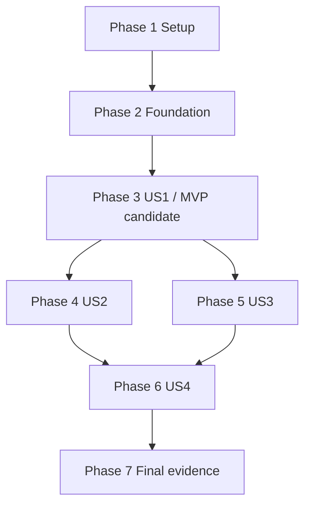

# Tasks: Decision Support AHP Criteria Weighting (Phase 4)

**Feature**: 021-decision-ahp | **Date**: 2026-10-11
**Input**: design documents in specs/021-decision-ahp/.
**Prerequisites**: [plan.md](plan.md), [spec.md](spec.md), [research.md](research.md), [data-model.md](data-model.md), [input contract](contracts/ahp-pairwise-matrix.md), [result contract](contracts/ahp-run-result.md), [UI contract](contracts/ahp-ui.md), [quickstart.md](quickstart.md), and project constitution.

**Tests / approach**: The spec explicitly requests pytest/frontend verification; the user requested TDD. Add gap regressions first, observe their intended failures, implement focused fixes, then rerun green. Already satisfied contract scenarios may remain green with evidence. Extend the existing engine/models/endpoints/components rather than rebuild them.

**Regeneration**: This pending correction/verification list replaces the older fully checked task list because it does not cover the refreshed plan. Every task below starts unchecked; previous checked markers are not carried forward as proof.

**Format**: checkbox, sequential task ID, optional [P], user-story label in story phases, and repository-relative file paths. [P] denotes distinct-file test work within its declared phase batch, not concurrent edits to shared files across phases.

## Phase 1: Setup (Shared Infrastructure)

**Purpose**: verify existing environment and preservation boundaries; no project reinitialization.

- [X] T001 Verify feature/worktree and Python/Django/Node/PostgreSQL/Redis prerequisites in specs/021-decision-ahp/quickstart.md; record current commands and evidence boundaries in specs/021-decision-ahp/validation.md without resetting databases, upgrading dependencies or disturbing existing changes.
- [X] T002 Record preservation of existing fields in specs/021-decision-ahp/validation.md from apps/api/core/decision_support/models.py: title "String, max 200", method "String, max 32", case "FK to DecisionCase, CASCADE", project "FK to Project, CASCADE", actor "User FK, PROTECT", id "UUID", selected_methods "Contains `ahp` for run"; no schema/migration/new permission codes.

## Phase 2: Foundational (Blocking Prerequisites)

**Purpose**: shared isolated fixtures and real browser harness. Complete before any story work.

- [X] T003 Prepare isolated two-project editor/read-only/nonmember fixtures in apps/api/core/decision_support/tests/test_ahp_api.py using existing root fixtures; verify view_decision_support/edit_decision_support and authenticated actor assignment for shared contract scenarios.
- [X] T004 Create reusable real-browser login/case/locale helpers and suite skeleton in apps/web/e2e/tests/decision-ahp.spec.ts using apps/web/e2e/playwright.config.ts; use accessible selectors and configured isolated development data.

## Phase 3: User Story 1 - Enter Pairwise Comparisons and Run AHP (Priority: P1)

**Goal**: Independent criteria weighting and usable pairwise entry.

**Independent Test**: Fresh n=1 and consistent 2/3/6 cases run AHP without alternatives/ranking data; positive weights sum to one, rows preserve input identity/order, fraction entry and reopen work in English/Persian.

### Tests first

- [X] T005 [P] [US1] Extend numerical/result contract tests in apps/api/core/decision_support/tests/test_ahp_service.py for 2/3/6 weights 0.6/0.3/0.1, n=1/2/10, reversed importance, ties and unchanged inputs; enforce "All values finite, weights positive and sum to 1±1e-6." and criteria input-order rows with separately computed ordinal ranks (FR-001–FR-004, FR-012).
- [X] T006 [P] [US1] Extend AHP-only create/run contract tests in apps/api/core/decision_support/tests/test_ahp_api.py for method "ahp", result status "ok"/engine "ahp", actor/time, full compatible snapshot and zero alternative/ranking requirements; assert "Independent deep copy of loaded case" and "Stored output, never recomputed during inspection" from data-model.md (FR-006–FR-007).
- [X] T007 [P] [US1] Replace all-ones expectations and add failing draft/reconciliation tests in apps/web/src/components/decision-support/SquareMatrixEditor.test.ts for "diagonal 1, unjudged pairs null", clear-both behavior, retained/reordered/new/renamed names and full-precision reciprocal values (FR-011).
- [X] T008 [P] [US1] Add initially failing happy-path browser scenarios in apps/web/e2e/tests/decision-ahp.spec.ts for fresh n=1, blank n>=2, fraction presets, consistent weights, criteria add/remove/reorder/rename and reopen/reload persistence in English/Persian (FR-010–FR-012, FR-015).

### Implementation and checkpoint

- [X] T009 [US1] Correct apps/api/core/decision_support/services/ahp_service.py to retain geometric-mean semantics with stable log-domain evaluation, fixed RI for n=1..10 and criteria input-order result rows; calculate descending ordinal rank separately with input-index tie breaks and preserve n<=2 CR=0/lambda approximation.
- [X] T010 [US1] Repair owned draft initialization/reconciliation and reciprocal updates in apps/web/src/components/decision-support/square-matrix-rules.ts: initialize only diagonal 1, leave unjudged pairs null, retain exact trimmed-name pairs and clear both directions without rounding state.
- [X] T011 [US1] Repair apps/web/src/components/decision-support/SquareMatrixEditor.tsx to render actual owned state without fallback equality, lock diagonal, offer numeric 1..9 and 1/2..1/9 presets/custom positive input and advisory outside [1/9,9]; malformed saved values must remain visibly invalid rather than silently repaired.
- [X] T012 [US1] Integrate criteria/matrix ownership in apps/web/src/app/routes/project-decision-support.tsx and awaited save-then-run submission in apps/web/src/components/decision-support/AhpMethodPanel.tsx; fresh n=1 owns [[1]], failed saves prevent execution and pending state prevents accidental repeat clicks.
- [X] T013 [US1] Complete criterion/decimal/percent/rank/result display in apps/web/src/components/decision-support/CriteriaWeightTable.tsx and AHP-specific empty/scale/pending copy in apps/web/src/app/locales/en.json and apps/web/src/app/locales/fa.json; use server results without client weighting/CI/CR derivation.
- [X] T014 [US1] Run US1 numerical/API/helper and both-language happy-path browser checks from specs/021-decision-ahp/quickstart.md; record new red regressions, green results and rendered/reload evidence in specs/021-decision-ahp/validation.md.

**Checkpoint**: US1 is supported by recorded API/helper/browser evidence, not checked boxes alone.

## Phase 4: User Story 2 - Inconsistency Detection and Advisory Alert (Priority: P1)

**Goal**: Preserve inconsistent results with clear advisory feedback.

**Independent Test**: Circular 5/5/5 judgments yield one successful frozen run with CR≈2.75862 and false consistency; English/Persian UI announces a warning, while consistent/n<=2 cases do not warn.

### Tests first

- [X] T015 [P] [US2] Extend apps/api/core/decision_support/tests/test_ahp_service.py for the full RI table, circular fixture lambda=6.2/CI=1.6/CR≈2.75862, CI clamping, n<=2 consistency and inclusive CR<=0.10 boundary (FR-002–FR-004); keep the spec's approximate-lambda method.
- [X] T016 [P] [US2] Extend apps/api/core/decision_support/tests/test_ahp_api.py to prove inconsistent input persists exactly one HTTP 201 run with false consistency and frozen finite results, rather than rejecting or discarding it (FR-009).
- [X] T017 [P] [US2] Add consistent/inconsistent browser assertions in apps/web/e2e/tests/decision-ahp.spec.ts for actual CR, announced localized advisory and successful revision/rerun in both languages (FR-013, SC-005).

### Implementation and checkpoint

- [X] T018 [US2] Repair only uncovered backend consistency/orchestration in apps/api/core/decision_support/services/ahp_service.py and apps/api/core/decision_support/services/execution_service.py; consume server is_consistent with role=alert/status in apps/web/src/components/decision-support/CriteriaWeightTable.tsx, remove client consistency inference from apps/web/src/components/decision-support/criteria-weight-rules.ts and update apps/web/src/components/decision-support/CriteriaWeightTable.test.ts and apps/web/src/app/locales/en.json and apps/web/src/app/locales/fa.json.
- [X] T019 [US2] Run US2 service/API/browser scenarios and record computed CR, successful record count and English/Persian warning behavior in specs/021-decision-ahp/validation.md.

**Checkpoint**: US2 is supported by recorded API/helper/browser evidence, not checked boxes alone.

## Phase 5: User Story 3 - Reject Invalid Pairwise Comparison Inputs (Priority: P1)

**Goal**: Reject invalid judgments with precise accessible errors and no run.

**Independent Test**: Strict cell/name types, diagonal 1.00005, dimensions and reciprocal-boundary violations return coded paths/no run; both-language keyboard error navigation reaches the offending cell.

### Tests first

- [X] T020 [P] [US3] Add strict validator/numerical-range regressions in apps/api/core/decision_support/tests/test_ahp_service.py enforcing verbatim "Criteria: n actual nonempty strings after trim, exact uniqueness, 1≤n≤10." and "Matrix: n rows of n actual finite positive numbers; exclude bool/string/null; exact diagonal 1; product residual <1e-4. No rounding before validation."; cover 1.00005 diagonal, symmetric/asymmetric product-residual boundaries, ragged rows, strings/bools and extreme values (FR-005).
- [X] T021 [P] [US3] Add exact HTTP envelope/cell-path/no-run cases in apps/api/core/decision_support/tests/test_ahp_api.py for invalid criteria/matrix/methods, missing membership/permission, foreign case IDs and localized messages; distinguish parser rejection from domain non_finite errors (FR-005, Constitution I/III).
- [X] T022 [P] [US3] Add blank/invalid-cell browser scenarios in apps/web/e2e/tests/decision-ahp.spec.ts proving no run, accurate finite/diagonal/reciprocal errors, keyboard navigation and error/cell association in both languages (SC-003, FR-015).

### Implementation and checkpoint

- [X] T023 [US3] Enforce strict AHP numbers/string criterion types/exact diagonal/product residual in apps/api/core/decision_support/services/validators.py without altering ranking coercion; validate shape before indexing. Guard unrepresentable output in apps/api/core/decision_support/services/ahp_service.py with coded non_finite at ahp_matrix rather than overflow/NaN JSON.
- [X] T024 [US3] Align local completeness/types/Number.isFinite/diagonal/reciprocal checks in apps/web/src/components/decision-support/AhpMethodPanel.tsx with the backend contract; preserve nulls, accept numeric preset values and consume error.details.issues without mathematical result derivation.
- [X] T025 [US3] Associate locatable issues with cells/keyboard focus in apps/web/src/components/decision-support/SquareMatrixEditor.tsx and apps/web/src/components/decision-support/ValidationIssueList.tsx, including row/column header scopes and aria-invalid/descriptions; localize messages through apps/web/src/app/locales/en.json, apps/web/src/app/locales/fa.json and existing apps/api/core/common/i18n.py conventions.
- [X] T026 [US3] Run US3 validator/API/authorization and accessible bilingual browser checks; record exact codes/paths, no-run assertions, reciprocal boundaries and parser behavior in specs/021-decision-ahp/validation.md.

**Checkpoint**: US3 is supported by recorded API/helper/browser evidence, not checked boxes alone.

## Phase 6: User Story 4 - Ranking Isolation and Immutable Run History (Priority: P2)

**Goal**: Preserve ranking inputs and inspect independent immutable history.

**Independent Test**: Matrix saves/runs preserve raw ranking fields; two runs leave the first entire snapshot/result unchanged; filtered pages/frozen inspection and delayed case switches stay correctly scoped.

### Tests first

- [X] T027 [P] [US4] Extend apps/api/core/decision_support/tests/test_ahp_api.py for matrix-only saves preserving complete/incomplete ranking drafts and raw weights/types/alternatives/performance/other-method inputs, real shared-criteria consistency, filtered pagination and scoped create/list/detail/foreign IDs (FR-008, Constitution I/II).
- [X] T028 [P] [US4] Extend apps/api/core/decision_support/tests/test_runs_immutability.py for whole previous snapshot/result/actor/time preservation after two AHP runs and case edits, unchanged raw/normalized ranking snapshots, PUT/PATCH/DELETE run_immutable and historical row-order compatibility (FR-007, FR-016).
- [X] T029 [P] [US4] Add mixed-method multi-page history, read-only frozen input/result, draft isolation and delayed case-switch response regressions in apps/web/e2e/tests/decision-ahp.spec.ts (US4/AC1–AC3).

### Implementation and checkpoint

- [X] T030 [US4] Repair targeted AHP-only updates in apps/api/core/decision_support/services/case_service.py to preserve unrelated raw/stale ranking fields and bypass ranking validation for matrix-only saves; intentional shared-criteria changes keep established consistency checks. Preserve independent snapshot copies from one loaded case in apps/api/core/decision_support/services/execution_service.py; no schema changes.
- [X] T031 [US4] Implement optional validated method filter before pagination and explicit case/project-scoped run list/detail queries in apps/api/core/decision_support/views.py; retain permissions/newest-first/run_immutable. Update stale stub descriptions in apps/api/core/decision_support/views.py, apps/api/core/decision_support/services/execution_service.py and apps/api/core/decision_support/serializers.py as applicable.
- [X] T032 [US4] Extend method/pagination request helpers and completed-AHP result discrimination in apps/web/src/app/lib/api/decision-support.ts; safely handle old stub/non-AHP records and historically sorted named rows, never rewrite historical output.
- [X] T033 [US4] Repair case/project-local result/error/history lifecycle and late-response guards in apps/web/src/app/routes/project-decision-support.tsx and apps/web/src/components/decision-support/AhpMethodPanel.tsx; reset on case changes, submit only changed AHP fields and preserve current draft when selecting a past run.
- [X] T034 [US4] Expose independent method-paginated history and clearly labeled read-only frozen matrix/result/actor/time in apps/web/src/components/decision-support/ExecutionHistoryList.tsx, apps/web/src/components/decision-support/InputSnapshotViewer.tsx and apps/web/src/app/routes/project-decision-support.tsx; preserve existing SAW/TOPSIS views.
- [X] T035 [US4] Complete localized current/historical/method-history states in apps/web/src/app/locales/en.json and apps/web/src/app/locales/fa.json; ensure historical inspection never mutates input/results and provides no automatic weight-transfer action.
- [X] T036 [US4] Run US4 API/immutability/history and both-language delayed-response browser scenarios; record unchanged ranking inputs/earlier records, paginated method isolation and tenant/permission results in specs/021-decision-ahp/validation.md.

**Checkpoint**: US4 is supported by recorded API/helper/browser evidence, not checked boxes alone.

## Phase 7: Polish & Cross-Cutting Concerns

**Purpose**: cross-cutting final-tree evidence and honest acceptance reporting.

- [X] T037 [P] Strengthen missing-target and math-boundary checks in apps/web/src/components/decision-support/no-client-ahp-math.test.ts and apps/api/core/decision_support/tests/test_no_math_in_views.py; audit client components/helpers/views, allowing only reciprocal sync, input validation and formatting (FR-014, SC-007).
- [X] T038 [P] Expand complete AHP locale-key/interpolation checks in apps/web/src/components/decision-support/i18n.keys.test.ts against apps/web/src/app/locales/en.json and apps/web/src/app/locales/fa.json; retain rendered-language verification as separate evidence (FR-015, SC-006).
- [X] T039 Run final-tree decision_support pytest and relevant Node helper/source/key regressions using specs/021-decision-ahp/quickstart.md; record unmasked exits/counts in specs/021-decision-ahp/validation.md and confirm apps/api/core/decision_support/models.py remains unchanged with no required migrations.
- [X] T040 Run pnpm typecheck and the complete apps/web/e2e/tests/decision-ahp.spec.ts via apps/web/e2e/playwright.config.ts; retain both-language RTL/keyboard/reload/history/case-switch evidence and separately document unrelated failures in specs/021-decision-ahp/validation.md.
- [ ] T041 Record observed human four-criterion comparison-to-visible-result timing under 30 seconds per SC-001 in specs/021-decision-ahp/validation.md; leave this task unchecked if no participant/timing evidence exists, never substitute scripted typing or engine latency.
- [X] T042 Update specs/021-decision-ahp/quickstart.md and specs/021-decision-ahp/validation.md with actual final results/limits/requirement coverage; preserve interim O05/O06 and unchanged spec/plan, leave unmet acceptance tasks unchecked and do not commit/push unless separately instructed.

## Dependencies & Execution Order

Default execution: Phase 1 → 2 → 3 → 4 → 5 → 6 → 7. US2 and US3 are logically independent after US1, but share the engine/API/browser files, so finish one before editing the other. US4 integrates their results/history. No story requires a SAW/TOPSIS execution; mixed-method fixtures prove regression isolation.

Within a story, the [P] test batch can be edited concurrently after prerequisites because files differ. Observe new regressions failing for the intended behavior before fixes. Implement in listed order, rerun affected tests and complete the story checkpoint. Existing-green acceptance checks do not require artificial failures. Every task within a phase depends on earlier nonparallel prerequisites; the final phase depends on all story checkpoints.

Shared-file ownership: numerical/validator tests reuse test_ahp_service.py, API tests reuse test_ahp_api.py, browser cases reuse decision-ahp.spec.ts, and translations/routes are touched by several stories. These story phases must not edit the same files simultaneously.

## Parallel Execution Examples

- **US1**: T005 in apps/api/core/decision_support/tests/test_ahp_service.py; T006 in apps/api/core/decision_support/tests/test_ahp_api.py; T007 in apps/web/src/components/decision-support/SquareMatrixEditor.test.ts; T008 in apps/web/e2e/tests/decision-ahp.spec.ts. Run only after that phase prerequisites and previous shared-file work finish.
- **US2**: T015 in apps/api/core/decision_support/tests/test_ahp_service.py; T016 in apps/api/core/decision_support/tests/test_ahp_api.py; T017 in apps/web/e2e/tests/decision-ahp.spec.ts. Run only after that phase prerequisites and previous shared-file work finish.
- **US3**: T020 in apps/api/core/decision_support/tests/test_ahp_service.py; T021 in apps/api/core/decision_support/tests/test_ahp_api.py; T022 in apps/web/e2e/tests/decision-ahp.spec.ts. Run only after that phase prerequisites and previous shared-file work finish.
- **US4**: T027 in apps/api/core/decision_support/tests/test_ahp_api.py; T028 in apps/api/core/decision_support/tests/test_runs_immutability.py; T029 in apps/web/e2e/tests/decision-ahp.spec.ts. Run only after that phase prerequisites and previous shared-file work finish.
- **Polish & Cross-Cutting Concerns**: T037 in apps/web/src/components/decision-support/no-client-ahp-math.test.ts; T038 in apps/web/src/components/decision-support/i18n.keys.test.ts. Run only after that phase prerequisites and previous shared-file work finish.

## Requirement and Entity Mapping

| Intent | Primary tasks |
|---|---|
| FR-001–FR-004 / SC-002: numerical method, RI and consistency | T005, T009, T015–T018, T023 |
| FR-005 / SC-003: strict locatable validation | T020–T026 |
| FR-006: AHP only, no ranking dependency | T006, T008, T012, T014 |
| FR-007–FR-008 / SC-004: immutable run and ranking isolation | T006, T027–T032, T036 |
| FR-009 / FR-013 / SC-005: saved inconsistency and advisory | T015–T019 |
| FR-010–FR-012: panel/editor/weights/ranks | T007–T014 |
| FR-014 / SC-007: backend mathematical derivation | T009, T018, T023, T037 |
| FR-015 / SC-006: complete bilingual accessible experience | T008, T013, T017, T022, T025, T035, T038, T040 |
| FR-016 / US4 acceptance: method history/frozen inspection | T028–T036 |
| SC-001: under-30-second human workflow | T041 |
| Constitution I: membership/permission and related-resource scope | T003, T021, T027, T031, T036 |
| Existing DecisionCase/DecisionRun field constraints | T002, T005–T006, T020; no new model/migration |

The input contract maps to US1 execution, US3 validation and US4 filtered scoped history; the result contract maps to US1 weights, US2 consistency and US4 preservation; the UI contract maps to all four stories. Existing shared entities are confirmed in Setup instead of redundantly created.

## Implementation Strategy

**MVP candidate**: Phase 1 + Phase 2 + US1, T001–T014. Verify independent entry/execution before adding further behavior. A release satisfying the full spec also requires US2 warnings, US3 strict validation, US4 isolation/history and final acceptance evidence; the candidate alone is not full completion.

Deliver US2, then US3, then US4 as tested increments. Complete final-tree pytest/Node/typecheck/browser gates on the stable result; repeat only if later changes/failures warrant it. Keep human timing pending if no evidence is available and complete independent executable work.

Preserve existing dirty planning documents and unrelated changes. Mark only proven-complete implementation tasks [X]; do not edit reviewer/spec checklists. This command generates tasks only. No branch change, commit, push, deployment, schema changes, new permission catalog or DEMATEL/ISM engine is part of this task list.

## Phase 8: Convergence

Present-state assessment on 2026-10-11 found F1–F7 below after inspecting all 42 existing tasks, 36 FR/SC/acceptance scenarios, six edge cases, 12 grouped plan decisions and seven constitution principles. Existing passing suites do not cover these gaps. No application code, spec, plan or previous tasks were changed by convergence.

Execute T043–T048 sequentially because several share validators, API tests, translations and browser tests. Use TDD: observe each focused regression fail for its intended reason, make the minimal fix, then record green evidence in specs/021-decision-ahp/validation.md. After T048, rerun the decision_support pytest suite, decision-support Node checks, the complete bilingual AHP Playwright suite and pnpm typecheck; distinguish unrelated typecheck failures. T049 is human acceptance work after those fixes and must remain unchecked without actual participant evidence; the original T041 remains unchanged.

- [X] T043 CRITICAL [F1] Complete AHP API error localization in apps/api/core/decision_support/services/validators.py, apps/api/core/decision_support/services/execution_service.py, apps/api/core/decision_support/views.py and apps/api/core/locale/fa/LC_MESSAGES/django.po (compile the existing catalog). Add failing English/Persian regressions in apps/api/core/decision_support/tests/test_ahp_api.py and apps/api/core/decision_support/tests/test_ahp_service.py for zero/over-ten criteria, non-list names/matrices/rows and unknown execution/history-filter methods. Current Persian probes return English text such as "Row must be a list."; use translatable templates for dynamic messages while preserving stable codes/paths and ranking coercion semantics, per Constitution III, FR-015, SC-006 and T021/T025 (contradicts).
- [X] T044 CRITICAL [F2] Show accessible localized request failures in apps/web/src/components/decision-support/AhpMethodPanel.tsx and apps/web/src/app/routes/project-decision-support.tsx when apps/web/src/components/decision-support/validation-issues.ts parses no cell issues; extend apps/web/src/app/locales/en.json and apps/web/src/app/locales/fa.json as needed. Add failing helper/browser regressions in apps/web/src/components/decision-support/ValidationIssueList.test.ts and apps/web/e2e/tests/decision-ahp.spec.ts for permission-denied/not-found/throttled and non-JSON server failures during save/run, retaining detailed cell issues and late-response guards. A mocked rejected PATCH currently yields zero alerts; assert failed saves create no run, the user sees useful feedback and can recover, per Constitution VII, FR-015 and T012/T024/T033 (contradicts).
- [X] T045 CRITICAL [F3] Format execution-history timestamps using the selected application language in apps/web/src/components/decision-support/ExecutionHistoryList.tsx and keep presentation consistent with apps/web/src/components/decision-support/InputSnapshotViewer.tsx. Add failing English/Persian browser assertions in apps/web/e2e/tests/decision-ahp.spec.ts with a browser locale differing from the selected language, including a language switch and unchanged stored timestamps. The list currently calls toLocaleString() without a locale and shows an English date beside a Persian frozen viewer, per Constitution III, FR-016 and T034/T035 (contradicts).
- [X] T046 CRITICAL [F4] Preserve input focus and caret during criterion renaming in apps/web/src/components/decision-support/NamedListEditor.tsx using rendered identity that does not change on each keystroke. Add failing real-keyboard English/Persian regressions in apps/web/e2e/tests/decision-ahp.spec.ts for multi-character typing, insertion and backspace, then verify reorder/remove and existing exact-name matrix reconciliation still work. The name-dependent li key remounts the input: typing "xyz" appended only "x" and blurred it in both probes, per Constitution VII and T008/T010/T011 (contradicts).
- [X] T047 [F5] Avoid intermediate overflow when computing representable AHP consistency metrics in apps/api/core/decision_support/services/ahp_service.py. Correct the service/API regressions in apps/api/core/decision_support/tests/test_ahp_service.py and apps/api/core/decision_support/tests/test_ahp_api.py that currently expect rejection of the valid cyclic matrix [[1,1e308,1e-308],[1e-308,1,1e308],[1e308,1e-308,1]]: weights are each 1/3, lambda_max is approximately 1e308, CI approximately 5e307 and CR approximately 8.620689655172414e307, all representable. Observe the success regression fail before fixing sum(ratios)/n; require one immutable HTTP 201 inconsistent run and retain coded non_finite rejection with separate genuinely unrepresentable-output fixtures, per FR-002, FR-009, SC-002, plan: numerical safety and T009/T023 (partial).
- [X] T048 [F6] Return a dimension_invalid issue at the root ahp_matrix path for every non-square or malformed matrix in apps/api/core/decision_support/services/validators.py, retaining useful additional row-specific diagnostics and shape-before-indexing safety. Add failing service/API assertions in apps/api/core/decision_support/tests/test_ahp_service.py and apps/api/core/decision_support/tests/test_ahp_api.py for wrong row count, ragged row lengths and non-list rows; verify localized errors and zero DecisionRun records. A malformed row currently returns only ahp_matrix.0, per US3/AC4, FR-005 and T020/T021 (partial).
- [ ] T049 [F7] Complete the remaining human acceptance from T041 after the convergence fixes: observe a project member entering four criteria's pairwise comparisons through to a visible AHP result and record participant context, start/end definition and actual elapsed time in specs/021-decision-ahp/validation.md. Verify the under-30-second target or report the observed failure without claiming completion; do not substitute scripted typing or engine latency. Keep this task and T041 unchecked if participant evidence is unavailable, per SC-001 and plan: performance goal (partial).
