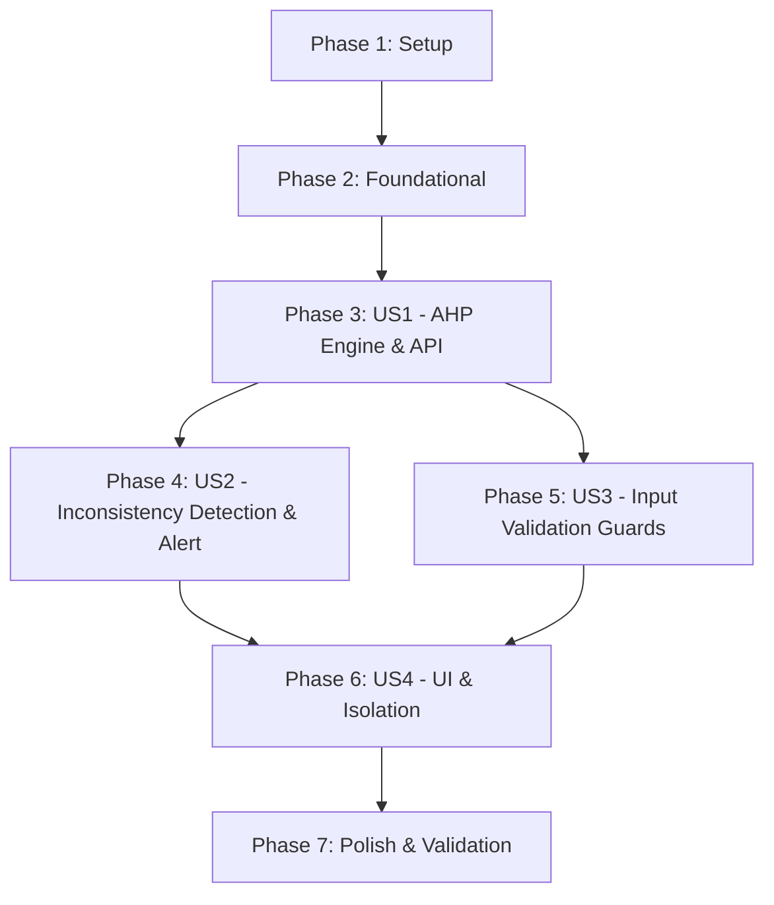

# Implementation Tasks: Decision Support AHP Criteria Weighting (Phase 4)

**Feature**: Decision Support AHP Criteria Weighting (Phase 4)  
**Spec**: [spec.md](./spec.md) | **Plan**: [plan.md](./plan.md)  
**Approach**: Test-Driven Development (TDD) — tests written first and verified failing before implementation.

---

## Phase 1: Setup (Shared Infrastructure)

**Purpose**: Register API contracts, TypeScript definitions, and bilingual translation keys.

- [x] T001 [P] Register AHP TypeScript contracts (`AhpWeightRow`, `AhpRunResult`, and `DecisionRunResult` union extension) in `apps/web/src/app/lib/api/decision-support.ts`
- [x] T002 [P] Add bilingual translation keys for AHP panel, headers, CR warning, and error codes in `apps/web/src/app/locales/en.json` and `apps/web/src/app/locales/fa.json`

---

## Phase 2: Foundational (Blocking Prerequisites)

**Purpose**: Input contract validators and execution service routing for AHP.

- [x] T003 Implement `validate_ahp_inputs(criteria, matrix)` enforcing $n \times n$ dimensions, positive cells, diagonal $1.0$, and reciprocal symmetry in `apps/api/core/decision_support/services/validators.py`
- [x] T004 Wire AHP execution branch in `create_run` in `apps/api/core/decision_support/services/execution_service.py`

**Checkpoint**: Foundational validators and dispatch ready.

---

## Phase 3: User Story 1 - AHP Weighting Engine & API (Priority: P1) 🎯 MVP

**Goal**: Deliver pure AHP calculation engine and execution endpoint returning normalized weights from pairwise comparisons without requiring alternatives or ranking matrices (AC02, AC17).

**Independent Test**: Provide consistent 3-criteria matrix → execute AHP alone → receive normalized weights summing to $1.0$, $CR = 0.0$, and verify no ranking run is created.

### Tests for User Story 1 (TDD)
- [x] T005 [P] [US1] Unit tests for pure AHP weight calculation in `apps/api/core/decision_support/tests/test_ahp_service.py` (geometric mean, normalized weights, $n=1$, $n=2$, AC17 fixture)
- [x] T006 [P] [US1] API integration test for independent AHP execution in `apps/api/core/decision_support/tests/test_ahp_api.py` (AC02 run without alternatives, returns status 'ok', engine 'ahp', and weight rows)

### Implementation for User Story 1
- [x] T007 [US1] Implement pure Python `compute_ahp` in `apps/api/core/decision_support/services/ahp_service.py` with geometric mean row products and weight normalization

**Checkpoint**: User Story 1 complete. AHP engine produces weights independently.

---

## Phase 4: User Story 2 - Inconsistency Detection & Alert (Priority: P1)

**Goal**: Calculate principal eigenvalue $\lambda_{\max}$, $CI$, and $CR$ using Saaty's $RI$ table, and flag $is\_consistent = False$ when $CR > 0.10$ without aborting run persistence (AC18, O05 interim).

**Independent Test**: Provide intransitive comparisons → execute AHP → verify run saved with $CR > 0.10$ and `is_consistent: false`.

### Tests for User Story 2 (TDD)
- [x] T008 [P] [US2] Unit tests for $\lambda_{\max}$, $CI$, $CR$, and Saaty $RI$ table in `apps/api/core/decision_support/tests/test_ahp_service.py` (consistent vs inconsistent matrix, $CR > 0.10$, clamping $CI \ge 0$)
- [x] T009 [P] [US2] API integration test for inconsistent run persistence in `apps/api/core/decision_support/tests/test_ahp_api.py` (run succeeds with HTTP 201, `is_consistent: false`, preserving audit trail)

### Implementation for User Story 2
- [x] T010 [US2] Implement $\lambda_{\max}$ estimation, $CI$, and Saaty $RI$ lookup in `compute_ahp` in `apps/api/core/decision_support/services/ahp_service.py`

**Checkpoint**: User Story 2 complete. Inconsistency ratios reliably evaluated and recorded.

---

## Phase 5: User Story 3 - Pairwise Input Validation Guards (Priority: P1)

**Goal**: Reject invalid matrices (non-positive, diagonal $\ne 1$, non-reciprocal, empty cells, dimension mismatch) with locatable cell paths before execution (AC08, AC26).

**Independent Test**: Submit invalid pairwise matrices → verify HTTP 400 with path `ahp_matrix.{j}.{k}` and 0 successful runs created.

### Tests for User Story 3 (TDD)
- [x] T011 [P] [US3] Unit tests for pairwise matrix validation guards in `apps/api/core/decision_support/tests/test_ahp_service.py` (non-positive cells, diagonal $\ne 1$, reciprocal mismatch, empty cells)
- [x] T012 [P] [US3] API integration tests for locatable error responses in `apps/api/core/decision_support/tests/test_ahp_api.py` (AC26, path `ahp_matrix.{j}.{k}`, zero false-positive runs)

### Implementation for User Story 3
- [x] T013 [US3] Complete validation error formatting and reciprocal tolerance handling in `apps/api/core/decision_support/services/validators.py` and `ahp_service.py`

**Checkpoint**: User Story 3 complete. Pairwise matrix input contract fully guarded.

---

## Phase 6: User Story 4 - UI Components & Method Isolation (Priority: P2)

**Goal**: Deliver `SquareMatrixEditor` with reciprocal auto-sync, `CriteriaWeightTable`, `AhpMethodPanel`, and ensure zero auto-feed into ranking weights (AC04, AC18, AC23, AC24).

**Independent Test**: Edit pairwise comparisons in UI → reciprocal cells auto-sync → run AHP → see weights table and CR alert badge → verify ranking weights untouched.

### Tests for User Story 4 (TDD)
- [x] T014 [P] [US4] Client math audit test in `apps/web/src/components/decision-support/no-client-ahp-math.test.ts` (ensuring zero AHP math formulas in React)
- [x] T015 [P] [US4] Unit test for `SquareMatrixEditor` in `apps/web/src/components/decision-support/SquareMatrixEditor.test.ts` (pairwise mode, diagonal 1, reciprocal sync)
- [x] T016 [P] [US4] Unit test for `CriteriaWeightTable` in `apps/web/src/components/decision-support/CriteriaWeightTable.test.ts` (weights, %, ranks, CR alert badge)
- [x] T017 [P] [US4] API integration test for ranking input isolation and snapshot immutability in `apps/api/core/decision_support/tests/test_ahp_api.py` (AC04, AC23, AC24)

### Implementation for User Story 4
- [x] T018 [US4] Implement `SquareMatrixEditor.tsx` in `apps/web/src/components/decision-support/SquareMatrixEditor.tsx`
- [x] T019 [US4] Implement `CriteriaWeightTable.tsx` in `apps/web/src/components/decision-support/CriteriaWeightTable.tsx`
- [x] T020 [US4] Implement `AhpMethodPanel.tsx` in `apps/web/src/components/decision-support/AhpMethodPanel.tsx` composing editor, run action, weight table, and advisory warning banner
- [x] T021 [US4] Integrate `AhpMethodPanel` into `apps/web/src/app/routes/project-decision-support.tsx` with dedicated state and independent history sync

**Checkpoint**: User Story 4 complete. Full UI workflow and isolation verified.

---

## Phase 7: Polish & Cross-Cutting Concerns

**Purpose**: Verification across all automated suites, documentation alignment, and end-to-end regression validation.

- [x] T022 [P] Execute full backend pytest suite `apps/api/.venv/bin/python -m pytest decision_support/tests/` in `apps/api/core` ensuring 100% pass rate
- [x] T023 [P] Execute frontend test suite `node --test apps/web/src/components/decision-support/*.test.ts` confirming zero regression
- [x] T024 Validate all quickstart scenarios in `specs/021-decision-ahp/quickstart.md` (Scenarios A through E)

---

## Dependencies & Execution Order

### Implementation Strategy
1. **Setup & Foundation**: Types, translations, validators, and execution dispatch.
2. **TDD Core (US1, US2, US3)**: Write tests first in `test_ahp_service.py` and `test_ahp_api.py`, then implement `ahp_service.py`.
3. **Frontend & UX (US4)**: Build `SquareMatrixEditor`, `CriteriaWeightTable`, and `AhpMethodPanel`.
4. **Validation**: Run all tests across backend and frontend.
