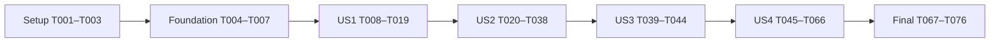

# Tasks: Traceable Decision Execution Records

**Input**: Design documents from `specs/024-decision-execution-records/`

**Prerequisites**: [plan.md](plan.md), [spec.md](spec.md), [research.md](research.md), [data-model.md](data-model.md), [contracts/](contracts/), [quickstart.md](quickstart.md), and `.specify/memory/constitution.md`.

**Tests**: Required. “Use TD” is interpreted as TDD, consistent with the user's preceding instructions and plan. For each source-backed gap: meaningful failing assertion → smallest coherent fix → focused green → safe refactor. Record already-correct behavior as regression. A missing module, fixture crash or selector error alone is not behavioral red; if a new helper needs an export scaffold, keep it minimal and reproduce an actual acceptance failure before its implementation.

**Organization**: Setup → Foundation → US1 (P1) → US2 (P1) → US3 (P2) → US4 (P2) → Final verification. Existing engines, storage and per-case coordinator are reused. No new schema/dependency, historical backfill, DEMATEL engine, manual weight transfer, merged ranking, automatic POST retry, commit, push or deployment is authorized by this task list.

## Format: `[ID] [P?] [Story] Description`

Every task uses `- [ ] Tnnn [P?] [USn?] description with exact file paths`. `[P]` marks distinct-file work in the ready test/fixture batch of that phase, after its prerequisites; it never bypasses red gates or allows concurrent edits to shared files. Story labels occur only in story phases. All paths are relative to repository root.

## Phase 1: Setup (Shared Infrastructure)

**Purpose**: Confirm the selected feature and preserve the existing workspace before implementation.

- [X] T001 Confirm cwd/branch and `.specify/feature.json` select `specs/024-decision-execution-records`; read all feature artifacts and scan `specs/024-decision-execution-records/checklists/requirements.md` as a read-only gate, then start `specs/024-decision-execution-records/validation.md` with current status, planned evidence categories and scope.
- [X] T002 Capture hashes/source copies of tracked and nonignored untracked files, including `.specify/feature.json`, under a local temporary baseline; reference it in `specs/024-decision-execution-records/validation.md` and protect source docs, 018–023 artifacts, feature-024 spec/design/checklist, dependencies/migrations and unrelated dirty work.
- [X] T003 Verify existing native PostgreSQL/Redis, API venv/Django 4.2.11 and Playwright/Node environment using `specs/024-decision-execution-records/quickstart.md`; verify `.gitignore`, `apps/api/.dockerignore` and `apps/web/.dockerignore` are sufficient, without installing full dev requirements, upgrading packages or resetting the development database; record actual prerequisites in `specs/024-decision-execution-records/validation.md`.

## Phase 2: Foundational (Blocking Prerequisites)

**Purpose**: Prepare independent literal fixtures and test support; do not implement story behavior yet.

- [X] T004 [P] Prepare reusable literal method inputs and fixed UUID/time/actor fixtures in `apps/api/core/decision_support/tests/execution_records_fixtures.py`; include valid SAW/TOPSIS/AHP/ISM, unchanged DEMATEL stub, equal-time mixed records, incomplete input and unrelated raw drafts. Preserve the data-model constraints “Stable case and authorized project scope”, “Current title and eligible method IDs”, “Ordered named axes, each within existing method input limits”, “Raw ranking inputs; strict eligibility applies at ranking execution”, “Method judgments, preserving existing draft policies”, and “Existing user/time/deletion semantics; an inactive case cannot be executed”; use existing 1..10 execution limits and allow existing unfinished draft policies.
- [X] T005 [P] Prepare pure completed/partial historical payload fixtures in `apps/web/src/components/decision-support/execution-record-fixtures.ts`: ranking raw/normalized weights, missing normalized values, explicit zero versus blank, legacy sorted AHP rows, ISM groups and signed completed DEMATEL output from `specs/022-decision-dematel/contracts/dematel-result.md`. Preserve “Stored method output; legacy placeholders/incomplete objects remain retained”; pin literal expected presentation values, never use client math to derive expected results.
- [X] T006 [P] Prepare reusable authenticated disposable-case helpers and controlled response gates in `apps/web/e2e/tests/helpers/decision-execution-records.ts`, using existing E2E setup and server routes; support real POST forwarding/committed-ID capture before response replacement, held reads, counters and named locale selectors. Label test-only completed DEMATEL fixture insertion explicitly, use an isolated test case, and never treat it as live engine proof.
- [X] T007 Verify fixture/test support fits `apps/api/core/decision_support/tests/conftest.py` without duplicating its RBAC seed lifecycle, and establish future focused pytest/Node/browser commands plus red-versus-fixture-error recording in `specs/024-decision-execution-records/validation.md`; keep fixture preparation separate from application acceptance.

**Checkpoint**: T001–T007 complete before story test batches. There is no new persistent model or framework scaffold to create.

## Phase 3: User Story 1 — Record One Selected Method Reliably (Priority: P1) — MVP

**Goal**: One eligible method executes on authoritative persisted input and appends one traceable record; invalid attempts cannot masquerade as an earlier success.

**Independent Test**: SAW-only prepared case → inspect raw/normalized weights and output → change one input → execute again → two distinct runs, unchanged first record and zero other-method runs; repeat relevant eligibility and invalid-input checks across live methods.

### Tests first

- [X] T008 [P] [US1] Add and run stale-caller, changed-input, method-removal and soft-deleted-parent cases in `apps/api/core/decision_support/tests/test_execution_records.py` for SAW/TOPSIS/AHP/ISM and preserved DEMATEL placeholder dispatch; require authoritative released state or rejection with zero append. Pin “One stable existing method ID”, “Deep-copied input/context actually used for that method”, and “Parent case and its project; record queries check both”; retain already-correct ISM cases as regressions and capture non-ISM behavioral red.
- [X] T009 [P] [US1] Add transaction-capable separate-connection tests in `apps/api/core/decision_support/tests/test_execution_records_concurrency.py` for locked execute versus input/selection changes, targeted PATCH merge and soft delete; synchronize holder/waiter, observe PostgreSQL `pg_stat_activity` lock wait and inspect final snapshot/result or zero append. Preserve unrelated drafts and targeted fields; sleep duration alone is not proof. Capture current unlocked-path failures before fixes.
- [X] T010 [P] [US1] Extend `apps/api/core/decision_support/tests/test_runs_immutability.py` with exact earlier-record equality after repeated identical/changed valid attempts and known invalid rejection; assert “UUID already supplied by the shared model; unchanged identity format”, “Recorded execution time, never rewritten by live case changes”, “Initiating user identity with existing protected relationship”, and “Existing shared timestamps; no new user-facing revision semantics”. Verify raw plus normalized ranking weights, no implicit other-method runs, and no weak success-or-failure assertion as zero-append evidence.
- [X] T011 [P] [US1] Add EN/FA normal single-method and prior-success→invalid-input→corrected-retry browser scenarios in `apps/web/e2e/tests/decision-execution-records.spec.ts`; assert named field/cell feedback, preserved draft, no new run for rejected input and no stale current success. Capture stale-result behavioral red before panel clearing changes; successful persistence remains real API evidence.

### Implementation and focused proof

- [X] T012 [US1] After T008/T009 red, unify `create_run` orchestration in `apps/api/core/decision_support/services/execution_service.py`: inside one atomic transaction reload/lock the active project-scoped case before selection/validation, compute with existing pure engines, deep-copy all retained context/output, append once and preserve engine-produced `weights_normalized`; remove redundant ISM-only ownership, preserve DEMATEL stub and result shapes, and make no cross-request revision/idempotency promise.
- [X] T013 [US1] After T009 red, lock/reload active scoped parent inside `apps/api/core/decision_support/services/case_service.py` through merge/validation/targeted update; preserve matrix-only AHP/ISM bypass of unrelated ranking checks, raw root JSON null handling, unsubmitted fields and existing audit timestamps. Do not change general-save domain rules or write all fields from a stale object.
- [X] T014 [US1] After T009 red, add the smallest case-specific locked soft-delete orchestration in `apps/api/core/decision_support/views.py` using the same parent row boundary; retain current scoped authorization and existing audit/deletion semantics without changing `common/viewsets.py` or project/case retention policy.
- [X] T015 [US1] After T011 red, clear stale current outputs on relevant input changes, new locally invalid attempts and failed requests in `apps/web/src/components/decision-support/SawMethodPanel.tsx`, `apps/web/src/components/decision-support/TopsisMethodPanel.tsx`, `apps/web/src/components/decision-support/AhpMethodPanel.tsx` and only necessary route callbacks in `apps/web/src/app/routes/project-decision-support.tsx`; retain ISM's already-correct behavior and per-case tokens. Shared uncertain-response orchestration follows in US4.
- [X] T016 [US1] Run T008–T010 tests plus existing ISM/AHP/SAW/TOPSIS API and snapshot regressions under `apps/api/core/decision_support/tests/`; retain focused red→minimal fix→green, actual PostgreSQL lock evidence, repeated distinct append and raw/normalized snapshot output in `specs/024-decision-execution-records/validation.md`.
- [X] T017 [US1] Run T011 EN/FA scenarios from `apps/web/e2e/tests/decision-execution-records.spec.ts` after T015 and verify stored IDs/counts, named feedback and corrected successful retry; retain actual focused output and traces in `specs/024-decision-execution-records/validation.md`.
- [X] T018 [US1] Verify the shared recording changes against `apps/api/core/decision_support/models.py`, `apps/api/core/decision_support/serializers.py` and existing engine files: envelope/protected actor relationship/math remain unchanged, no schema change is proposed, and `makemigrations --check --dry-run` is clean; record actual checks in `specs/024-decision-execution-records/validation.md` without manufacturing edits to already-correct code.
- [X] T019 [US1] Record the independently demonstrated MVP and its limits in `specs/024-decision-execution-records/validation.md`, mapping US1/AC1–AC5, FR-001–FR-007 and SC-001/SC-002/SC-005 to concrete evidence; keep ambiguous-response, full historical review and bilingual-access acceptance open for later stories.

**Checkpoint**: US1 is independently demonstrable. Source inspection, an atomic decorator or a task checkmark alone does not prove serialized recording.

## Phase 4: User Story 2 — Reopen the Exact Analysis Behind a Decision (Priority: P1)

**Goal**: Deterministic history and safe readable frozen inputs/results, including incomplete legacy records, without injecting old results into the live case.

**Independent Test**: Record ranking → change live names/order/weights/cell → record again → reopen first analysis and inspect original named inputs/raw/normalized weights/result/provenance; page/filter old records and inspect partial data without mutation or crashes.

### Tests first

- [X] T020 [P] [US2] Add fixed-UUID identical-time multi-page/filter API tests in `apps/api/core/decision_support/tests/test_execution_records.py`; assert exact `(-extracted_at,-id)` order, correct count, every fixed-set ID once, valid method filtering, unknown-method rejection and invalid-page behavior. Reproduce absent secondary ordering with a deterministic expected order before queryset changes; do not depend on coincidental database row order.
- [X] T021 [P] [US2] Add and run unknown-safe historical classifier/provenance tests in `apps/web/src/components/decision-support/execution-record-rules.test.ts` for null/missing snapshot, partial inputs, absent normalized weights, explicit zero/null, placeholder/wrong engine/broken dimensions/unknown names, legacy sorted AHP and completed signed DEMATEL shape. Distinguish safe partial history from strict new completion; reproduce acceptance failures before implementation, preserving stored rank/order and forbidding derivation.
- [X] T022 [P] [US2] Extend actual Decision Support API-boundary tests in `apps/web/src/app/lib/api/decision-support.test.ts` for malformed list/detail JSON/envelopes, bad count/pagination/row metadata, detail ID mismatch and usable legacy partial content; require local read failure or safe historical classification, not generic transport casts. Capture meaningful red before read guards.
- [X] T023 [US2] Add real EN/FA browser cases in `apps/web/e2e/tests/decision-execution-records.spec.ts` for readable SAW/TOPSIS frozen criteria/alternatives/types/raw and normalized weights/performance matrix plus recorded score/rank/distances after live edits; assert old detail equality and that selecting history leaves draft/current results untouched. Capture missing named review and historical injection failures before implementation.
- [X] T024 [US2] Add EN/FA legacy/partial review scenarios in `apps/web/e2e/tests/decision-execution-records.spec.ts` using T006: missing/null snapshot, absent normalized weights, placeholder/unusable output, actor-name fallback, stored sorted AHP/inconsistency, ISM groups and completed DEMATEL fixture indicators; require safe provenance/input/unavailable states and no invented zero or computation. Fixed completed DEMATEL examples prove review only.
- [X] T025 [US2] Add delayed historical detail then row/filter/page/case transition, new-read failure after prior success, empty/no-match/out-of-range page and inaccessible-case scenarios in `apps/web/e2e/tests/decision-execution-records.spec.ts`; require owned selected detail or history-specific read error, zero mutations and no stale prior detail. Capture page-transition/failure handling red before route changes.

### Implementation and focused proof

- [X] T026 [US2] After T020 red, apply explicit `order_by('-extracted_at','-id')` before existing filtering/pagination in `apps/api/core/decision_support/views.py`; retain scoped query, actor `select_related`, default 50/max 100 and `page_size`/`per_page` compatibility. Keep tie ordering at query level to avoid a model-metadata migration and claim fixed-set completeness only.
- [X] T027 [US2] After T021 red, implement pure unknown-safe provenance and partial historical classifiers in `apps/web/src/components/decision-support/execution-record-rules.ts`; reuse ISM structural guards, preserve legacy AHP named rows/order, classify missing input/output by section and validate stored finite shapes/membership without deriving math or rejecting every partial record wholesale.
- [X] T028 [US2] After T022 red, integrate local list/detail response guards in `apps/web/src/app/lib/api/decision-support.ts` with existing actual transport and optional read abort signals; distinguish invalid envelopes/selected-ID mismatch from readable partial record data without modifying global `api-client.ts` behavior or executing anything on a read failure.
- [X] T029 [US2] After T023 red, implement a read-only named ranking snapshot presenter in `apps/web/src/components/decision-support/RankingSnapshotTable.tsx` for frozen ordered axes/types/raw weights/recorded normalized weights/performance values; preserve explicit zero versus unavailable/blank, support ten-axis horizontal reading and never normalize values on the client.
- [X] T030 [US2] After T023 red, extend `apps/web/src/components/decision-support/InputSnapshotViewer.tsx` to present frozen ranking inputs and stored SAW/TOPSIS output with existing `RankingResultTable.tsx` and TOPSIS extra columns/precision; preserve stored option names/order/ranks and partial older missing distance data with explicit unavailable sections.
- [X] T031 [US2] After T021/T024 red, harden AHP/ISM review in `apps/web/src/components/decision-support/InputSnapshotViewer.tsx` and only necessary guards in `apps/web/src/app/lib/api/decision-support.ts`/`apps/web/src/components/decision-support/ism-result-rules.ts`: no unsafe snapshot/result dereference, retain existing weight/CR and layer/group presenters, readable raw inputs and legacy sorted AHP rows without recalculation or historical rewrites.
- [X] T032 [US2] After T024 red, add the smallest completed-DEMATEL stored indicator presenter in `apps/web/src/components/decision-support/CriteriaMetricsTable.tsx` and integrate it in `apps/web/src/components/decision-support/InputSnapshotViewer.tsx`; use feature-022 row/dimension/policy contract, preserve signed relation and recorded roles, display available direct/derived data and explicit unavailable placeholders, with no solve/derived role/rank/weight transfer or engine dispatch change.
- [X] T033 [US2] After T023/T025 red, fix `apps/web/src/app/routes/project-decision-support.tsx` historical ownership: remove SAW/TOPSIS history assignments into current panel state; invalidate request generation on actual case/filter/page navigation; clear/supersede old detail at selection; verify captured row ID/case/generation on callback; show retryable history read errors independently of draft issues and prevent late failed/inaccessible detail from retaining another selection.
- [X] T034 [US2] Add required named snapshot/output, provenance fallback, partial/unavailable and history-read-state strings to `apps/web/src/app/locales/en.json` and `apps/web/src/app/locales/fa.json`; reuse existing labels/date formatting and retain user names, stable IDs, stored values and method policies verbatim across language switching.
- [X] T035 [US2] Integrate safe list loading/error/empty/no-match/out-of-range recovery and selected-history accessibility in `apps/web/src/components/decision-support/ExecutionHistoryList.tsx` and `apps/web/src/app/routes/project-decision-support.tsx`; history controls and GET-only retry remain usable independently of same-case mutation protection, and wrong-case cache rows never appear as the selected case's data.
- [X] T036 [US2] Run T020–T022 focused API/guard/transport tests plus relevant existing guards from `apps/api/core/decision_support/tests/` and `apps/web/src/components/decision-support/`; retain meaningful red→green, deterministic IDs/counts and partial-versus-strict distinctions in `specs/024-decision-execution-records/validation.md`.
- [X] T037 [US2] Run T023–T025 EN/FA browser cases from `apps/web/e2e/tests/decision-execution-records.spec.ts` plus existing AHP sorted-history/ISM frozen-history regressions; retain actual readable input/output, detail ownership, full earlier-data equality and zero-mutation proof in `specs/024-decision-execution-records/validation.md`.
- [X] T038 [US2] Reconcile US2/AC1–AC6, FR-005–FR-011/FR-013 and SC-002/SC-003 against focused evidence in `specs/024-decision-execution-records/validation.md`; explicitly separate completed DEMATEL fixture presentation from unimplemented engine acceptance and leave SC-004 final performance proof outstanding.

**Checkpoint**: Historical review is independently testable using saved records; it does not depend on running every method in sequence or changing the editable draft.

## Phase 5: User Story 3 — Review Independent Results from Multiple Methods (Priority: P2)

**Goal**: Different stored method results remain separately labeled and unchanged, including ties and history for a currently deselected method.

**Independent Test**: Record a pinned SAW/TOPSIS disagreement fixture, inspect each method's original order/score/rank/distances, then inspect ties and a deselected method; no merged ranking, auto-run or weight transfer occurs.

### Tests first

- [X] T039 [P] [US3] Add real saved disagreement/tie/mixed-method cases in `apps/api/core/decision_support/tests/test_execution_records.py` using literal or independently checked fixture expectations: separate SAW/TOPSIS records and stored ordinal ranks, unchanged ranking weights after AHP/DEMATEL placeholder review-compatible operations, historical availability after method deselection and zero unintended runs; retain correct engine behavior as regression and do not refactor formulas to manufacture red.
- [X] T040 [P] [US3] Add EN/FA disagreement, equal-score stored order/ranks, deselected-method history and no-automatic-transfer/no-read-triggered-run scenarios in `apps/web/e2e/tests/decision-execution-records.spec.ts`; inspect both independent historical tables, verify zero POST/PATCH during review and full unchanged stored payloads, capturing any presentation gap before T041.

### Integration and focused proof

- [X] T041 [US3] Complete any behavior demonstrated missing by T040 in `apps/web/src/components/decision-support/InputSnapshotViewer.tsx`, `apps/web/src/components/decision-support/RankingResultTable.tsx` and only necessary explanatory strings in `apps/web/src/app/locales/en.json`/`apps/web/src/app/locales/fa.json`; keep each method clearly labeled, original stored score/rank/order and existing precision, with no blended result, re-sort or final O01/O02 policy change. If already correct after US2, record regression proof rather than gratuitous code edits.
- [X] T042 [US3] Verify independent stored inputs/results and no history-triggered writes across `apps/web/src/app/routes/project-decision-support.tsx`, `apps/web/src/components/decision-support/InputSnapshotViewer.tsx` and backend T039 tests; preserve AHP warning/ISM structure/DEMATEL signed-indicator interpretations and make no manual transfer action or automatic selection/run behavior.
- [X] T043 [US3] Run T039/T040 and relevant earlier frozen-history tests under `apps/api/core/decision_support/tests/` and `apps/web/e2e/tests/decision-execution-records.spec.ts`; retain real persisted method disagreement/ties, deselection compatibility and zero implicit mutation evidence in `specs/024-decision-execution-records/validation.md`.
- [X] T044 [US3] Reconcile US3/AC1–AC4, FR-012/FR-019 and SC-008 in `specs/024-decision-execution-records/validation.md`, preserving source open decisions and labeling already-working behavior as regression.

**Checkpoint**: Result comparison is inspection of independently stored methods, not a new combined scoring or execution-chain product.

## Phase 6: User Story 4 — Recover and Review Safely in Either Language (Priority: P2)

**Goal**: Every live method and global save handles unconfirmed responses safely, with bounded visible history recovery, per-case isolation, real access enforcement and usable bilingual review.

**Independent Test**: In each language, execute a live method, lose only its committed response and hold/fail/timeout recovery; same-case retry waits, no automatic duplicate occurs, successful filtered/page-two recovery exposes the saved ID/count, case B stays independent, and view-only/no-view users cannot bypass access.

### Tests first

- [X] T045 [P] [US4] Add or extend actual permission/project/parent/record API tests in `apps/api/core/decision_support/tests/test_execution_records_access.py` for viewer, no-view, unauthenticated/nonmember, foreign case/run, corrupt parent-project relation and attempted immutable PUT/PATCH/DELETE; verify zero prohibited write/disclosure, existing administrator behavior, revoked access and active/deleted-parent checks. Existing correct enforcement is regression, not an invented failing gate.
- [X] T046 [P] [US4] Extend `apps/web/src/components/decision-support/execution-record-rules.test.ts` with strict draft-compatible save and expected-method completed-response cases: valid raw/unfinished draft metadata, wrong existing case identity, null/object/partial envelope, actor/time, required frozen input, finite result membership and TOPSIS distances; distinguish strict new success from T021 legacy classification and capture actual malformed-success acceptance failures before guard integration.
- [X] T047 [P] [US4] Add deferred-network/actual QueryClient tests in `apps/web/src/components/decision-support/execution-recovery.test.ts` for validated forced-fresh page-one success, malformed count/row/envelope, HTTP failure, ten-second abort/late completion, captured case ownership and settlement-before-release with zero repeat POST; exercise the real helper/orchestrator boundary with injected scheduling only, not copied code or source-string assertions.
- [X] T048 [P] [US4] Extend actual mutation response-boundary tests in `apps/web/src/app/lib/api/decision-support.test.ts` for global save and live methods' empty/non-JSON/truncated/null/object/wrong-case-or-method/missing-snapshot/invalid-result responses; retain existing parsing regressions, valid unfinished drafts and AHP/shared helper compatibility before application adapters.
- [X] T049 [US4] Add EN/FA global create/PATCH and four-live-method malformed-success browser scenarios in `apps/web/e2e/tests/decision-execution-records.spec.ts`; verify guarded metadata callbacks, zero POST after unconfirmed save, cleared current success, preserved draft, localized request feedback and zero page/callback crashes. Record new SAW/TOPSIS/AHP/global behavioral red; ISM coverage remains a required regression.
- [X] T050 [US4] Add real committed-POST response-loss/replacement scenarios for SAW/TOPSIS/AHP/ISM in `apps/web/e2e/tests/decision-execution-records.spec.ts`; capture committed ID, hold history GET, assert same-case protection and one POST, then successful visible recovery from method filter and page two with accurate ID/count/all-method page-one transition before explicit retry.
- [X] T051 [US4] Extend `apps/web/e2e/tests/decision-execution-records.spec.ts` with HTTP-failed/malformed recovery and ten-second timeout for each live method in EN/FA; preserve explicit uncertainty, prior readable history/filter/page and input, no automatic POST, and subsequent manual retry only after settlement. Never infer zero commit from lost response or empty page one.
- [X] T052 [US4] Add held global/method PATCH→POST/recovery current-case reselect and A→B→A cases in `apps/web/e2e/tests/decision-execution-records.spec.ts`; case B may operate independently, A's late response cannot replace B's draft/result/history filter/page/detail or release B's token, returning A remains guarded, and history reads remain usable. Wait for the browser's actual recovery settlement rather than an unrelated API count poll.
- [X] T053 [US4] Add real EN/FA keyboard selection/named frozen axes/ten-axis horizontal access, localized dates/status/error/unavailable feedback, locale-switched stored-value equality and view-only/no-view/foreign-case browser bypass scenarios in `apps/web/e2e/tests/decision-execution-records.spec.ts`; include read failure and permission revocation without stale protected detail, preserving stable method IDs and user names.

### Implementation and focused proof

- [X] T054 [US4] After T046/T048 red, implement strict draft-compatible saved-case and expected-method completed-response guards in `apps/web/src/components/decision-support/execution-record-rules.ts` and expose/use them in `apps/web/src/app/lib/api/decision-support.ts`; validate consumed metadata, method/provenance/frozen required inputs and stored shapes without normalizing draft values or scientific computation. Preserve usable partial legacy reads separately and strengthen AHP null/membership handling without losing sorted rows.
- [X] T055 [US4] After T049 red, guard global create/PATCH save inside the acquired operation in `apps/web/src/app/routes/project-decision-support.tsx` before success callbacks or release; expected existing ID must match, a new create ID must be usable, raw drafts stay recoverable and old selection callbacks stay isolated. Clear current outputs on failed/unconfirmed global save while retaining recoverable draft and localized feedback. Global save never initiates an analysis.
- [X] T056 [US4] After T047/T050/T051 red, extract ISM's bounded authoritative read into `apps/web/src/components/decision-support/execution-recovery.ts`: shared project/case cache feedback, validated unfiltered page one, `staleTime:0`, `retry:false`, prefix invalidation without automatic refetch, AbortController and total ten-second wait; success/failure/timeout settle explicitly, and late completion cannot change failed feedback or another case's view.
- [X] T057 [US4] After T047/T049–T052 red, implement thin shared `apps/web/src/components/decision-support/useDecisionExecution.ts` using captured cloned payload/IDs and existing `beginOperation` token: validate PATCH before POST, mark POST started before dispatch, guard completed response before callbacks, await bounded recovery after any unconfirmed POST, publish only for active ownership and release in finally after settlement; no automatic mutation retry or math.
- [X] T058 [US4] Adapt `apps/web/src/components/decision-support/SawMethodPanel.tsx` to T057, retaining its own ranking validators/payload/editors/results and T015 clearing behavior; validated saved metadata precedes POST, recovered uncertainty is visible and valid current output remains separate from historical review.
- [X] T059 [US4] Adapt `apps/web/src/components/decision-support/TopsisMethodPanel.tsx` to T057, preserving TOPSIS-only execution, existing extra distance/closeness columns, ranking inputs and precision; use strict completed response before current result publication and guarded recovery before retry.
- [X] T060 [US4] Adapt `apps/web/src/components/decision-support/AhpMethodPanel.tsx` to T057, preserving trimmed/saved criterion behavior, matrix-only raw draft saves, existing validation/focus/CR interpretation, and captured active callbacks; no `saved.criteria` or null-result dereference before its guard and no recovery-triggered weight transfer.
- [X] T061 [US4] Adapt `apps/web/src/components/decision-support/IsmMethodPanel.tsx` to T056/T057, preserving existing malformed-success, ten-second recovery, visible page reset, cached navigation feedback, raw JSON-null draft and structural-output behavior; remove duplicated lifecycle only after prior ISM regression assertions remain covered.
- [X] T062 [US4] Integrate shared per-case recovery feedback and owned visible-history transition in `apps/web/src/app/routes/project-decision-support.tsx` and the four method panels: select the fetched all-method page-one key only for the still-selected captured case, invalidate pending detail only on actual navigation change, preserve already-valid frozen detail when the view does not change, and clear/supersede old recovery feedback on a new confirmed flow without clearing another case's state.
- [X] T063 [US4] Complete localized shared recovery/current-versus-history/error/status presentation in `apps/web/src/app/locales/en.json`, `apps/web/src/app/locales/fa.json` and only changed coded backend messages/catalogs under `apps/api/core/locale/fa/LC_MESSAGES/`; retain explicit uncertain-commit wording, usable provenance fallbacks and locale-correct dates/axes without altering IDs, values or source method policies. Repair only real T045/T053 access/presentation failures in the existing scoped surfaces; add no parallel permissions.
- [X] T064 [US4] Run T045–T048 API/pure/actual-boundary tests plus relevant existing regressions in `apps/api/core/decision_support/tests/` and `apps/web/src/components/decision-support/`; retain green ownership/timeout/strict-versus-partial proof and red evidence in `specs/024-decision-execution-records/validation.md` after all shared adapters are integrated.
- [X] T065 [US4] Run T049–T053 EN/FA scenarios from `apps/web/e2e/tests/decision-execution-records.spec.ts` and focused existing AHP/ISM failure/pending/malformed-success cases; retain real committed ID/count, held/failed/timeout recovery, zero automatic repeats, independent B, keyboard/access/locale and corrected explicit retry evidence in `specs/024-decision-execution-records/validation.md`.
- [X] T066 [US4] Reconcile US4/AC1–AC6, FR-014–FR-018 and SC-005–SC-007 in `specs/024-decision-execution-records/validation.md`; record unresolved outcome limitations (no idempotency/revision or page-one absence guarantee), preserve earlier story green results, and leave final full-tree/timing proof open until the final phase.

**Checkpoint**: Four live methods share safe recovery; DEMATEL placeholder compatibility and future review do not claim its engine is delivered.

## Phase 7: Polish & Cross-Cutting Verification

**Purpose**: Validate the final integrated tree and retain evidence; application acceptance cannot be inferred from task completion.

- [X] T067 Add SC-004 timing instrumentation/scenarios to `apps/web/e2e/tests/decision-execution-records.spec.ts` and its test helpers: a fixed 100-record mixed case with four live methods plus DEMATEL placeholders, completed DEMATEL fixtures in a separate case, ten-row pages, full unfiltered/each-method traversal reaching all matching IDs exactly once with accurate counts, and at least 40 page and 40 detail selections per locale; time selection→matching readable display with fresh/cached metadata and all failed trials, retain raw page/run IDs and environment in `specs/024-decision-execution-records/validation-performance.json`, and require at least 95% within 2000 ms in each locale/category. These are history timings, not earlier ISM calculation timings; capture instrumentation errors separately and fix any measured application gap with new red→green proof before final checks.
- [X] T068 Update `apps/api/core/decision_support/ENDPOINTS.md` and `specs/024-decision-execution-records/quickstart.md` with implemented locking/order/review/recovery behavior, exact executable checks, permissions and legacy/DEMATEL limits; do not rewrite source documents, spec, research/design contracts or reviewer checklist as a shortcut to passing acceptance.
- [X] T069 Run final full PostgreSQL Decision Support pytest suite under `apps/api/core/decision_support/tests/` after all production edits, retain command/exit/output in `specs/024-decision-execution-records/evidence/backend.txt` and report engine/immutability/concurrency/ordering/access proof separately from browser proof; restore reused test catalog through existing fixtures only, with no dev DB reset.
- [X] T070 Run final Node helper/guard/recovery/transport and existing Decision Support input/source suites including `apps/web/src/components/decision-support/*.test.ts` and `apps/web/src/app/lib/api/decision-support.test.ts`; retain actual command/exit/output in `specs/024-decision-execution-records/evidence/frontend.txt` and confirm no scientific derivation entered guards/presenters.
- [X] T071 Run final `pnpm typecheck` and retain `specs/024-decision-execution-records/evidence/typecheck.txt`; attribute every actual failure against T002 hashes, require zero feature diagnostics and distinguish unchanged unrelated failures from a passing repository check. Do not use prior feature error counts as current proof or repair unrelated files.
- [X] T072 Run final migration dry run/runtime verification and changed Persian catalog compilation/check (or record unchanged catalog hashes rather than claim a fresh compile) using `apps/api/django.sh` and `apps/api/core/locale/fa/LC_MESSAGES/django.po`; retain command/exits/output in `specs/024-decision-execution-records/evidence/migrations.txt`, `versions.txt` and `locale.txt`, requiring no unplanned schema/dependency change.
- [X] T073 Run final combined real Chromium EN/FA `apps/web/e2e/tests/decision-execution-records.spec.ts`, `apps/web/e2e/tests/decision-ahp.spec.ts` and `apps/web/e2e/tests/decision-ism.spec.ts` with the dedicated app config and traces after all production/test changes; retain final `specs/024-decision-execution-records/evidence/browser.txt` and fresh SC-004 raw timing, verify each locale/category threshold/count/failures and all access/legacy/mixed pending regressions. Only repeat other checks if a new fix changes their relevant tree or leaves a concern unresolved.
- [X] T074 Verify formatting of scoped new/changed code, `git diff --check`, relative artifact links and T002 full baseline preservation; retain `specs/024-decision-execution-records/evidence/preservation.json` and format/whitespace outputs, identifying every intentional change/new file and confirming protected requirements/design/checklist, 018–023 work, math, dependencies/migrations and unrelated type-error source files remain preserved.
- [X] T075 Complete final FR-001–FR-019, SC-001–SC-008, 21 acceptance scenarios, edge cases and constitution reconciliation in `specs/024-decision-execution-records/validation.md`; link retained meaningful red/green and final-tree proof, raw SC-004 boundary/environment/failures, explicit legacy/DEMATEL/uncertain-commit limits and any actual remaining human/production gaps. No invented human sign-off or old test/timing count substitutes for current evidence.
- [X] T076 Check `.specify/extensions.yml` after-implement hooks according to the implementation skill, keep requirements checklist markers read-only, validate all task IDs/status/file/evidence links and report completion only when obligations pass; retain final checks in `specs/024-decision-execution-records/evidence/completion.json` without commit, push or deployment.

## Dependencies & Execution Order

### Phase dependencies

The safe default is sequential story delivery because backend services, the route, guards, viewer, locales and the browser suite are shared. Each story has an independent demonstration; US2/US3 can use saved fixtures without rerunning all prior journeys, but integrated work still preserves the completed predecessor. Cross-story parallel edits are not marked safe.

### Red and implementation dependencies

| Slice | Tests ready first | Implementation follows | Focused gate |
| --- | --- | --- | --- |
| Authoritative execute/PATCH/delete | T008,T009,T010 | T012,T013,T014 | T016,T018 |
| Current stale-success clearing | T011 | T015 | T017 |
| Deterministic history | T020 | T026 | T036 |
| Partial history/reads | T021,T022 | T027,T028 | T036 |
| Named frozen presenters | T023,T024 | T029–T032,T034 | T037 |
| Historical detail ownership/state | T023,T025 | T033,T035 | T037 |
| Independent multi-method presentation | T039,T040 | T041,T042 only where demonstrated missing | T043 |
| Strict new-response acceptance | T046,T048,T049 | T054,T055 | T064,T065 |
| Shared recovery/lifecycle | T047,T049–T052 | T056,T057 | T064,T065 |
| Four adapters and visible recovery | T049–T052 plus existing ISM proof | T058→T059→T060→T061→T062 | T065 |
| Access, keyboard and bilingual states | T045,T053 | T063 and only required existing surfaces | T064,T065 |

T012–T014 edit distinct backend files but are sequential after their red gate because transaction ownership must stay coherent. T029–T032 share viewer/rules and are sequential. T033/T035/T055/T062 share route state and follow their dependencies. T056 precedes T057; strict guards T054 precede adapter success publication; T057 precedes T058–T061; all adapters precede shared visible-state integration. T067/T068 finish before final application checks. No check is marked done from an earlier feature's output.

### Parallel execution examples per story

| Ready phase batch | Safe distinct-file work | Sequential follow-up |
| --- | --- | --- |
| Foundation | T004 backend fixtures, T005 pure payload fixtures, T006 browser helpers | T007 support verification |
| US1 | T008 API tests, T009 separate concurrency tests, T010 immutable-run tests, T011 browser scenarios | T012–T015 after actual red; green T016/T017 |
| US2 | T020 pagination API tests, T021 pure classifiers, T022 API transport boundary | One owner adds T023–T025 to browser suite, then guards/presenters/route |
| US3 | T039 backend disagreement/tie proof and T040 browser review proof | T041/T042 after results, then T043 |
| US4 | T045 API access, T046 strict guard cases, T047 async recovery helper tests, T048 transport boundary | One owner adds T049–T053; T054–T063 integrate sequentially |

`[P]` means readiness within the listed batch and distinct edited files, not permission to write the same evidence file concurrently. Collect test results before a single writer appends validation. Final timing uses one browser worker with documented server conditions; avoid running resource-heavy independent suites concurrently with measurements.

## Implementation Strategy

### MVP first

Complete Setup/Foundation and US1, then independently demonstrate reliable SAW-only recording, repeated distinct snapshots, method eligibility and invalid-attempt clearing. This delivers a bounded reliable-recording increment; full feature acceptance still requires US2–US4 and final timing/evidence. Do not stop after MVP unless the user changes scope.

### Incremental delivery

Add deterministic/readable historical review (US2), independent disagreement/tie/deselection presentation (US3), then cross-method uncertain-response recovery and bilingual access/ownership proof (US4). Preserve all predecessor behavior and real AHP/ISM regressions. Test first, repair the demonstrated boundary and rerun focused green before safe refactoring. No automatic release, deployment or source-policy closure is implied.

### Entity and interface mapping

| Entity / contract | Tasks |
| --- | --- |
| Live DecisionCase, active scope, targeted audit updates | T004,T008,T009,T012–T014,T045,T055 |
| Immutable DecisionRun identity/actor/time/context | T008,T010,T012,T016,T018,T020,T026,T045 |
| Fixed ranking/criteria inputs and method outputs | T005,T010,T021,T023,T024,T027–T032,T039–T043,T046,T054 |
| History view, detail ownership and transient recovery | T020,T022,T025,T026,T028,T033–T035,T047,T050–T052,T056,T062 |
| `contracts/execution-api.md` | T008–T010,T012–T014,T020,T022,T026,T028,T045,T048,T054–T057 |
| `contracts/result-review.md` | T021,T023,T024,T027,T029–T032,T039–T043 |
| `contracts/history-ui.md` | T011,T015,T023–T025,T033–T035,T049–T053,T055–T063 |

### Requirements and outcome traceability

| Requirement / outcome | Tasks |
| --- | --- |
| FR-001 / SC-001 single-method independence | T008,T010,T011,T012,T016,T017,T039,T043 |
| FR-002 / SC-005 locatable zero-append invalid attempt | T008,T010,T011,T012,T015–T017,T049,T054,T065 |
| FR-003 distinct traceable append | T008,T010,T012,T016,T039,T050 |
| FR-004 consistent authoritative state | T008,T009,T012–T014,T016,T018 |
| FR-005 frozen required input/raw+normalized weights | T004,T005,T010,T012,T023,T029,T030,T037 |
| FR-006 / SC-002 immutable earlier data | T010,T016,T018,T023,T024,T037,T045 |
| FR-007 repeated explicit distinct attempts | T010,T012,T016,T050,T051,T065 |
| FR-008 / SC-004 fixed-set history/order/timing | T020,T025,T026,T035,T036,T067,T073 |
| FR-009 read-only provenance/current-history separation | T021–T025,T027–T035,T037,T053 |
| FR-010 frozen names/data, no recalculation | T021,T023,T024,T027,T029–T033,T037,T042 |
| FR-011 method-specific stored output | T021,T023,T024,T027,T030–T032,T037,T040 |
| FR-012 / SC-008 independent disagreement/no transfer | T039–T044 |
| FR-013 / SC-003 usable partial legacy/unavailable | T005,T021–T024,T027–T032,T037,T038 |
| FR-014 / SC-005 unconfirmed save/no stale success | T011,T015,T046,T048,T049,T054,T055,T057–T061,T065 |
| FR-015 / SC-006 bounded visible uncertain-POST recovery | T047,T050,T051,T054,T056–T062,T065 |
| FR-016 captured pending/detail/case isolation | T025,T033,T047,T052,T055–T062,T065 |
| FR-017 / SC-007 real scoped authorization | T045,T053,T063–T065 |
| FR-018 / SC-007 keyboard/EN-FA stable presentation | T023–T025,T034,T035,T037,T040,T049–T053,T063,T065 |
| FR-019 working interim policies/old compatibility | T005,T010,T018,T021,T024,T027,T031,T032,T039–T044,T061 |
| US1/AC1–AC5 | T008–T019 |
| US2/AC1–AC6 | T020–T038 plus T010/T045 |
| US3/AC1–AC4 | T039–T044 |
| US4/AC1–AC6 | T045–T066 plus T025/T033 |
| All final FR/SC/edge-case/constitution reconciliation | T069–T076 |

## Notes and completion limits

76 tasks: Setup 3, Foundation 4, US1 12, US2 19, US3 6, US4 22, Final 10. There are 16 `[P]` fixture/test tasks in ready distinct-file batches. All tasks start unchecked; specification-quality checklist markers remain separate and read-only during implementation. Each story's tests precede its fixes, and all contract/entity/FR/SC/scenario mappings are included.

Task generation verifies structure, dependencies, coverage, artifact paths and preservation only. Application tests, new timing, actual red/green and implementation acceptance have not run in this phase. Actor display names are presentation, while actor identity/time are immutable; fixed offset pages do not freeze concurrently changing history; no page-one absence/idempotency/revision promise is introduced. Completed DEMATEL review fixtures remain explicitly different evidence from a working DEMATEL engine.
