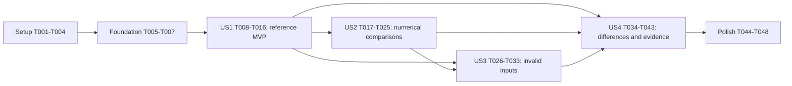

# Tasks: Verifiable Decision Ranking Reference

**Input**: Design documents from `specs/025-decision-ranking-reference/`

**Prerequisites**: [plan.md](plan.md), [spec.md](spec.md), [research.md](research.md), [data-model.md](data-model.md), [reference contract](contracts/reference-verification.md), [product boundary](contracts/existing-product-boundary.md), [quickstart.md](quickstart.md), and `.specify/memory/constitution.md`.

**Tests**: Required. Interpret “Use TD” as TDD, consistent with the user's prior requests and this verification feature. Write tests before each new behavior, capture meaningful behavioral red, implement the smallest correction, then retain green evidence. Import/setup failures are not behavioral red. Existing correct engine/validator behavior may pass immediately as a regression; do not alter formulas or source documents to manufacture failures.

**Organization**: Seven phases; four independently verifiable user-story increments. All 48 tasks are initially unchecked. Creating this list is not implementation or acceptance.

## Format: `[ID] [P?] [Story] Description`

- `[P]` means separate files with no dependency on the other tasks in the stated parallel group. Respect the prerequisite barriers below; it does not authorize automatic agent delegation.
- Story-phase tasks carry `[US1]`–`[US4]`; setup, foundation and polish tasks do not.
- All paths below are repository-relative. Existing production paths identify checks/reuse or a conditional, reproduced defect fix, not blanket rewrite authorization.

## Path Conventions

New test-only files live in `apps/api/core/decision_support/reference_tests/`, a sibling of the existing DB-backed `tests/`. Preserve `apps/api/core/decision_support/tests/conftest.py` and its catalog lifecycle. Use `apps/api/.venv` for pytest and root `.venv` for Spec Kit. Feature evidence belongs only to `specs/025-decision-ranking-reference/`; original source/reference and earlier feature evidence are protected.

## Phase 1: Setup (Shared Infrastructure)

**Purpose**: Establish the selected scope, environment and protected baseline without installing dependencies or changing product behavior.

- [X] T001 Capture actual cwd/branch, selected feature, tracked/untracked file hashes and relevant source copies in `specs/025-decision-ranking-reference/evidence/baseline.json`; verify `.specify/feature.json` selects 025 and protect all prior work, `docs/document (10).docx` and `docs/decision-support/09-ranking-reference.md`.
- [X] T002 [P] Record API Python/Django/pytest versions and safe settings prerequisites in `specs/025-decision-ranking-reference/evidence/environment.txt`; inspect `apps/api/core/pytest.ini` and existing venvs, preserve Django 4.2.11 and add no dependency installation, database reset or secret logging.
- [X] T003 [P] Inventory named reusable product checks, candidate feature-024 manifests/browser artifacts and evidence levels in `specs/025-decision-ranking-reference/evidence/coverage-inventory.json`, using `specs/025-decision-ranking-reference/contracts/existing-product-boundary.md`; missing artifacts remain candidates needing fresh checks, not acceptance.
- [X] T004 Create only the proposed sibling layout under `apps/api/core/decision_support/reference_tests/` and feature-local evidence directory; verify `apps/api/core/conftest.py` has no autouse DB fixture applicable there and preserve `apps/api/core/decision_support/tests/conftest.py` unchanged.

## Phase 2: Foundational (Blocking Prerequisites)

**Purpose**: Define shared fixture/observation boundaries and a database-blocked test seam before story behavior. This phase blocks all stories.

- [X] T005 Define common case/check field names and required-check registry in `apps/api/core/decision_support/reference_tests/ranking_reference_fixtures.py`, following `specs/025-decision-ranking-reference/data-model.md`: quote and enforce “classification `valid`, `invalid` or `representation`” and “Expected numbers are literal or documented analytical expressions independent of product/reference outputs”; include stable IDs, FR/story/SC tags, ordered inputs, expected outcomes and companion-case links without deriving goldens from evaluated code.
- [X] T006 Write boundary tests first in `apps/api/core/decision_support/reference_tests/test_ranking_reference_harness.py` for independent copied inputs, unchanged inputs after observation, error capture before assertion and blocked database access; enforce “Cases use copied input objects so neither evaluated function can affect the other's input” and “outcomes are captured before assertions, so a mismatch remains visible in a failed report.”
- [X] T007 Add the minimal shared observation/copying seam in `apps/api/core/decision_support/reference_tests/ranking_reference_support.py` and test-local fixtures in `apps/api/core/decision_support/reference_tests/conftest.py`; keep DB access blocked with no DB markers/fixtures/unblocking, no dispatcher/runtime imports and no untrusted evaluation. Retain meaningful boundary red/green in `specs/025-decision-ranking-reference/evidence/foundation.txt`; existing DB-blocker behavior is a regression, not a required manufactured red.

**Checkpoint**: Shared observations and fixtures are usable without database initialization; authentication, score comparison and reporting behavior remain story-owned.

## Phase 3: User Story 1 - Inspect a Faithful, Usable Reference (Priority: P1) — MVP

**Goal**: Preserve and authenticate the exact editable sample, describe its true interface and reproduce its published example.

**Independent Test**: Extract Markdown and DOCX independently, match reviewed digests/text, inspect five inputs/two outputs, and reproduce published SAW 1/.5 and TOPSIS 1/0 without changing authoritative files or touching product history.

### Tests for User Story 1 — write first

- [X] T008 [US1] Add reviewed DOCX/source/block digests, exact ordered argument names and the literal published Persian-label example to `apps/api/core/decision_support/reference_tests/ranking_reference_fixtures.py` using `specs/025-decision-ranking-reference/research.md`; enforce “Digests are constants, not regenerated expected values” and preserve original example names and analytical scores (FR-001–FR-003).
- [X] T009 [P] [US1] Add fidelity/interface tests to `apps/api/core/decision_support/reference_tests/test_ranking_reference.py`: unique implementation fence rather than signature fence, unique DOCX source paragraph, exact text except one separator LF, all pinned digests, five positional arguments, two method keys/repeated scores and absent numeric rank/distances (FR-001–FR-002).
- [X] T010 [P] [US1] Add temporary/in-memory counterfeit-source tests to `apps/api/core/decision_support/reference_tests/test_ranking_reference_harness.py`: changed Persian message/comment/whitespace, changed DOCX, missing/duplicate implementation fence and wrong callable/import/top-level shape must fail before evaluation; enforce “any extraction/identity/shape failure → failed, with no execution” and never mutate source documents (FR-001).
- [X] T011 [US1] Run the new fidelity/counterfeit tests and retain actual behavioral red plus command/exits in `specs/025-decision-ranking-reference/evidence/us1-red.txt`; ensure a missing fidelity guard is observed as a wrong outcome, not merely an import/setup failure, and do not execute unauthenticated code to obtain red.

### Implementation for User Story 1

- [X] T012 [US1] Implement exact extraction/authentication in `apps/api/core/decision_support/reference_tests/ranking_reference_support.py`: preserve DOCX text/breaks/tabs, allow only one Markdown separator LF difference, require all reviewed digests/source equality and expected AST/callable shape before compile; no duplicated engine or general code runner (FR-001–FR-002).
- [X] T013 [US1] Write published-example evaluation and full reference-row-shape assertions in `apps/api/core/decision_support/reference_tests/test_ranking_reference.py` before adding execution support; validate both method scores repeated across both lists, exact names/order and the absence of ranks/distances (FR-002–FR-003).
- [X] T014 [US1] Add authenticated test-local reference evaluation and independent observations to `apps/api/core/decision_support/reference_tests/ranking_reference_support.py`, using copied inputs and no product calculation import inside the reference namespace; preserve the sample unchanged and make the published-example tests pass (FR-003).
- [X] T015 [US1] Record source attribution, five-input/two-output description review and all sample omissions/limitations in the US1 section of `specs/025-decision-ranking-reference/validation.md`, referencing the existing document without rewriting it or asserting product acceptance (FR-001–FR-003, US1 scenarios 1–4).
- [X] T016 [US1] Run the complete US1 fidelity/example and counterfeit-source slice; retain green, source identities, zero-DB/no-input-mutation proof and actual observations in `specs/025-decision-ranking-reference/evidence/us1-green.txt`, completing the SC-001/MVP checkpoint only with evidence.

## Phase 4: User Story 2 - Compare Independent Ranking Results (Priority: P1)

**Goal**: Establish bounded numerical and exact-order agreement for the existing independent methods with analytical expectations and the preserved sample.

**Independent Test**: All required families produce finite expected scores within absolute 1e-9 and exact names/membership/order; scaled weights and reordered exact ties behave as specified, including TOPSIS .5 degeneracy.

### Tests for User Story 2 — write first

- [X] T017 [US2] Add the full literal valid catalog to `apps/api/core/decision_support/reference_tests/ranking_reference_fixtures.py` from `specs/025-decision-ranking-reference/contracts/reference-verification.md`: 1×1, 2×3 unequal/zero weights, 10×10 monotonic rows, benefit-only with valid zero, cost-only, mixed, identical/constant rows, EN/FA labels, scaled weights and genuine disagreement; enforce ordinary values `[0,1000]` with nonzero values at least 0.1 and independently derived expected scores/orders (FR-003–FR-007).
- [X] T018 [P] [US2] Write parametrized sample/SAW/TOPSIS-versus-expected and per-method parity tests in `apps/api/core/decision_support/reference_tests/test_ranking_reference.py` before comparator implementation; require finite scores, complete unique alternatives, exact names/order and `abs(actual-expected) <= 1e-9` with relative tolerance zero (FR-004–FR-005).
- [X] T019 [US2] Add proportional-weight and exact-tie permutation tests to `apps/api/core/decision_support/reference_tests/test_ranking_reference.py`, including zero-weight validation, constant positive columns, single/identical-row TOPSIS .5, unchanged inputs and disagreement orders; near-equal tolerance must not define ties (FR-006–FR-007).
- [X] T020 [P] [US2] Add comparator falsification cases to `apps/api/core/decision_support/reference_tests/test_ranking_reference_harness.py` for out-of-tolerance/non-finite scores, missing/duplicate alternative, wrong method score, changed label and wrong exact-tie order; test the tolerance boundary and reject shape errors before indexing (FR-004–FR-005).
- [X] T021 [US2] Retain meaningful new comparator behavioral red in `specs/025-decision-ranking-reference/evidence/us2-red.txt`; distinguish comparator discrepancy detection from already-green engine regressions and do not break a correct production formula to force red.

### Implementation for User Story 2

- [X] T022 [US2] Implement finite/shape/membership/order and absolute-score comparison in `apps/api/core/decision_support/reference_tests/ranking_reference_support.py`, enforcing “Valid scores must be finite; output membership is unique and complete; output shape is checked before indexing”; capture raw observations before comparison failures and keep extra product fields separate (FR-004–FR-007).
- [X] T023 [US2] Wire actual independent `compute_saw` and `compute_topsis` calls into `apps/api/core/decision_support/reference_tests/test_ranking_reference.py` using separate copied inputs; assert expected normalized weights/ordinal ranks and TOPSIS score/closeness aliases, while retaining separate existing distance checks rather than pretending distances come from the sample (FR-003–FR-007).
- [X] T024 [US2] Review any real mismatches and record an explicit defect/no-defect decision in `specs/025-decision-ranking-reference/validation.md`; only after reproduced behavioral red, minimally fix the demonstrated requirement violation in `apps/api/core/decision_support/services/saw_service.py`, `topsis_service.py`, `weights.py` or `validators.py` as actually affected, then run affected regressions. No mismatch means no production edit, not an incomplete task.
- [X] T025 [US2] Run all valid-family/invariant and falsification tests; retain exact case coverage, observed scores/orders and green results in `specs/025-decision-ranking-reference/evidence/us2-green.txt`, establishing SC-002 without a universal numeric-domain or display-precision claim.

## Phase 5: User Story 3 - Distinguish Invalid Inputs from Reference Limitations (Priority: P1)

**Goal**: Prove each invalid category is rejected, preserve located product feedback and explicitly classify representation/arithmetic limitations.

**Independent Test**: Separate cases for every invalid category reject in reference and both methods with relevant product paths; representation probes show observed established differences, not new input policy, and numeric extremes remain explicit exclusions.

### Tests for User Story 3 — write first

- [X] T026 [US3] Add separate invalid cases and expected reference rejection/product issue code-path pairs to `apps/api/core/decision_support/reference_tests/ranking_reference_fixtures.py`: zero/>10 criteria and alternatives, short/long vectors/row counts/widths, blank/duplicate names on both axes, invalid types, empty/null/nonnumeric/negative/non-finite weight/cell, all-zero weights, zero cost and all-zero benefit with zero/nonzero weight. Enforce “Invalid fixtures violate a named rule” and “Missing/null/empty-string/zero values remain distinguishable” (FR-008).
- [X] T027 [US3] Write invalid-category checks in `apps/api/core/decision_support/reference_tests/test_ranking_reference.py` before rejection-classifier behavior: inspect reference ValueError/TypeError and both engines' CodedValidationError, require relevant product paths and method-specific all-zero codes, and reject unexpected programming errors rather than counting any exception as acceptance (FR-008).
- [X] T028 [US3] Add representation probe fixtures to `apps/api/core/decision_support/reference_tests/ranking_reference_fixtures.py` for numeric text, boolean cell/weight, raw-versus-trimmed duplicate names, None name and trimmed type; encode each layer's current observed expectation instead of assuming all numeric strings are sample-only (FR-009).
- [X] T029 [US3] Write representation/classification tests in `apps/api/core/decision_support/reference_tests/test_ranking_reference.py`, preserving actual conversion behavior and distinguishing legitimate rejection checks from numerical disagreement; include a wrong/unexpected rejection case that the classifier must fail (FR-008–FR-009).
- [X] T030 [P] [US3] Record huge/tiny finite arithmetic exclusions, ordinary fixture bounds, current conversion differences and unresolved O03/O04 ownership in the US3 section of `specs/025-decision-ranking-reference/validation.md`; do not execute excluded cases as ordinary parity or silently introduce a numeric-domain policy (FR-009–FR-010).

### Implementation for User Story 3

- [X] T031 [US3] Capture meaningful classifier/rejection behavioral red in `specs/025-decision-ranking-reference/evidence/us3-red.txt`; separately label invalid cases already correctly rejected by existing validators as green regressions and keep real source documents unchanged.
- [X] T032 [US3] Extend `apps/api/core/decision_support/reference_tests/ranking_reference_support.py` to retain expected versus actual rejection class and product issue path/code, representation classification and input-before/after equality; enforce “Expected errors are successful rejection checks only when observed and asserted; unexpected errors remain failures” without modifying existing policy or demanding identical messages (FR-008–FR-010).
- [X] T033 [US3] Run every invalid/representation case and classifier falsification; retain category coverage, actual rejections/issues and green results in `specs/025-decision-ranking-reference/evidence/us3-green.txt`, verifying SC-003 and keeping arithmetic limitations explicit.

## Phase 6: User Story 4 - Review Product Differences and Acceptance Evidence (Priority: P2)

**Goal**: Produce honest structured observations, document six differences and establish product-boundary checks using fresh or attributable prior evidence.

**Independent Test**: A strict report retains failures/unrun observations; actual independent runs preserve history/access/weights; six difference categories and O01/O02 status are clear; EN/FA interaction proof is fresh or validly reused with source/artifact provenance.

### Tests for User Story 4 — write first

- [X] T034 [US4] Add reporter contract/falsification tests in `apps/api/core/decision_support/reference_tests/test_ranking_reference_harness.py` for required checks initialized unrun, setup/call/teardown failure, partial selection/missing observations, truncated/unreadable output and strict JSON non-finite tags; enforce “status becomes passed only after relevant assertions and pytest setup/call/teardown succeed” and “A failure remains failed, missing checks remain unrun” (FR-014).
- [X] T035 [US4] Retain reporter behavioral red and exact commands/exits in `specs/025-decision-ranking-reference/evidence/us4-red.txt`, proving failed/unrun observations cannot be falsely accepted; do not count JSON parse success alone as complete verification.

### Implementation for User Story 4

- [X] T036 [US4] Implement `--ranking-reference-report` and pytest lifecycle/status integration in `apps/api/core/decision_support/reference_tests/conftest.py`, with observation serialization in `ranking_reference_support.py`: schema version 1, UTC time, Git SHA plus dirty source hashes, pinned identities/versions/command/exit, expected/observed outcomes, reasons, levels and `passed|failed|unrun` status. Enforce “never emit non-standard JSON numeric NaN/Infinity”; use explicit non-finite tags, preserve pytest exits and never promote arithmetic-only proof to product/browser acceptance (FR-014).
- [X] T037 [P] [US4] Run the selected existing engine/validator/SAW-TOPSIS API/immutability/records/access tests listed in `specs/025-decision-ranking-reference/quickstart.md` and retain command/exits and named-check results in `specs/025-decision-ranking-reference/evidence/backend.txt`; verify no unrequested method, no blended ranking/automatic transfer, whole-record integrity and authorized scope using actual test DB behavior (FR-011, FR-013).
- [X] T038 [P] [US4] Write `specs/025-decision-ranking-reference/differences.md` with exactly the six FR-012 categories, sample omissions, current product additions, requirement/test references, separate distance/interaction proof limits and O01/O02 still open as final policy; preserve current ordinal ties/precision and source documents (FR-012, SC-005).
- [X] T039 [P] [US4] Evaluate candidate feature-024 EN/FA evidence against relevant dirty source hashes, artifact presence, original scenario/date/environment/command and scope; record per-scenario reuse/needs-fresh decisions in `specs/025-decision-ranking-reference/evidence/browser-provenance.json`, enforcing “candidate → accepted reuse when provenance and scope match, otherwise unrun/needs fresh check” and excluding secrets (FR-013–FR-014).
- [X] T040 [US4] Establish both-language keyboard/history/access/feedback evidence in `specs/025-decision-ranking-reference/evidence/browser.txt`: reference verified reused artifacts from T039 when eligible, otherwise run the filtered existing `apps/web/e2e/tests/decision-execution-records.spec.ts` command from quickstart and retain feature-local result/trace references. Any changed interaction requires fresh actual EN/FA proof; zero selected cases or missing artifacts is not success. Exclude old SC004 timing cases to protect earlier performance files (FR-013–FR-014).
- [X] T041 [US4] Run the implemented report option and reporter/harness suite, writing actual arithmetic observations to `specs/025-decision-ranking-reference/validation-reference.json` and green output to `specs/025-decision-ranking-reference/evidence/us4-green.txt`; validate all required fields, failure/unrun honesty, strict tags and preserved test exits (FR-014).
- [X] T042 [US4] Reconcile US4's four scenarios and SC-004–SC-006 in `specs/025-decision-ranking-reference/validation.md`, linking fresh product checks or verified reuse, actual unchanged inputs/history/access, six difference categories and evidence-level distinctions; incomplete required product checks remain visibly unrun and block acceptance (FR-011–FR-014).
- [X] T043 [US4] Verify no production module imports the test reference helper and that reference-only invocation remains DB-blocked/nonmutating; retain source-boundary and zero-write evidence in `specs/025-decision-ranking-reference/evidence/boundary.txt`, supplemented by T037's real access/immutability checks rather than equating source inspection with product enforcement (FR-013).

## Phase 7: Polish & Cross-Cutting Concerns

**Purpose**: Finish acceptance on the final changed tree, preserve prior work and report precise limits.

- [X] T044 Run the final complete sibling reference/harness suite with reporting from `specs/025-decision-ranking-reference/quickstart.md`, retaining final command/exits and report in `specs/025-decision-ranking-reference/evidence/reference-final.txt` and `validation-reference.json`; require all registered arithmetic checks, exact source identity and falsification cases, while retaining original red/green logs separately.
- [X] T045 Verify relevant source hashes for T037/T040 evidence still match the final changed tree in `specs/025-decision-ranking-reference/evidence/final-provenance.json`; rerun only affected checks if later changes invalidate them. Any actual production/UI/schema/locale change triggers its appropriate final tests/checks, including fresh EN/FA browser proof for changed interaction; report actual results and unrelated baseline limits.
- [X] T046 [P] Review runnable commands, proposed-versus-implemented wording, report path/status contract and difference links in `specs/025-decision-ranking-reference/quickstart.md` and `contracts/reference-verification.md`; update only necessary feature-local guidance and verify source documents/older plans remain unchanged.
- [X] T047 Compare protected baseline file hashes, expected new/changed paths, source DOCX/sample identity and `git diff --check`; retain results and no-secret artifact review in `specs/025-decision-ranking-reference/evidence/preservation.json`. Preserve unrelated dirty files and prior evidence; no commit/push/deploy or whole-module human sign-off is included.
- [X] T048 Finish the FR-001–FR-014/SC-001–SC-006/all-16-scenarios evidence ledger and actual test-count/limit summary in `specs/025-decision-ranking-reference/validation.md`; mark tasks complete only from their outcomes, keep unresolved acceptance gates unchecked, and explicitly distinguish fresh arithmetic/API/browser, source inspection and verified reused evidence.

## Dependencies & Execution Order

### Phase Dependencies

- Setup T001 establishes preservation; T002 and T003 can then run together. Complete T001–T004 before foundation.
- Foundation T005 → T006 → T007 blocks all stories. It supplies observation/copying seams, not reference authentication or score acceptance.
- US1 T008–T016 depends only on foundation and is the MVP. T009/T010 both depend on T008, not each other; T011 precedes T012. T013 precedes T014.
- US2 T017–T025 depends on US1's authenticated evaluator. T018/T020 both depend on T017; T019 follows T018 and precedes T021. T021 precedes T022/T023; T024 is the bounded defect/no-defect gate.
- US3 T026–T033 depends on US1 and the shared comparator/observations delivered by US2. T030 can run after T026 alongside T027 because it reviews limitations in a separate document. T031 precedes T032.
- US4 T034–T043 finalizes observations from US1–US3. T034 → T035 → T036; then T037/T038/T039 are independent. T040 follows T039 and T037 so service-backed regressions and browser execution are serialized. T041–T043 settle reporting and boundary acceptance before polish.
- Polish T044–T048 requires all stories. T046 can run alongside T044's test execution; T045 checks resulting source provenance, T047 checks preservation, T048 finalizes completion.

### User Story Completion Graph

US2/US3 share the authenticated evaluator and observation/comparator seam; ordering avoids concurrent edits to their shared fixture/helper/test files. Each story nevertheless has its own acceptance slice and observable value. US4's documentation/provenance preparation can be drafted early, but its completion needs all relevant observed outcomes.

### Within Each User Story

Tests → meaningful red for new behavior → minimal helper/fix → green → independently verified checkpoint. Already-correct engine/validator behavior is retained as a regression. Conditional production fixes must cite the exact failed case and requirement; modifying the reference or lowering tolerance to erase failure is forbidden.

## Parallel Execution Examples

### User Story 1

After T008, T009 writes fidelity/interface tests in `test_ranking_reference.py` while T010 writes counterfeit-source tests in `test_ranking_reference_harness.py`. Join both before T011. No simultaneous helper or fixture edits.

### User Story 2

After T017, T018 writes real parity tests in `test_ranking_reference.py` while T020 writes controlled bad-output tests in `test_ranking_reference_harness.py`. T019 extends T018's file sequentially. Join before T021 and comparator implementation.

### User Story 3

After T026, T027 writes rejection tests in `test_ranking_reference.py` while T030 records domain/conversion limitations in `specs/025-decision-ranking-reference/validation.md`. T028/T029 follow their fixture/test dependencies; do not concurrently edit the shared fixture or test file.

### User Story 4

After T036, T037 runs existing product tests into `evidence/backend.txt`, T038 writes `differences.md`, and T039 inspects prior artifacts into `evidence/browser-provenance.json`. They use separate outputs and need no result from one another. Join before real browser execution T040; serialize service-backed tests and browser work.

## Requirement and Outcome Coverage

| Scope | Primary tasks and checkpoint |
| --- | --- |
| FR-001–FR-002; SC-001; US1.1–US1.2 | T008–T012, T015–T016: exact source, attribution, interface, counterfeit rejection. |
| FR-003; US1.3–US1.4 | T013–T016 plus T018/T023 and T038: published numbers, actual shape and limitations. |
| FR-004–FR-007; SC-002; US2.1–US2.4 | T017–T025: complete valid catalog, exact order, bounded score tolerance, invariants/degeneracy. |
| FR-008–FR-010; SC-003; US3.1–US3.4 | T026–T033: every invalid category, located errors, actual representation differences and numeric limits. |
| FR-011; SC-004; US4.1 | T037, T040, T042–T043: actual independent runs, disagreement/no transfer and preserved records. |
| FR-012; SC-005; US4.2 | T038, T042: six difference categories, existing interim policy preserved; O01/O02 remain open. |
| FR-013; US4.3 | T006–T007, T037, T039–T040, T043/T047: no-DB arithmetic, real access/immutability and bilingual boundaries. |
| FR-014; SC-006; US4.4 | T034–T036, T039–T042, T044–T048: strict actual observations, failed/unrun honesty, provenance and final reconciliation. |

## Implementation Strategy

### MVP First (User Story 1 Only)

Complete setup/foundation and US1, then validate source fidelity, trusted evaluation, actual output shape and the published example. This is a reviewable reference MVP; it does not imply product or whole-module acceptance. Continue to the remaining authorized tasks during implementation rather than requesting routine approval.

### Incremental Delivery

Add US2 numerical comparisons, then US3 invalid/representation checks, then US4 reporting/differences/product evidence. Run each independent slice at its checkpoint and preserve evidence. Reuse working calculations/contracts; no endpoint, model, UI, dependency or numeric-policy addition is assumed.

### Parallel Team Strategy

Only the explicitly listed independent file/work groups are parallel opportunities. Shared fixtures/helper/test files stay serialized. Parallel markers do not constitute an instruction to spawn agents. No automatic commit, deployment or rewrite of earlier artifacts is included.

## Notes

48 tasks: setup 4, foundation 3, US1 9, US2 9, US3 8, US4 10, polish 5. 11 tasks carry `[P]`; parallel examples state the barriers and safe companions. All 16 source acceptance scenarios and six outcomes are mapped. Task generation runs no application tests and checks no implementation task off.

## Implementation completion

All 50 tasks completed with evidence in [validation.md](validation.md). Final reference/harness suite: 138 passed; fresh selected backend: 61 passed; eight unchanged EN/FA browser scenarios verified for reuse with source/trace provenance. No production defect or runtime change, original source/earlier work preserved, no commit/deploy.

## Phase 8: Convergence

Present-state assessment found two HIGH partial gaps in evidence completeness; arithmetic/product behavior and verified browser reuse remain established. Complete both through behavioral TDD, preserve existing task markers and earlier evidence, and refresh the affected reference report/acceptance ledger before claiming convergence.

- [X] T049 [US4] Capture explicit inputs, expected outcomes and actual observations for `test_fixture_invariants`, `test_reference_database_is_blocked` and `test_registry_requires_uncollected_falsifications` in `apps/api/core/decision_support/reference_tests/test_ranking_reference.py` and `test_ranking_reference_harness.py`; fix `conftest.py` and `ranking_reference_support.py` so empty helper events plus pytest phase bookkeeping cannot satisfy the observation requirement or produce a complete report. First reproduce that false acceptance with a lifecycle-level falsification, then require meaningful recorded evidence, keep bookkeeping-only checks unrun/incomplete and retain failed-phase behavior; run the affected/final suite and refresh `specs/025-decision-ranking-reference/validation-reference.json`, feature-local red/green evidence and `validation.md` per FR-014, SC-006, T034/T036 and plan: structured observations (partial).
- [X] T050 [US4] Strengthen `read_report` in `apps/api/core/decision_support/reference_tests/ranking_reference_support.py` to validate the required EvidenceRun provenance and VerificationCheck evidence-level fields at the reading boundary; first add falsification tests in `test_ranking_reference_harness.py` demonstrating that removing UTC time/source hashes/reference identities/versions/command or per-check evidence levels from a complete report is currently accepted. Reject missing or malformed required fields instead of returning complete acceptance, give synthetic reader fixtures valid metadata, preserve legitimate partial reports with explicit unrun observations, and retain strict JSON/ID/phase/exit validation. Run the full reference/harness suite and reconcile the report, feature-local evidence, `contracts/reference-verification.md` and `validation.md` per FR-014, SC-006, T041/T046 and plan: structured evidence contract (partial).

### Phase 8 completion

T049–T050 completed through retained behavioral red/green. Final reference/harness suite: 138 passed; current partial and main-file selections remain incomplete; actual setup/call/teardown faults remain failed. Existing 61-pass backend and eight EN/FA browser scenarios have revalidated unchanged-source/artifact provenance and were not rerun in this pass. See validation.md and evidence/convergence/.
