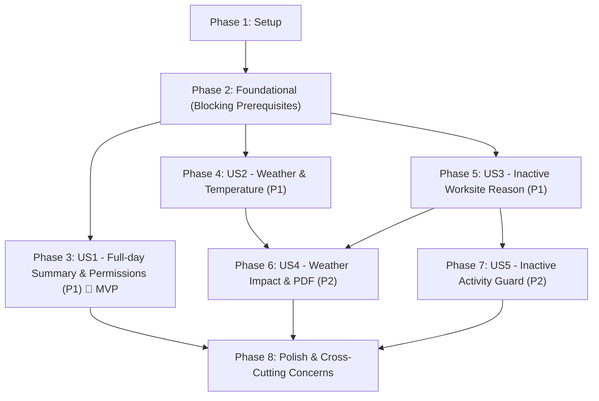

# Tasks: Daily Report Header and Weather Controls

**Input**: Design documents from `/specs/030-daily-header-weather/`
- Spec: [spec.md](./spec.md)
- Plan: [plan.md](./plan.md)
- Data Model: [data-model.md](./data-model.md)
- API Contract: [contracts/daily-report-header-weather-api.md](./contracts/daily-report-header-weather-api.md)
- UI Contract: [contracts/daily-report-header-weather-ui.md](./contracts/daily-report-header-weather-ui.md)
- Research: [research.md](./research.md)
- Quickstart & Verification: [quickstart.md](./quickstart.md)

**Prerequisites**: plan.md (required), spec.md (required for user stories), research.md, data-model.md, contracts/

**Tests**: Test-Driven Development (TDD) approach requested. All test tasks must be written first and observed to FAIL before implementing the corresponding features.

**Organization**: Tasks are grouped by user story to enable independent implementation and testing of each story.

## Format: `[ID] [P?] [Story] Description`

- **[P]**: Can run in parallel (different files, no dependencies)
- **[Story]**: Which user story this task belongs to (e.g., [US1], [US2], [US3], [US4], [US5])
- All descriptions include exact file paths and quoted verbatim constraints where applicable

## Path Conventions

- Backend (Django 4.2 + DRF): `apps/api/core/`
- Frontend (React Router 7 + Vite): `apps/web/src/`
- End-to-End Tests (Playwright): `e2e/tests/`

---

## Phase 1: Setup (Shared Infrastructure)

**Purpose**: Test infrastructure initialization, baseline verification, and test file skeletons

- [x] T001 Configure and verify test infrastructure for daily report header and weather tests in `apps/api/core/pytest.ini` and verify PostgreSQL/Redis test database connectivity
- [x] T002 [P] Create initial test suite file skeleton for focused header and weather verification in `apps/api/core/field_reports/tests/test_spec_01_daily_header_weather.py`
- [x] T003 [P] Create initial Playwright E2E test file skeleton for daily report header, weather, and activity guard verification in `e2e/tests/daily-report-header-weather.spec.ts`

---

## Phase 2: Foundational (Blocking Prerequisites)

**Purpose**: Core infrastructure, shared vocabulary standardization, data migration, and base localization that MUST be complete before ANY user story can be implemented

**⚠️ CRITICAL**: No user story work can begin until this phase is complete. Legacy weather values must be normalized before new choice restrictions take effect.

- [x] T004 Standardize `WeatherCondition` choices in `apps/api/core/field_reports/models.py` to the five approved values: `CLEAR = 'clear', 'آفتابی / صاف'`, `CLOUDY = 'cloudy', 'ابری'`, `RAINY = 'rainy', 'بارانی'`, `SNOWY = 'snowy', 'برفی'`, `STORMY = 'stormy', 'طوفانی / گرد و غبار'` (retiring `sunny`, `partly_cloudy`, `foggy`)
- [x] T005 [P] Update shared weather condition TypeScript type and choices in `apps/web/src/app/lib/api/weather.ts` to `"clear" | "cloudy" | "rainy" | "snowy" | "stormy"` and remove `sunny`, `partly_cloudy`, `foggy`
- [x] T006 [P] Update `WEATHER_META` and `WeatherCondition` in `apps/web/src/app/lib/api/daily-reports.ts` to use only the five approved values: `clear` ("آفتابی / صاف"), `cloudy` ("ابری"), `rainy` ("بارانی"), `snowy` ("برفی"), `stormy` ("طوفانی / گرد و غبار")
- [x] T007 [P] Update Persian and English base localization dictionaries in `apps/web/src/app/locales/fa.json` and `apps/web/src/app/locales/en.json` with keys for the five weather conditions (`clear`, `cloudy`, `rainy`, `snowy`, `stormy`), five inactivity reasons (`weather`, `holiday`, `strike_or_dispute`, `client_stop_order`, `safety_incident`), validation error codes (`temp_max_must_be_gte_temp_min`, `inactivity_reason_required`), and inactive activity confirmation warning dialog
- [x] T008 Write data migration in `apps/api/core/field_reports/migrations/0018_daily_header_weather.py` to normalize legacy rows in `daily_reports` and `weather_logs`: `sunny -> clear`, `partly_cloudy -> cloudy`, `foggy -> cloudy` before altering field choices, adding `weather_impact_notes` (`text, blank, default ''`), `inactivity_reason` (`choice, blank, default '', max length sufficient for strike_or_dispute and client_stop_order` / `max_length=30`), and decimal range validators on `temp_min` and `temp_max` (`decimal(5,1), nullable, inclusive -40..60`)
- [x] T009 Write dependent data migration in `apps/api/core/sub_reports/migrations/0004_standardize_weather.py` depending on `0018_daily_header_weather.py` to normalize legacy rows in `discipline_sub_reports`: `sunny -> clear`, `partly_cloudy -> cloudy`, `foggy -> cloudy` before altering `weather_condition` choices to the five approved values
- [x] T010 Update development seed data in `apps/api/core/projects/seeds/full_project.py` to replace all references to `sunny`, `partly_cloudy`, and `foggy` with approved values (`clear`, `cloudy`)

**Checkpoint**: Shared vocabulary standardized, legacy data normalized, and schema foundation ready. User story implementation can now begin.

---

## Phase 3: User Story 1 - Open the authorized full-day summary (Priority: P1) 🎯 MVP

**Goal**: An authorized project user opens a date and receives the single 24-hour project daily report assembled from specialty-unit reports. The report header represents the whole day, while shift detail remains on activity and personnel rows. A viewer can inspect an existing summary via `GET by-date` without mutation but cannot cause a new summary record to be created (`POST by-date` requires `edit_reports`); direct blank creation remains blocked with `auto_summary_only`.

**Independent Test**: Open the same project/date as an editor and as a viewer, then attempt both the date-based create-or-open operation and direct blank creation. Verify that only the editor can cause the date summary shell to be created, direct blank creation remains unavailable with status 400 and code `auto_summary_only`, and the resulting header is full-day.

### Tests for User Story 1 (TDD - Write FIRST, ensure they FAIL before implementation) ⚠️

- [x] T011 [P] [US1] Write failing test for `GET /daily-reports/by-date/?date=YYYY-MM-DD` read-only behavior in `apps/api/core/field_reports/tests/test_daily_report_by_date.py`: assert `view_reports` permission reads existing report with 200, returns 404 when report does not exist without creating any database records or child rows, and asserts row count does not change
- [x] T012 [P] [US1] Write failing test for `POST /daily-reports/by-date/` permission and concurrency in `apps/api/core/field_reports/tests/test_daily_report_summary_permissions.py`: assert caller with only `view_reports` receives 403 Forbidden on POST, caller with `edit_reports` receives 200/201, and concurrent POSTs serialize on project lock returning exactly one logical full-day report shell (`shift='full'`)
- [x] T013 [P] [US1] Write failing test for direct collection creation rejection in `apps/api/core/field_reports/tests/test_daily_report_by_date.py`: assert `POST /daily-reports/` returns HTTP 400 with stable error code `auto_summary_only` for both editors and viewers

### Implementation for User Story 1

- [x] T014 [US1] Update `required_permission` and `get_permissions` on `DailyReportViewSet` in `apps/api/core/field_reports/daily_report_views.py` so that `by_date` action requires `view_reports` on GET and `edit_reports` on POST
- [x] T015 [US1] Refactor `by_date` method in `apps/api/core/field_reports/daily_report_views.py` to separate GET and POST: GET queries existing non-deleted current `shift=full` report and returns 404 if missing without calling `ensure_daily_report_summary`; POST calls `ensure_daily_report_summary`
- [x] T016 [US1] Add project row locking (`Project.objects.select_for_update().get(id=project_id)`) inside `ensure_daily_report_summary` in `apps/api/core/field_reports/services/daily_report_aggregation.py` within the atomic transaction to serialize concurrent date ensure calls
- [x] T017 [P] [US1] Update `apps/web/src/app/lib/api/daily-reports.ts` to add separate `getDailyReportByDate(projectId, date)` using GET and `ensureDailyReportByDate(projectId, date)` using POST
- [x] T018 [US1] Update `apps/web/src/app/routes/daily-reports-list.tsx` to verify no «گزارش جدید» / "New report" button exists, and route date navigation to `ensureDailyReportByDate` for users with `edit_reports` or `getDailyReportByDate` with a localized no-data empty state for view-only users
- [x] T019 [US1] Update `apps/web/src/components/daily_reports/ReportHeader.tsx` to display full-day coverage (remove header-level shift selection in daily report summary mode), while preserving row-level shift fields on activity rows (`shift_1`, `shift_2`, `shift_3`) and workforce shift-count columns (`shift_1_count`, `shift_2_count`, `shift_3_count`)

**Checkpoint**: User Story 1 is functional and testable independently. Date-based ensure/read permission separation is strictly enforced, concurrent access produces exactly one summary shell, and direct blank creation remains blocked.

---

## Phase 4: User Story 2 - Record standardized weather and valid temperatures (Priority: P1)

**Goal**: An authorized editor records daily weather using the five official Shiraz-form categories (`clear`, `cloudy`, `rainy`, `snowy`, `stormy`) and bounded minimum/maximum temperatures. Invalid weather values, out-of-range temperatures outside `[-40, 60]`, and reversed minimum/maximum values (`temp_max < temp_min`) are blocked with field-specific guidance and stable error code `temp_max_must_be_gte_temp_min`. Weather reconciliation during auto-summary follows deterministic severity order (`stormy > snowy > rainy > cloudy > clear`).

**Independent Test**: Save one header for each allowed weather category, then try each retired category, both temperature boundaries (-40°C and +60°C), values just outside the boundaries, and a maximum below the minimum. Verify accepted and rejected outcomes and their field-specific error codes.

### Tests for User Story 2 (TDD - Write FIRST, ensure they FAIL before implementation) ⚠️

- [x] T020 [P] [US2] Write failing tests for weather condition choices and legacy rejection in `apps/api/core/field_reports/tests/test_spec_01_daily_header_weather.py`: assert `DailyReport`, `WeatherLog`, and `DisciplineSubReport` accept `clear`, `cloudy`, `rainy`, `snowy`, `stormy`; assert new submissions of `sunny`, `partly_cloudy`, `foggy`, or unknown strings are rejected with 400
- [x] T021 [P] [US2] Write failing tests for temperature validation and partial updates in `apps/api/core/field_reports/tests/test_spec_01_daily_header_weather.py`: assert `temp_min` and `temp_max` within `[-40, 60]` inclusive are accepted; assert values <-40 or >60 fail with field-level errors; assert partial PATCH updating only `temp_max < stored temp_min` or `temp_min > stored temp_max` returns HTTP 400 with stable code `temp_max_must_be_gte_temp_min` attached to `temp_max`
- [x] T022 [P] [US2] Write failing tests for weather aggregation severity order in `apps/api/core/field_reports/tests/test_spec_01_daily_header_weather.py`: assert multiple specialty reports reconcile weather according to descending severity `stormy > snowy > rainy > cloudy > clear` (`50 > 40 > 30 > 20 > 10`), and that `weather_override=true` preserves project-level override
- [x] T023 [P] [US2] Write failing tests for standalone `WeatherLog` temperature bounds and cross-field check in `apps/api/core/field_reports/tests/test_weather.py`: assert `temp_min` and `temp_max` validation rules and `temp_max_must_be_gte_temp_min` error attachment

### Implementation for User Story 2

- [x] T024 [US2] Implement model-level validators `MinValueValidator(-40)` and `MaxValueValidator(60)` for `temp_min` and `temp_max` (`decimal(5,1), nullable, inclusive -40..60`) and cross-field check in `clean()` method of `DailyReport` and `WeatherLog` in `apps/api/core/field_reports/models.py`
- [x] T025 [US2] Implement temperature validation and cross-field check merging partial PATCH inputs with existing instance values in `DailyReportSerializer`, `DailyReportHeaderUpdateSerializer`, and `WeatherLogSerializer` in `apps/api/core/field_reports/serializers.py`, raising coded validation error with code `temp_max_must_be_gte_temp_min` attached to `temp_max`
- [x] T026 [US2] Update `WEATHER_SEVERITY` dictionary in `apps/api/core/field_reports/services/daily_report_aggregation.py` to `{WeatherCondition.STORMY: 50, WeatherCondition.SNOWY: 40, WeatherCondition.RAINY: 30, WeatherCondition.CLOUDY: 20, WeatherCondition.CLEAR: 10}` and update `aggregate_weather` to reconcile using the 5 standard conditions
- [x] T027 [P] [US2] Update weather icons and color mapping in `apps/web/src/components/weather/weather-icons.tsx` to support the five standard conditions (`clear`, `cloudy`, `rainy`, `snowy`, `stormy`) and remove retired `sunny`, `partly_cloudy`, `foggy`
- [x] T028 [P] [US2] Update weather selection controls in `apps/web/src/components/sub_reports/SpecialtyContributionForm.tsx` to use the five standardized weather options
- [x] T029 [P] [US2] Update standalone weather drawer in `apps/web/src/components/weather/weather-log-drawer.tsx` to use the five weather options and enforce `min="-40"`, `max="60"`, `step="0.1"` with client-side and server-side temperature validation
- [x] T030 [US2] Update temperature inputs and weather selector in `apps/web/src/components/daily_reports/ReportHeader.tsx` and `apps/web/src/app/routes/daily-report-view.tsx` with `min="-40"`, `max="60"`, `step="0.1"`, client-side cross-field validation, and server error mapping for `temp_max_must_be_gte_temp_min`

**Checkpoint**: User Stories 1 and 2 work independently. All five weather conditions are supported across models, aggregation, and UI surfaces; temperature boundaries and ordering rules are enforced with precise error codes.

---

## Phase 5: User Story 3 - Explain an inactive worksite (Priority: P1)

**Goal**: When an authorized editor marks the site inactive (`site_status='inactive'`), the editor must select one standardized reason (`weather`, `holiday`, `strike_or_dispute`, `client_stop_order`, `safety_incident`). An inactive report without a reason is rejected with stable code `inactivity_reason_required`. When the site is active (`site_status='active'`), `inactivity_reason` is cleared (`''`). Rebuilding preserves an existing valid reason when derived inactive or leaves it requiring human classification, and clears it when derived active.

**Independent Test**: Toggle the site between active and inactive, attempt to save without a reason, then save once for each allowed reason and reopen the report.

### Tests for User Story 3 (TDD - Write FIRST, ensure they FAIL before implementation) ⚠️

- [x] T031 [P] [US3] Write failing tests for inactivity reason requirement and active clearing in `apps/api/core/field_reports/tests/test_spec_01_daily_header_weather.py`: assert saving or updating `site_status='inactive'` with empty `inactivity_reason` returns HTTP 400 with stable error code `inactivity_reason_required` on `inactivity_reason`; assert all five allowed reasons (`weather`, `holiday`, `strike_or_dispute`, `client_stop_order`, `safety_incident`) succeed; assert saving `site_status='active'` clears `inactivity_reason` to `''`
- [x] T032 [P] [US3] Write failing tests for lifecycle transitions with inactive site in `apps/api/core/field_reports/tests/test_spec_01_daily_header_weather.py`: assert submit, review, and approve endpoints reject an inactive daily report if `inactivity_reason` is empty with `inactivity_reason_required`
- [x] T033 [P] [US3] Write failing tests for aggregation rebuild inactivity reason behavior in `apps/api/core/field_reports/tests/test_daily_report_summary_metadata.py`: assert rebuild when specialty reports derive inactive preserves existing valid reason or keeps blank draft without inventing fake reasons; assert rebuild when all specialty reports are active sets active and clears `inactivity_reason`

### Implementation for User Story 3

- [x] T034 [US3] Define `InactivityReason(models.TextChoices)` and add `inactivity_reason` field (`CharField, max_length=30, choices=InactivityReason.choices, blank=True, default=''`) to `DailyReport` in `apps/api/core/field_reports/models.py`, with model clean validation enforcing `inactivity_reason` when `site_status == 'inactive'` and clearing `inactivity_reason = ''` when `site_status == 'active'`
- [x] T035 [US3] Add `inactivity_reason` to `DailyReportSerializer`, `DailyReportHeaderUpdateSerializer`, and workflow transition serializers in `apps/api/core/field_reports/serializers.py`, validating that inactive site requires one of the 5 allowed reasons and raising coded validation error with code `inactivity_reason_required` on `inactivity_reason`, and forcing `inactivity_reason = ''` when `site_status == 'active'`
- [x] T036 [US3] Update `rebuild_daily_report_summary` in `apps/api/core/field_reports/services/daily_report_aggregation.py` to preserve existing valid `inactivity_reason` when deriving inactive site without `site_status_override`, and clear `inactivity_reason` when deriving active site
- [x] T037 [US3] Update `ReportHeader.tsx` and `daily-report-view.tsx` in `apps/web/src/components/daily_reports/ReportHeader.tsx` and `apps/web/src/app/routes/daily-report-view.tsx`: conditionally reveal `inactivity_reason` select when `site_status === 'inactive'` containing the five localized reasons, remove from focus order and clear when `site_status === 'active'`, block client-side submission if inactive without a reason, and map server error `inactivity_reason_required` to the reason select

**Checkpoint**: User Stories 1, 2, and 3 work independently. Inactive sites require an explicit reason from the five approved categories, clearing active reports is automatic, and lifecycle approvals enforce reason completeness.

---

## Phase 6: User Story 4 - Preserve weather impact context in the official report (Priority: P2)

**Goal**: An authorized editor can add optional `weather_impact_notes` explaining how weather affected work. The text is preserved across save, read, automatic rebuilds, correction copies, and sync. Both `weather_impact_notes` and the localized `inactivity_reason` (when inactive) appear in the official daily-report PDF header table.

**Independent Test**: Save multilingual weather-impact text, reopen the report, produce the official PDF, and compare the displayed text and inactive reason with the saved header.

### Tests for User Story 4 (TDD - Write FIRST, ensure they FAIL before implementation) ⚠️

- [x] T038 [P] [US4] Write failing tests for `weather_impact_notes` persistence and preservation in `apps/api/core/field_reports/tests/test_spec_01_daily_header_weather.py`: assert optional Persian and English text in `weather_impact_notes` is saved and read back without truncation; assert automatic summary rebuild does not overwrite or wipe `weather_impact_notes`
- [x] T039 [P] [US4] Write failing tests for correction copy and sync batch preservation in `apps/api/core/field_reports/tests/test_daily_report_gaps_correction.py` and `apps/api/core/field_reports/tests/test_sync_batch.py`: assert correction version copies `weather_impact_notes`, `inactivity_reason`, weather, and temperatures; assert sync-batch header comparison and conflict detection include both fields
- [x] T040 [P] [US4] Write failing tests for official PDF content extraction in `apps/api/core/field_reports/tests/test_spec_01_daily_header_weather.py`: assert generated PDF contains non-empty `weather_impact_notes` in a labeled header row and localized `inactivity_reason` when inactive, asserting extracted text with `pypdf` / `pdftotext`

### Implementation for User Story 4

- [x] T041 [US4] Add `weather_impact_notes` field (`TextField, blank=True, default=''`) to `DailyReport` in `apps/api/core/field_reports/models.py`
- [x] T042 [US4] Add `weather_impact_notes` to `DailyReportDetailSerializer`, `DailyReportHeaderUpdateSerializer`, and auto-summary serializers in `apps/api/core/field_reports/serializers.py`
- [x] T043 [US4] Update `create_correction_version` in `apps/api/core/field_reports/services/correction_service.py` to copy `weather_impact_notes` and `inactivity_reason` to the new version
- [x] T044 [US4] Update sync conflict detection in `apps/api/core/field_reports/views.py` to include `weather_impact_notes` and `inactivity_reason` in header comparison
- [x] T045 [US4] Update PDF generator in `apps/api/core/field_reports/pdf.py` to render `weather_impact_notes` row (when non-empty) and localized `inactivity_reason` (when inactive) in the header specification table
- [x] T046 [US4] Add `weather_impact_notes` multiline textarea to `ReportHeader.tsx` and `daily-report-view.tsx` in `apps/web/src/components/daily_reports/ReportHeader.tsx` and `apps/web/src/app/routes/daily-report-view.tsx`

**Checkpoint**: User Stories 1 through 4 work independently. Weather-impact notes survive rebuilds, version copies, and sync, and are printed in the official PDF header table alongside inactive reasons.

---

## Phase 7: User Story 5 - Confirm activity on an inactive day (Priority: P2)

**Goal**: If the site is marked inactive (`site_status === 'inactive'`) but a user creates or edits an execution activity whose quantity is greater than zero (`quantity > 0`), the system pauses saving and displays an accessible confirmation dialog: «کارگاه در این تاریخ تعطیل ثبت شده است؛ آیا از ثبت کارکرد اجرایی اطمینان دارید؟». Cancelling makes no network/queue writes and suppresses duplicate autosave loops; confirming proceeds with the save once. Active site or zero quantity does not trigger the warning. Offline queueing and IndexedDB schema upgrade normalize legacy weather values.

**Independent Test**: On an inactive report, create and edit rows with zero and positive quantities, then cancel and confirm the warning. Repeat on an active report to verify the warning boundary.

### Tests for User Story 5 (TDD - Write FIRST, ensure they FAIL before implementation) ⚠️

- [x] T047 [P] [US5] Write failing unit/component tests for inactive activity confirmation guard in `apps/web/src/components/daily_reports/__tests__/activity-guard.test.tsx`: assert confirmation dialog opens with exact Persian text «کارگاه در این تاریخ تعطیل ثبت شده است؛ آیا از ثبت کارکرد اجرایی اطمینان دارید؟» when `site_status === 'inactive'` and `quantity > 0`; assert cancel aborts save without network/offline queue call and suppresses autosave loop; assert confirm proceeds with save exactly once; assert active status or zero quantity does not trigger dialog
- [x] T048 [P] [US5] Write failing tests for IndexedDB offline upgrade and payload normalization in `apps/web/src/app/lib/__tests__/offlineDB.test.ts`: assert DB version increment normalizes `sunny -> clear`, `partly_cloudy -> cloudy`, and `foggy -> cloudy` in cached `offline_daily_reports` and pending `offline_queue` payloads without losing queue identity or retry state

### Implementation for User Story 5

- [x] T049 [US5] Implement pre-save guard support in `apps/web/src/components/daily_reports/InlineGridTab.tsx` and `apps/web/src/components/daily_reports/EditableGrid.tsx` allowing parent tab to intercept row saving before API call or offline queueing
- [x] T050 [US5] Implement inactive-site activity confirmation dialog component and pre-save guard logic in `apps/web/src/components/daily_reports/ActivityTab.tsx`: parse normalized numeric quantity, check against current header `site_status`, display accessible Radix dialog with Persian prompt «کارگاه در این تاریخ تعطیل ثبت شده است؛ آیا از ثبت کارکرد اجرایی اطمینان دارید؟» and English equivalent, handle cancel (suppress repeat autosave for unchanged snapshot, restore focus), and handle confirm (resume save)
- [x] T051 [US5] Increment IndexedDB schema version and add data migration in `apps/web/src/app/lib/offlineDB.ts` to normalize legacy weather values (`sunny -> clear`, `partly_cloudy -> cloudy`, `foggy -> cloudy`) across cached reports and queue payloads, preserving retry counters and payload identity
- [x] T052 [US5] Update offline write helpers in `apps/web/src/app/lib/offlineWrite.ts` and `apps/web/src/app/lib/syncService.ts` to include `weather_impact_notes` and `inactivity_reason` in cached daily report schemas, sync-batch payloads, and conflict resolution views

**Checkpoint**: All user stories are complete and independently functional. Activity rows with positive quantity on inactive days require deliberate acknowledgment, online and offline, without causing infinite autosave loops.

---

## Phase 8: Polish & Cross-Cutting Concerns

**Purpose**: Verification, cleanup, typecheck, documentation, and blueprint schema conformance

- [x] T053 [P] Run and verify complete Playwright E2E test suite in `e2e/tests/daily-report-header-weather.spec.ts` covering editor/viewer date access, weather & temperature boundary validation, inactive reason requirement, weather impact in PDF, activity warning on inactive day, and offline replay
- [x] T054 [P] Audit all frontend code in `apps/web/src` and `e2e` for retired weather values (`sunny`, `partly_cloudy`, `foggy`) to confirm zero active UI or metadata occurrences remain except migration/test assertions
- [x] T055 Run full backend regression test suite in `apps/api/core` via `../.venv/bin/python -m pytest field_reports/tests sub_reports/tests -q` to confirm zero regressions across all daily report and specialty report capabilities
- [x] T056 [P] Update API documentation in `apps/api/core/field_reports/ENDPOINTS.md` and `apps/api/core/sub_reports/ENDPOINTS.md` reflecting the five-value weather condition, temperature boundaries, `weather_impact_notes`, and `inactivity_reason`
- [x] T057 Run blueprint schema verification command `python manage.py verify_blueprint_schema` in `apps/api/core` to ensure schema integrity against the system blueprint

---

## Dependencies & Execution Order

### Phase Dependencies

- **Setup (Phase 1)**: No dependencies - starts immediately
- **Foundational (Phase 2)**: Depends on Setup completion - **BLOCKS all user stories**
- **User Story 1 (Phase 3)**: Depends on Foundational (Phase 2) completion - core MVP shell and permissions
- **User Story 2 (Phase 4)**: Depends on Foundational (Phase 2) completion - standardized weather and temperatures
- **User Story 3 (Phase 5)**: Depends on Foundational (Phase 2) completion - worksite inactivity reason
- **User Story 4 (Phase 6)**: Depends on US2 and US3 - weather-impact notes and PDF output incorporating weather and inactivity reasons
- **User Story 5 (Phase 7)**: Depends on US3 - inactive site activity confirmation guard
- **Polish (Phase 8)**: Depends on all user stories (Phases 3–7) being complete



### User Story Dependencies

- **User Story 1 (P1)**: Independent of other stories after Foundation; establishes date lookup vs ensure permission boundary.
- **User Story 2 (P1)**: Independent of other stories after Foundation; establishes five-value weather and temperature constraints.
- **User Story 3 (P1)**: Independent of other stories after Foundation; establishes inactive-site reason requirement and active clearing.
- **User Story 4 (P2)**: Integrates weather from US2 and inactivity reason from US3 into persistent notes and official PDF output.
- **User Story 5 (P2)**: Integrates with site status from US3 to trigger confirmation on positive activity quantities.

### Within Each User Story (TDD Workflow)

1. **Write failing tests FIRST** and execute to ensure they fail with the expected error.
2. **Implement minimal backend model & serializer changes**.
3. **Implement services, aggregation, and workflow changes**.
4. **Implement frontend client UI and components**.
5. **Run story-specific tests** to confirm green pass before advancing.

---

## Parallel Opportunities

- **Phase 1 (Setup)**: T002 and T003 can run in parallel with T001.
- **Phase 2 (Foundational)**: T005, T006, and T007 can be executed concurrently after T004.
- **Phase 3 (US1)**: Test tasks T011, T012, T013 can be written concurrently; API client task T017 can run in parallel with backend tasks.
- **Phase 4 (US2)**: Test tasks T020, T021, T022, T023 can be written in parallel; UI components T027, T028, T029 can be implemented concurrently.
- **Phase 5 (US3)**: Test tasks T031, T032, T033 can be written in parallel.
- **Phase 6 (US4)**: Test tasks T038, T039, T040 can be written in parallel; PDF generator T045 and frontend textarea T046 can be implemented in parallel.
- **Phase 7 (US5)**: Test tasks T047 and T048 can be written in parallel.
- **Phase 8 (Polish)**: T053, T054, and T056 can be run concurrently.

---

## Parallel Execution Examples

### Parallel Example: User Story 1 Tests
```bash
# Launch test creation for User Story 1 together:
Task T011: apps/api/core/field_reports/tests/test_daily_report_by_date.py
Task T012: apps/api/core/field_reports/tests/test_daily_report_summary_permissions.py
Task T013: apps/api/core/field_reports/tests/test_daily_report_by_date.py
```

### Parallel Example: User Story 2 UI Components
```bash
# Launch UI components for User Story 2 together:
Task T027: apps/web/src/components/weather/weather-icons.tsx
Task T028: apps/web/src/components/sub_reports/SpecialtyContributionForm.tsx
Task T029: apps/web/src/components/weather/weather-log-drawer.tsx
```

---

## Implementation Strategy

### MVP First (User Story 1 Only)

1. Complete **Phase 1: Setup** (T001–T003).
2. Complete **Phase 2: Foundational** (T004–T010).
3. Complete **Phase 3: User Story 1** (T011–T019).
4. **STOP and VALIDATE**: Run `apps/api/core/field_reports/tests/test_daily_report_by_date.py` and `test_daily_report_summary_permissions.py`. Verify that `GET by-date` is read-only, `POST by-date` requires `edit_reports`, and raw create returns 400 `auto_summary_only`.
5. Deploy/demo the core full-day summary permission model.

### Incremental Delivery

1. **Sprint 1 (Foundation & MVP)**: Setup + Foundational + User Story 1 → Delivers secure full-day summary date lookup.
2. **Sprint 2 (Weather & Temperature)**: User Story 2 → Delivers standardized 5-state weather and temperature range/ordering validation.
3. **Sprint 3 (Inactive Explanations & Context)**: User Story 3 + User Story 4 → Delivers mandatory inactivity reason and weather-impact notes in PDF.
4. **Sprint 4 (Guards & Resilience)**: User Story 5 + Polish → Delivers inactive activity confirmation dialog, offline IndexedDB upgrade, and full E2E test suite.

---

## Notes

- All tasks strictly adhere to the checklist format: `- [ ] [TaskID] [P?] [Story?] Description with file path`
- For TDD compliance, write test tasks first and confirm failure prior to writing implementation code.
- Database migrations: `0018_daily_header_weather.py` in `field_reports` and `0004_standardize_weather.py` in `sub_reports`.
- Stable error codes: `temp_max_must_be_gte_temp_min`, `inactivity_reason_required`, `auto_summary_only`.
- Always run tests with `pytest` in `apps/api/core` with root `.env` loaded, and preserve pinned `Django==4.2.11`.
