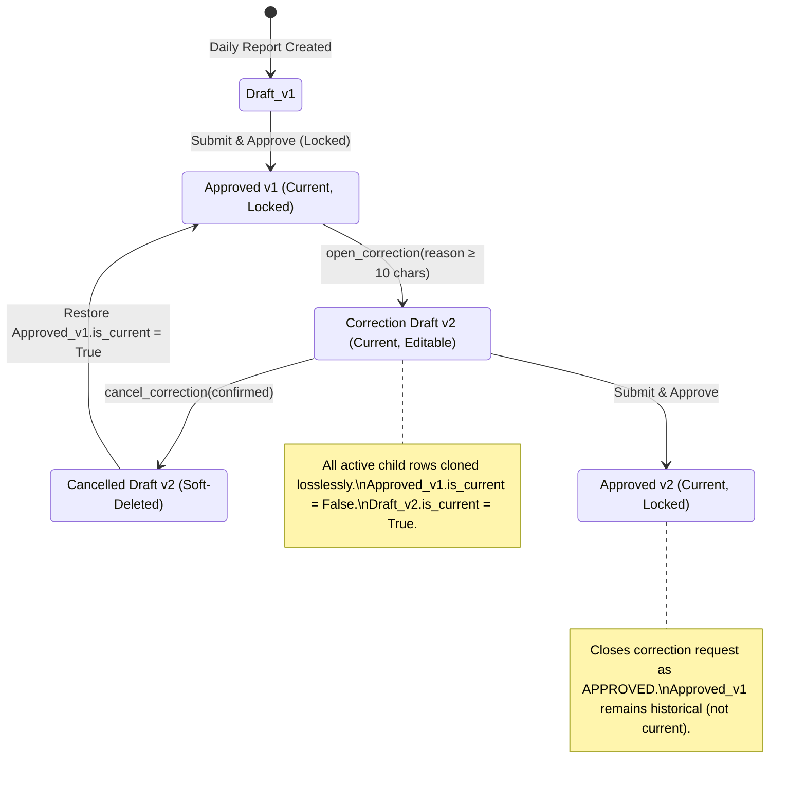

# Data Model: Daily Report Correction Lineage and Lossless Cloning

**Feature**: `035-correction-lineage-cloning`  
**Date**: 2026-10-27  
**Status**: Complete  

## 1. Domain Entities & Lineage Hierarchy

---

## 2. Model Specifications

### 2.1 `DailyReport`
Represents an immutable historical snapshot or current active daily operational report.

| Field | Type | Description |
|---|---|---|
| `id` | `UUID` (PK) | Unique report identifier |
| `project` | `ForeignKey(Project)` | Project scope (tenant boundary) |
| `report_date` | `DateField` | Operational date of the report |
| `version_number` | `PositiveIntegerField` | Monotonically increasing version index (1, 2, 3...) |
| `lineage_id` | `UUID` | Shared UUID linking all iterations of the report for this date |
| `supersedes` | `ForeignKey(DailyReport, null=True)` | Direct pointer to predecessor version |
| `status` | `CharField` | Workflow state: `draft`, `submitted`, `under_review`, `approved`, `rejected` |
| `is_current` | `BooleanField` | True if this is the active visible version for the report date (exactly one per lineage) |
| `is_deleted` | `BooleanField` | Soft delete flag |
| `prepared_by` | `ForeignKey(User)` | Author who initialized this version |
| `created_by` / `updated_by` | `ForeignKey(User)` | Audit user references |
| `created_at` / `updated_at` | `DateTimeField` | Timestamps |

### 2.2 `DailyReportCorrectionRequest`
Tracks the business justification, author, and lifecycle of a request to correct an approved report.

| Field | Type | Description |
|---|---|---|
| `id` | `UUID` (PK) | Unique correction request identifier |
| `project` | `ForeignKey(Project)` | Project scope |
| `source_report` | `ForeignKey(DailyReport)` | Approved report from which correction was requested |
| `result_report` | `ForeignKey(DailyReport, null=True)` | Newly cloned draft report version |
| `reason` | `TextField` | Mandatory justification (minimum 10 characters) |
| `status` | `CharField` | Workflow status: `draft`, `submitted`, `approved`, `cancelled` |
| `requested_by` | `ForeignKey(User)` | User who opened the correction |
| `requested_at` | `DateTimeField` | When correction was opened |
| `decided_by` | `ForeignKey(User, null=True)` | User who approved or cancelled the correction |
| `decided_at` | `DateTimeField, null=True` | When correction was approved or cancelled |

---

## 3. Child Cloning Inventory (`CHILD_CLONE_SPECS`)

When `open_correction` clones an approved report, every active row (`is_deleted=False`) in each registered child collection is replicated to the target draft version:

| Child Model | Related Manager | Cloned Attributes |
|---|---|---|
| `DailyReportActivity` | `activities` | `activity_ref_id`, `activity_description`, `shift`, `subcontractor_name`, `subcontractor_ref_id`, `headcount`, `zone`, `block`, `floor`, `location_detail`, `quantity`, `quantity_measured`, `unit`, `execution_percentage`, `responsible_user_id`, `responsible_name`, `notes`, `photo_file_id`, `contractor_ref_id`, `crew_name`, `foreman_count`, `worker_count`, `parcel`, `source_sub_report_id`, `source_discipline` |
| `DailyReportLabor` | `labor_entries` | `project_id`, `report_date`, `labor_category`, `job_title`, `custom_title`, `shift_1_count`, `shift_2_count`, `shift_3_count`, `total_count`, `work_hours`, `overtime_hours`, `daily_rate`, `absence_count` |
| `DailyReportEquipment` | `equipment_entries` | `equipment_id`, `equipment_name`, `equipment_ref`, `shift`, `status`, `ownership_type`, `work_start`, `work_end`, `repair_hours`, `idle_hours`, `idle_reason`, `productive_hours`, `hourly_rate`, `fuel_cost`, `activity_ref_id`, `notes` |
| `DailyReportMaterial` | `material_entries` | `material_ref_id`, `material_description`, `quantity`, `unit_cost`, `unit`, `transaction_type`, `consumption_location`, `activity_ref_id`, `notes` |
| `DailyReportConcreteLog` | `concrete_logs` | `concrete_description`, `volume_m3`, `activity_ref_id`, `zone`, `block`, `floor`, `notes` |
| `DailyReportLaborCamp` | `labor_camp_entries` | `connex_number`, `subcontractor_name`, `total_residents`, `present_count`, `on_leave_count`, `capacity` |
| `DailyReportIncident` | `incidents` | `incident_type`, `description`, `corrective_action`, `follow_up_owner_user_id`, `follow_up_owner_name`, `due_date`, `severity`, `source_report_id`, `source_row_id` |
| `DailyReportMachineryRow` | `machinery_rows` | `equipment_type`, `equipment_ref_id`, `status_total`, `status_active`, `status_ready`, `status_inactive`, `status_under_repair`, `operating_hours`, `stoppage_hours`, `repair_hours`, `stoppage_reason_code`, `source_sub_report_id`, `source_discipline` |
| `DailyReportGeneralActivity` | `general_activities` | `row_number`, `activity_description`, `location`, `quantity`, `unit`, `notes`, `source_sub_report_id`, `source_discipline` |
| `DailyReportVisit` | `visits` | `row_number`, `text`, `source_sub_report_id`, `source_discipline` |

---

## 4. Invariants & Business Rules

1. **Exactly One Current Version**: In any given daily report lineage, exactly one `DailyReport` record MUST have `is_current = True` at any point in time.
2. **Approved Lock Guard**: An approved report cannot be directly edited via `PATCH` or child record endpoints. It can only be transitioned into a new draft via `open_correction`.
3. **Single Open Correction**: If an open correction (`status in {draft, submitted}`) exists for a lineage, no further correction requests can be initiated. Attempting to do so yields error code `correction_already_open` (HTTP 400).
4. **Clean Cancellation Restore**: When an open correction is cancelled:
   - The result report (`DailyReport`) is soft-deleted and marked `is_current = False`.
   - The predecessor source report (`DailyReport`) is marked `is_current = True`.
   - The correction request is marked `status = CANCELLED`.
5. **No History Back-Propagation**: Version 1 MUST NOT inherit the reason from a subsequent correction.
