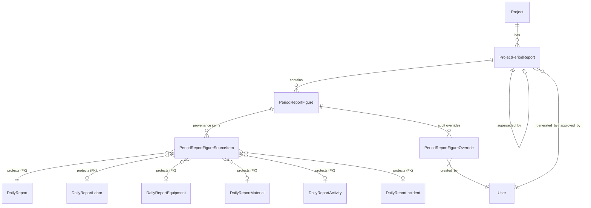

# Data Model: Automated Periodic Reports Rollup, Figure Provenance, and Controlled Override Audit

**Feature**: `041-periodic-reports-rollup`  
**Status**: Draft / Complete  
**Target App**: `apps/api/core/schedule` and `apps/api/core/field_reports`  

---

## 1. Entity-Relationship Overview

---

## 2. Model Specifications

### 2.1. `ProjectPeriodReport` (`apps/api/core/schedule/models.py`)

Represents the contractual periodic weekly or monthly report document.

| Field | Type | Modifiers | Description |
|---|---|---|---|
| `id` | `UUIDField` | `primary_key=True, default=uuid4` | Unique entity identifier |
| `project` | `ForeignKey` (`projects.Project`) | `on_delete=models.CASCADE, related_name='period_reports'` | Project scope |
| `kind` | `CharField(max_length=20)` | `choices=PeriodReportKind.choices` | `weekly` or `monthly` |
| `period_start` | `DateField` | Not null | Beginning of reporting window |
| `period_end` | `DateField` | Not null | End of reporting window |
| `status` | `CharField(max_length=20)` | `choices=PeriodReportStatus.choices, default=PeriodReportStatus.GENERATED` | `generated`, `approved`, `superseded` |
| `serial_number` | `CharField(max_length=64)` | `blank=True, default=''` | Immutable official registered serial number (e.g. `REP-PRJ01-140508-M01`) |
| `warnings` | `JSONField` | `default=list, blank=True` | Header warnings (e.g., missing or unapproved daily dates) |
| `title` | `CharField(max_length=200)` | `blank=True, default=''` | Localized report title |
| `generated_at` | `DateTimeField` | Not null | Extraction timestamp |
| `generated_by` | `ForeignKey` (`User`) | `on_delete=models.SET_NULL, null=True, blank=True` | User generating the report |
| `approved_at` | `DateTimeField` | `null=True, blank=True` | Formal sign-off timestamp |
| `approved_by` | `ForeignKey` (`User`) | `on_delete=models.SET_NULL, null=True, blank=True` | Executive or authority approving report |
| `superseded_by` | `ForeignKey('self')` | `on_delete=models.SET_NULL, null=True, blank=True` | Link to newer replacement report |

#### State Transitions (`PeriodReportStatus`):
- `generated`: Initial compiled state. Figures can be inspected, and authorized overrides may be applied.
- `approved`: Official contractual release. A unique `serial_number` is stamped. Modifications and regenerations are locked.
- `superseded`: Historical report superseded by a regeneration of the same period.

---

### 2.2. `PeriodReportFigure` (`apps/api/core/schedule/models.py`)

An individual quantitative, tabular, or status metric within a periodic report section.

| Field | Type | Modifiers | Description |
|---|---|---|---|
| `id` | `UUIDField` | `primary_key=True, default=uuid4` | Unique figure identifier |
| `report` | `ForeignKey` (`ProjectPeriodReport`) | `on_delete=models.CASCADE, related_name='figures'` | Parent periodic report |
| `section` | `CharField(max_length=60)` | Not null | Section key (`labor_machinery`, `materials`, `completed_activities`, etc.) |
| `label_key` | `CharField(max_length=120)` | Not null | i18n translation key |
| `value` | `JSONField` | `null=True, blank=True` | Active displayed value (computed or overridden) |
| `calculated_value` | `JSONField` | `null=True, blank=True` | Original calculated value, preserved permanently |
| `is_overridden` | `BooleanField` | `default=False` | True if modified via approved override workflow |
| `unit_of_measure` | `CharField(max_length=40)` | `blank=True, default=''` | Unit (e.g. `m3`, `hours`, `tons`) |
| `value_status` | `CharField(max_length=20)` | `choices=FigureValueStatus.choices` | `recorded` or `not_recorded` |
| `source_type` | `CharField(max_length=40)` | `blank=True, default=''` | Source classification |
| `source_id` | `UUIDField` | `null=True, blank=True` | Primary source identifier |
| `source_path` | `CharField(max_length=255)` | `blank=True, default=''` | UI client navigation path |
| `source_approved` | `BooleanField` | `default=False` | True if verified against approved source |
| `last_updated_at` | `DateTimeField` | `null=True, blank=True` | Last mutation timestamp |

---

### 2.3. `PeriodReportFigureSourceItem` (`apps/api/core/schedule/models.py`)

Represents an individual constituent source item contributing to a rolled-up figure (figure provenance item).

| Field | Type | Modifiers | Description |
|---|---|---|---|
| `id` | `UUIDField` | `primary_key=True, default=uuid4` | Unique provenance item identifier |
| `figure` | `ForeignKey` (`PeriodReportFigure`) | `on_delete=models.CASCADE, related_name='source_items'` | Parent report figure |
| `source_type` | `CharField(max_length=40)` | Not null | `daily_report`, `daily_labor`, `daily_equipment`, `daily_material`, `daily_activity`, `daily_incident`, `baseline_task` |
| `daily_report` | `ForeignKey` (`field_reports.DailyReport`) | `on_delete=models.PROTECT, null=True, blank=True, related_name='period_figure_sources'` | Protected FK to daily report |
| `daily_labor` | `ForeignKey` (`field_reports.DailyReportLabor`) | `on_delete=models.PROTECT, null=True, blank=True, related_name='period_figure_sources'` | Protected FK to labor row |
| `daily_equipment` | `ForeignKey` (`field_reports.DailyReportEquipment`) | `on_delete=models.PROTECT, null=True, blank=True, related_name='period_figure_sources'` | Protected FK to equipment row |
| `daily_material` | `ForeignKey` (`field_reports.DailyReportMaterial`) | `on_delete=models.PROTECT, null=True, blank=True, related_name='period_figure_sources'` | Protected FK to material row |
| `daily_activity` | `ForeignKey` (`field_reports.DailyReportActivity`) | `on_delete=models.PROTECT, null=True, blank=True, related_name='period_figure_sources'` | Protected FK to activity row |
| `daily_incident` | `ForeignKey` (`field_reports.DailyReportIncident`) | `on_delete=models.PROTECT, null=True, blank=True, related_name='period_figure_sources'` | Protected FK to incident row |
| `source_id` | `UUIDField` | `null=True, blank=True` | Generic source ID |
| `source_date` | `DateField` | `null=True, blank=True` | Gregorian date of source record |
| `source_code` | `CharField(max_length=60)` | `blank=True, default=''` | Human daily report code / reference |
| `contributed_quantity` | `JSONField` | `null=True, blank=True` | Numeric volume, hours, or description |
| `created_by` | `ForeignKey` (`User`) | `on_delete=models.SET_NULL, null=True, blank=True, related_name='+'` | Creator of daily source record |
| `approved_by` | `ForeignKey` (`User`) | `on_delete=models.SET_NULL, null=True, blank=True, related_name='+'` | Approver of daily source record |

**Referential Integrity Invariant**: Because `daily_report` and child rows use `on_delete=models.PROTECT`, any user attempting to call `.delete()` or `DELETE FROM daily_reports ...` on a daily report that has been incorporated into a periodic report will trigger `django.db.models.deletion.ProtectedError`.

---

### 2.4. `PeriodReportFigureOverride` (`apps/api/core/schedule/models.py`)

Immutable audit log of all authorized modifications to report figures.

| Field | Type | Modifiers | Description |
|---|---|---|---|
| `id` | `UUIDField` | `primary_key=True, default=uuid4` | Unique override entry ID |
| `figure` | `ForeignKey` (`PeriodReportFigure`) | `on_delete=models.CASCADE, related_name='overrides'` | Overridden figure |
| `old_value` | `JSONField` | `null=True, blank=True` | Value prior to override |
| `new_value` | `JSONField` | `null=True, blank=True` | New overridden value |
| `reason` | `TextField` | Not null | Justification text (validated $\ge 10$ characters) |
| `created_by` | `ForeignKey` (`User`) | `on_delete=models.PROTECT, related_name='period_figure_overrides'` | User submitting the override |
| `created_at` | `DateTimeField` | `auto_now_add=True` | Timestamp of override action |

---

## 3. Data Integrity & Validation Rules

1. **Override Reason Length**: `len(reason.strip()) >= 10`. Shorter strings raise `ProgressValidationError('دلیل بازنویسی باید حداقل ۱۰ کاراکتر باشد.', 'override_reason_required')`.
2. **Direct Mutation Prohibition**: Calling `PUT` or `PATCH` directly on `/figures/{figure_id}/` raises `ProgressValidationError('مقدار شاخص گزارش مستقیماً قابل ویرایش نیست؛ از override همراه با دلیل استفاده کنید.', 'figure_immutable')`.
3. **Approved Report Immutability**: Any override or modification attempt on a report with `status == 'approved'` is rejected with `report_locked`.
4. **Referential Integrity Defense**: Deletion of any source daily report referenced in `PeriodReportFigureSourceItem` raises `ProtectedError`.
