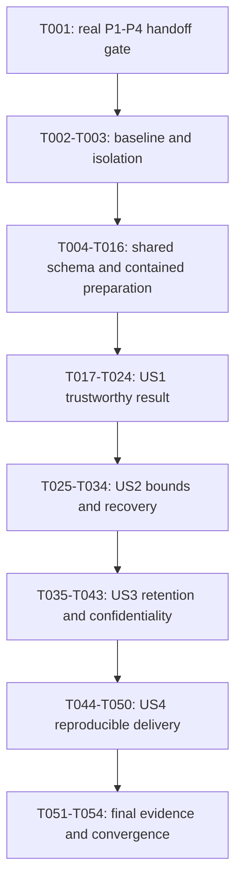

# Tasks: Reliable Schedule Import Operations

**Input**: Design documents in `specs/055-a7-p5-import-operations/`
**Prerequisites**: [plan.md](plan.md), [spec.md](spec.md), [research.md](research.md), [data-model.md](data-model.md), [contracts/import-operations.md](contracts/import-operations.md), [contracts/runtime-containment.md](contracts/runtime-containment.md), [quickstart.md](quickstart.md), Constitution 1.1.0.
**Tests**: Explicitly required by FR-013, all acceptance stories, and Constitution quality gates. Write the indicated regressions before implementation, confirm a meaningful missing-behavior failure, then run them against the final changed tree. Mocked/eager checks remain separate from real-runtime acceptance.
**Organization**: Four story phases follow shared setup/foundation. Tasks were initially unchecked. Current completion marks refer to implementation and categorized evidence in evidence/verification.md; historical planning text below does not supersede the latest evidence. Partial acceptance tasks stay open even when individual scenarios pass.

## Format: `[ID] [P?] [Story] Description`

- `[P]` means an explicitly listed, same-phase, disjoint-file opportunity after that phase's prerequisites; it does not authorize simultaneous A.7 phases or shared-service mutation.
- Story tasks use `[US1]`–`[US4]`. Shared setup/foundation/polish tasks omit story labels.
- Paths below are repository-relative from `/home/hossein/Desktop/projects/building-management`. Proposed files are to be created during implementation; existing documents and predecessor files are not regenerated.

## Path Conventions

API code is under `apps/api/core/`, operational acceptance configuration under `ops/a7-p5/`, browser tests under `e2e/`, and evidence under `specs/055-a7-p5-import-operations/evidence/`. New migration filenames must use the next actual schedule migration number at implementation time and be recorded exactly; no migration number is reserved here.

## Phase 1: Setup (Shared Infrastructure)

**Purpose**: Confirm the integrated baseline and prevent work against shared resources.

- [x] T001 Read real P1–P4 handoffs through `output/a7-implementation/phase-map.json`, verify their integrated code/evidence rather than task ticks, and record the gate in `specs/055-a7-p5-import-operations/handoff.md`; if `specs/054-a7-p4-import-experience/handoff.md` is absent or any necessary predecessor is unready, stop before T002 and do not manufacture another phase's handoff.
- [x] T002 Record Git HEAD/dirty changes, current schedule migration head, running-work ownership, and rollback-aware integration baseline in `specs/055-a7-p5-import-operations/evidence/baseline.md`; bind every SpecKit helper to the absolute P5 directory and verify returned FEATURE_DIR while preserving unrelated changes and phase-map entries.
- [x] T003 Fingerprint unchanged `real-data/plan.mpp`, identify existing supported/corrupt/protected fixture paths and authorized disposable database/broker/queue/scratch identities, and record these without secrets in `specs/055-a7-p5-import-operations/evidence/fixtures-and-isolation.md`; do not copy confidential bytes into logs or mutate reference/shared data.

---

## Phase 2: Foundational (Blocking Prerequisites)

**Purpose**: Shared schema, bounded preparation and isolated execution infrastructure needed by all stories.
**CRITICAL**: Complete T001–T016 before story implementation. Exact field constraints quoted below come from data-model.md; historical nullability follows its migration section rather than inventing historical timestamps.

### Foundation tests

- [x] T004 [P] Add migration/state regression fixtures in `apps/api/core/schedule/tests/test_a7_p5_migrations.py` for both concrete job tables, historical terminal/active/missing-byte rows, immutable identity/timestamps, conservative legacy anchors, slot constraints, forward preservation and isolated reverse-schema behavior; assert no premature purge or removal of old columns/history.
- [x] T005 [P] Add standalone helper/codec/launcher tests in `apps/api/core/schedule/tests/test_a7_p5_preparation.py` covering fresh exec/JVM isolation, safe JSON reconstruction, combined fallback deadline, denied containment, bounded output/diagnostics, capacity rejection and actual child-group teardown; label simulated-control tests separately from real-kernel evidence.

### Shared entities and migration

- [x] T006 Extend `BaseImportJob` in `apps/api/core/schedule/models.py` with `source_sha256`: “64-character digest, computed from accepted source bytes, immutable” and `source_size`: “nonnegative original byte count, immutable after intake”; preserve existing columns and scope indexes by project/actor/mode/status, with nullable historical identity only when source bytes are unavailable.
- [x] T007 Add `queued_at`, `dispatch_deadline_at`, `last_dispatched_at`, `dispatch_count` in `apps/api/core/schedule/models.py`, preserving the constraints “timezone-aware intake and deadline; pending publish attempts must not extend the deadline” and “publication observations; broker task UUID stays in existing task_id and is persisted before publish”; new intake populates them, historical rows remain conservatively nullable until reconciled.
- [x] T008 Add `started_at`, `execution_deadline_at`, `execution_token` in `apps/api/core/schedule/models.py` with “claim time and absolute bounded deadline” and “nullable random UUID fence. It is internal, never a user authorization token”; preserve public status vocabulary and cap nonterminal progress below 100 without introducing a second public state machine.
- [x] T009 Add `completed_at`, `retention_anchor_at`, `retention_anchor_source`, `file_purged_at` in `apps/api/core/schedule/models.py` with “immutable terminal completion timestamp for new jobs; set in the same commit as DONE/result or terminal FAILED”, “immutable expiry anchor, equal to completed_at for new jobs; source is `terminal` or `legacy_backfill`”, and “nullable timestamp; set atomically when file_data is cleared. Purging does not change source digest/size, completed_at or result”; historical completed_at remains unknown.
- [x] T010 Add `retry_of` and `ImportProcessingSlot` in `apps/api/core/schedule/models.py` with “nullable self-reference within the concrete job family; same project, confirming actor authorized now, immutable after intake”, “fixed seeded slots (initial profile: one)”, “slot_number unique”, and “nullable execution token, family/job UUID or preview request UUID, owner-host identifier, deadline, and containment-relative identifier”; forbid credential/source-byte storage in slot metadata and represent quarantine so unverifiable leaked work cannot release capacity. Keep retry_of nullable for fresh/legacy rows only; request intent=retry requires a visible FAILED same-family/project predecessor, while intent=new forbids retry_of; request intent adds no new persisted state.
- [x] T011 Generate the next available lifecycle/schema/data migration from `apps/api/core/schedule/models.py` into `apps/api/core/schedule/migrations/` using `makemigrations schedule --name import_operations_lifecycle`; record its exact filename/dependencies in `specs/055-a7-p5-import-operations/traceability.md`, backfill digest/size in bounded batches, anchor historical terminal bytes at one recorded migration instant labeled legacy_backfill, protect active rows, seed one slot and pass T004 on an isolated copy. Document old-worker drain before activating fencing/maintenance and loss-of-purged-bytes rollback limits in `specs/055-a7-p5-import-operations/quickstart.md`.

### Shared runtime foundation

- [x] T012 Define validated import-profile settings in `apps/api/core/config/settings.py`: existing upload cap 50 MiB/conversion 60 seconds total; preparation 75 seconds including two-second kill grace; helper memory 1 GiB/swap zero/heap 512 MiB/pids 32/one CPU; scratch 256 MiB/output 128 MiB/diagnostics 64 KiB/one slot; execution soft/hard 170/180 seconds, application at most 90 seconds and remaining deadline, lock wait three seconds; dispatch 300 seconds, publish budget five seconds, reconciliation 60 seconds/batch 100, purge hourly/retention 168 hours and Redis visibility 600 seconds in all required locations. Reject inconsistent budgets; do not enable nonexistent Beat tasks or change unrelated tasks/global worker-loss policy. Add C=10-second per-item maintenance budget, B=100 maximum batch, G≤1-second inter-batch delay and validated cohort-bound calculations from contracts/runtime-containment.md; expose successful-pass assumptions and budget failures explicitly.
- [x] T013 Implement the fixed-name private manifest and bounded versioned prepared-data JSON protocol in `apps/api/core/schedule/services/import_process.py`, validating explicit P3 task/relationship fields, lengths/types/dates/decimals/output size without pickle, executable input, source-derived paths or credentials; helper has only an allowlisted environment and no DB connection, and slots/manifests record token plus host/reboot/deadline identity.
- [x] T014 Implement the shared slot-aware launcher/helper in `apps/api/core/schedule/services/import_process.py` and replace the caller-JVM route in `apps/api/core/schedule/services/mpp_convert.py`: fresh exec/session and verified delegated cgroup before releasing input, bounded scratch/streams, JPype-first and configured CLI fallback sharing one deadline, no fallback after limits, watchdog/parent-death handling, complete group termination/reaping, token-conditional slot release and quarantine if emptiness cannot be verified; pass T005 without treating mocked controls as containment proof.
- [x] T015 Refactor `apps/api/core/schedule/services/msp_import.py` and `apps/api/core/schedule/services/p6_import.py` to share contained MPP/XML/XER preparation and accept only trusted server-produced bounded prepared data for apply, preserving P3 mapping/warnings/omissions and keeping project-dependent safety/annotation under the final lock; retain callable compatibility needed by existing tests and prevent recursive helper launches or unbounded reparsing inside apply.
- [x] T016 Create isolated acceptance services in `ops/a7-p5/compose.yml`, a secret-free `ops/a7-p5/.env.acceptance.example` and ignored private env path: phase project/database/private Redis/import and maintenance queues, API/import-worker/maintenance-worker/Beat roles, eager false, prefetch one, explicit real Celery commands and compatible pytest tooling. Provide narrow helper delegation and bounded scratch or a clear preflight blocker; no Docker socket/broad host privilege/shared volumes. Disable RabbitMQ entrypoint waiting for this suite, align Gunicorn 90 seconds/upstream greater than 90, and document equivalent delivery overrides without deploying them in `ops/a7-p5/README.md`.

**Checkpoint**: Shared schema and bounded preparation are tested; isolated environment can be brought up without changing active services. Missing runtime access is recorded as blocked/unrun, never waived.

---

## Phase 3: User Story 1 — Follow an import to a trustworthy result (Priority: P1) — MVP

**Goal**: Preserve existing endpoints while returning one stable attempt and an honest committed result.
**Independent Test**: Valid native MPP/XML/XER succeeds through actual background execution; unreadable input terminates clearly; reopening status returns the same attempt, and revoked apply-time permission leaves domain data unchanged.

### Tests for User Story 1

- [x] T017 [P] [US1] Add existing-route contract tests in `apps/api/core/schedule/tests/test_a7_p5_import_api.py` for recognized kinds/preview no-writes, durable UUID versus delivery UUID, 202 admission, existing result/error bodies, in-flight deduplication, read-only status/reopen, unknown/cross-project UUIDs and current P2 actor/archive/protected-history checks at apply; cover both import families. Include pre-admission input/capacity rejection without a job, retained FAILED history for existing safety refusals, admitted background failure with the same identifier, sole-slot saturation returning an existing matching job before busy, and a concurrent-new-start post-preparation dedupe race.
- [x] T018 [P] [US1] Add transaction/progress tests in `apps/api/core/schedule/tests/test_a7_p5_lifecycle.py` proving claim token/deadline, committed preparation milestones below 100, one atomic domain-plus-DONE/result/100% commit, rollback on injected apply failure and sanitized failure recording only by the current owner; use real PostgreSQL transaction/connection semantics. Distinguish validation rejection from an actual durably admitted worker failure; use a controlled post-admission failure without treating pre-admission corrupt input as worker evidence.

### Implementation for User Story 1

- [x] T019 [US1] Implement job intake, persisted digest/size and delivery UUID, fixed timestamps, bounded ownership claims and project→job locking in `apps/api/core/schedule/services/import_operations.py`; terminal delivery returns the existing outcome, live-claim duplicate is a no-op, and capacity-row locks are released before project/job lock acquisition. Current authorization and cheap bounded upload/digest checks precede in-flight lookup; matching a live job precedes capacity reservation, and a final project-locked recheck after preparation closes the concurrent-new-start race. Refuse a PENDING claim past its dispatch_deadline_at even before maintenance reaches it; terminalize it under the same locks.
- [x] T020 [US1] Integrate bounded preparation and durable post-commit publication into existing preview/start views in `apps/api/core/schedule/views.py`, retaining synchronous preview, P2 safety/no-write behavior and in-flight scope; return admitted PENDING identity even if publication fails within the five-second budget, and use 503 processing_busy without creating a job only for genuinely new work with no slot; an authorized matching in-flight confirmation returns its existing 202 identity before reservation/conversion, and pre-admission input rejections remain jobless while existing persisted safety refusals retain FAILED identity/timestamps.
- [x] T021 [US1] Replace `_run_import_task` in `apps/api/core/schedule/tasks.py` with claim→prepare→locked recheck/apply; commit result, DONE, progress 100 and terminal/retention timestamps in the same transaction as domain writes, persist only honest pre-apply stages, and roll back before token-fenced failure recording; leave unrelated Celery tasks unchanged.
- [x] T022 [US1] Preserve status/error/result compatibility in `apps/api/core/schedule/views.py` and use `source_sha256`/`source_size` for scoped in-flight matching in `apps/api/core/schedule/services/import_safety.py`; no raw-file/token/path disclosure and no global same-file suppression after terminal completion. Pass T017/T018 and existing P2/P3/P4 selected regressions.
- [x] T023 [US1] Add sanitized operational failure definitions/messages in `apps/api/core/schedule/services/mpp_errors.py`, `apps/api/core/schedule/views.py`, `apps/api/core/locale/fa/LC_MESSAGES/django.po`, `apps/web/src/app/locales/en.json` and `apps/web/src/app/locales/fa.json`: processing_resource_limit/interrupted/busy/input_expired only as needed, existing stable codes unchanged, generic import_failed without raw str(exc); compile server translations with the established tooling and preserve the wizard layout.
- [x] T024 [US1] Run valid native-file success, jobless unreadable-input rejection, and a separate admitted native-file job that fails in actual background preparation/application with the isolated API and independent worker from `ops/a7-p5/compose.yml`, poll/reopen status and compare stored schedule/warnings/results, then record actual commands, identities, bilingual error observation and verification limits in `specs/055-a7-p5-import-operations/evidence/us1.md`; record intake and background failure separately; unreadable rejection alone is not a failed-worker test, and eager/contract tests cannot close this checkpoint.

**Checkpoint**: US1 is a useful demonstrable slice after foundation; it is not full P5 failure/recovery/retention acceptance.

---

## Phase 4: User Story 2 — Recover from interruption and excessive processing (Priority: P1)

**Goal**: Bound processing and safely reconcile dispatch gaps, crashes and message repeats.
**Independent Test**: For timeout/resource exhaustion and each pre/during/post-commit interruption, inspect a terminal outcome and preserved/once-committed domain state, then complete a healthy native import without data repair.

### Tests for User Story 2

- [x] T025 [P] [US2] Add PostgreSQL delivery/ownership/dispatch race regressions in `apps/api/core/schedule/tests/test_a7_p5_recovery.py` for broker publication loss, fixed dispatch deadline, stale pending/running claims, concurrent duplicate delivery, terminal no-op, fenced old deliveries, same-project MSP/P6 serialization and failure-recording interruption; avoid inferring business success from Celery result state. Add a ≥201-job two-family recovery cohort with new arrivals, temporarily locked deferred rows, duplicate maintenance invocations, no starvation, no full-interval inter-batch wait and W_recovery(N) assertions; budget exhaustion must yield failed/blocked maintenance, not renewed deadlines.
- [x] T026 [P] [US2] Add real-containment integration scenarios in `apps/api/core/schedule/tests/test_a7_p5_resource_limits.py` for actual memory/swap/pids/CPU/scratch/output/time controls across preview/start/worker, combined fallback budget, parent death and cgroup/group disappearance; require an explicit isolated-runtime marker and report unavailable controls as not-run, not simulated success.

### Implementation for User Story 2

- [x] T027 [US2] Implement bounded pending dispatch republish/expiry and token-fenced stale-execution terminalization in `apps/api/core/schedule/services/import_operations.py`: fixed 300/180-second deadlines, project→job lock order, bounded wait/skip live locked applies, sanitized terminal failures, no automatic business retry and no timeout renewal on publication/read/redelivery. Implement stable oldest-first cutoff/cohort paging, count all N outstanding items ahead of the target, fair revisit of skipped rows, immediate consecutive batches with G≤1 second, per-item C=10 seconds and W_recovery(N)=60+480+10*N+ceil(N/100); new arrivals cannot overtake the cohort, and service/budget failures keep catch-up admission closed.
- [x] T028 [US2] Add idempotent reconciliation operations to `apps/api/core/schedule/management/commands/maintain_import_jobs.py` with dry-run, batch-size 100, secret-free summaries and nonzero mandatory-recovery failure exit; reconcile only authorized owned import resources and preserve active work, leaving purge operation for US3. --batch-size limits a page, not the entire cohort; use one bounded PostgreSQL maintenance-leader guard per scope and report cutoff/N/elapsed/deferred/unfinished items, enforce the per-item wall budget, and terminate nonzero on unverifiable completion rather than logging a false passing bound.
- [x] T029 [US2] Add maintenance task wrappers/routing and the 60-second reconciliation Beat entry in `apps/api/core/schedule/tasks.py` and `apps/api/core/config/settings.py`, route maintenance independently of blocked import work, and enable only per-import late acknowledgment after T021/T025 pass; keep global worker-loss/retry and unrelated task behavior intact.
- [x] T030 [US2] Enforce remaining absolute execution/apply/lock budgets in `apps/api/core/schedule/tasks.py`, `apps/api/core/schedule/services/import_operations.py`, `apps/api/core/schedule/services/msp_import.py` and `apps/api/core/schedule/services/p6_import.py`; cap DB statements at 90 seconds or less remaining time and locks at three seconds, check deadlines throughout apply, and verify hard worker termination rolls back instead of leaving an ambiguous commit.
- [x] T031 [US2] Complete abandoned-containment reconciliation in `apps/api/core/schedule/services/import_process.py`: verify token/host/reboot identity rather than PID alone, stop complete expired descendant groups, confirm emptiness before slot release, quarantine unverifiable slots and retain private manifests for US3 cleanup; never kill unrelated processes or trust symlinks.
- [x] T032 [US2] Add isolated-only named fault barriers around intake/publish, preparation, domain apply, commit/ack and failure recording in `apps/api/core/schedule/tests/a7_p5_runtime_support.py`, with guardrails rejecting non-phase resources; do not expose a public fault-injection API or deploy enabled test hooks.
- [x] T033 [US2] Execute actual broker/worker-loss and duplicate-delivery cases in `ops/a7-p5/compose.yml`, using T032 barriers before apply/during apply/after commit-before-ack/during failure recording and concurrent repeats for both families; record domain assertions, immutable outcomes, deadlines and healthy follow-up in `specs/055-a7-p5-import-operations/evidence/us2-recovery.md`. Include an actual multi-batch recovery drain with ≥201 items and measure its cutoff/N/elapsed against the documented formula after service restoration; simulated-clock-only checks do not prove actual draining.
- [x] T034 [US2] Execute T026 against effective kernel/filesystem controls, selected JPype and supported CLI-fallback routes, including healthy import after each limit/timeout/parent-loss case; record route versions, peaks, process/cgroup disappearance, API response deadlines, unavailable-route limitations and deliberate profile calibration in `specs/055-a7-p5-import-operations/evidence/us2-containment.md` without claiming unsupported routes passed.

**Checkpoint**: Resource events and service interruptions produce safe terminal outcomes; duplicate messages cause at most one committed application. Actual failure/recovery evidence remains mandatory.

---

## Phase 5: User Story 3 — Keep files private and remove processing residue (Priority: P1)

**Goal**: Enforce original-byte seven-day retention and immediate/restart temporary cleanup while preserving authorized history.
**Independent Test**: For both terminal outcomes in two disposable projects, check before/at/after 168 hours, repeated/restarted cleanup, active-input protection, surviving history, cross-project denial and retry after byte expiry.

### Tests for User Story 3

- [x] T035 [P] [US3] Add deterministic-clock purge/retry tests in `apps/api/core/schedule/tests/test_a7_p5_retention.py` for both concrete tables, exact before/at/after anchor+168-hour boundary, hourly/catch-up cleanup, legacy_backfill anchor, active/unexpired protection, immutable deadline on reads/delivery, byte-only deletion and preserved attribution/result; no system-clock changes or seven-day sleep. Add ≥201 expired rows across both families with later arrivals, one temporarily locked eligible row, repeated/competing runs, fair deferred-row revisit, no one-hour pause after a page, computed W_purge(N), maintenance-budget failure and retry intent/linkage validation.
- [x] T036 [P] [US3] Add workspace/privacy regressions in `apps/api/core/schedule/tests/test_a7_p5_artifact_privacy.py` for cleanup after success/failure/timeout, interrupted cleanup/restart, active owners, quarantine, symlinks/unrelated names, two-project artifact/status isolation, secret-bearing errors and bounded diagnostic output without a new raw-file endpoint.

### Implementation for User Story 3

- [x] T037 [US3] Implement locked terminal-only original-byte purge in `apps/api/core/schedule/services/import_operations.py`: eligibility anchor+168 hours≤now and bytes present; clear only file_data and stamp file_purged_at, preserve actor/project/mode/file digest/size/result/history, leave active/unexpired/unanchored rows untouched and make repeated purge a no-op. Pass T035 before enabling scheduled deletion.
- [x] T038 [US3] Implement immediate and restart scratch cleanup in `apps/api/core/schedule/services/import_process.py`, only after containment confirmed empty; scan the dedicated bounded root using fixed private manifests/token ownership, reject symlinks, preserve active/quarantined/unrelated files, and never glob-delete generic /tmp or purge original DB bytes early.
- [x] T039 [US3] Extend `apps/api/core/schedule/management/commands/maintain_import_jobs.py`, `apps/api/core/schedule/tasks.py` and `apps/api/core/config/settings.py` with independently invocable scratch/purge operations, hourly original expiry, 60-second abandoned-scratch reconciliation, bounded batches, dry-run, catch-up before restored admission and observable lag/failure; production code must not accept an unauthenticated test clock. Reuse the finite-cohort leader/cutoff/fairness and C/B/G budgets, drain expiry batches without another hourly pause and enforce W_purge(N)=3600+480+10*N+ceil(N/100), with immediate startup detection and explicit failed/blocked outcomes when assumptions or budgets are violated.
- [x] T040 [US3] Implement explicit business-retry intent and linkage in `apps/api/core/schedule/views.py` and `apps/api/core/schedule/services/import_operations.py`: intent=retry requires retry_of for a visible FAILED same-family/project predecessor; intent=new is the backwards-compatible default and forbids retry_of; current confirming actor permission, mandatory fresh upload after expiry, new job identity/lifecycle and unchanged predecessor expiry; reject inaccessible linkage without disclosing the target and present actionable localized expiry guidance. Extend request types/FormData in `apps/web/src/app/lib/api/msp.ts` and the existing flow in `apps/web/src/components/wbs/msp-import-wizard.tsx` to capture the failed job, require a fresh file and send intent=retry plus retry_of for both families; fresh import clears linkage, while status-refresh retry only polls the same job. Preserve layout/accessibility and reject missing intent-specific linkage rather than guessing a predecessor.
- [x] T041 [US3] Remove sensitive raw exception/source content from import public diagnostics in `apps/api/core/schedule/tasks.py`, `apps/api/core/schedule/services/mpp_convert.py`, `apps/api/core/schedule/services/import_process.py` and `apps/api/core/schedule/views.py`; use bounded sanitized reasons/correlation and verify temporary/original/diagnostic access applies existing organization/project and sensitive-file policy without adding download rights.
- [x] T042 [US3] Run real success/failure/timeout/restart cleanup, exact expiry fixtures, repeated purge, fresh-upload retry and unrelated/active-input protection in the isolated environment; record actual artifact/DB observations and surviving action history in `specs/055-a7-p5-import-operations/evidence/us3-cleanup.md`, and scan saved public logs/status for fixture secrets without storing those secrets in evidence. Include actual ≥201-item expiry/scratch cohort draining with recorded cutoff/N/timing, no starvation or full-interval page pauses, and the documented bound plus blocked-budget behavior.
- [x] T043 [US3] Add and run bilingual operational-error/expiry-retry/reopen browser coverage in `e2e/tests/a7-p5-import-operations.spec.ts`, preserving P4 keyboard/mobile behavior; record Persian/English observations in `specs/055-a7-p5-import-operations/evidence/us3-browser.md` and run `pnpm typecheck` if frontend locale/error wiring changed. Assert outgoing multipart intent=retry/retry_of and a new linked job for explicit Retry, intent=new with no predecessor for fresh import, missing-link rejection and no new job on status-refresh retry.

**Checkpoint**: Original bytes expire on the agreed clock; temporary residue is removed safely; attributable outcomes remain readable only through authorized existing interfaces.

---

## Phase 6: User Story 4 — Reproduce the delivery check (Priority: P2)

**Goal**: A second operator can reproduce actual native-file and adverse-path evidence using the recorded delivery configuration.
**Independent Test**: Follow quickstart from a clean isolated setup with eager false and real worker/maintenance, process unchanged plan.mpp, repeat the required failure matrix and distinguish every pass/failure/not-run result without secrets.

### Tests for User Story 4

- [x] T044 [P] [US4] Add command/preflight refusal tests in `apps/api/core/schedule/tests/test_a7_p5_runtime_preflight.py` for wrong database/Redis/queue/cgroup/scratch identities, eager mode, missing real workers, absent containment, inconsistent deadlines and credential redaction; a failed preflight cannot yield an empty passing matrix.
- [x] T045 [P] [US4] Add evidence-manifest and matrix-completeness tests in `apps/api/core/schedule/tests/test_a7_p5_runtime_manifest.py`, requiring code/image/file identity, actual dependency/route/effective-limit fields, categorized scenario outcomes and second-operator reproduction status; assertions must reject eager/mock evidence labeled as real-worker acceptance.

### Implementation for User Story 4

- [x] T046 [US4] Implement `apps/api/core/schedule/management/commands/verify_import_runtime.py` --preflight/--run-matrix/--project-prefix/--reference/--output interface per quickstart, guarded to isolated phase resources; create only disposable phase-prefixed test subjects, call authenticated existing preview/start/status APIs, record normal operator permissions, refuse unsafe/shared targets and avoid credential-bearing output.
- [x] T047 [US4] Complete preflight and matrix orchestration in `apps/api/core/schedule/management/commands/verify_import_runtime.py`, reusing `apps/api/core/schedule/tests/a7_p5_runtime_support.py` only for isolated test barriers: cover all ten quickstart groups, actual JRE/classpath/JPype/fallback routes, both job families, resource peaks, commit correctness, expiry/cleanup and healthy follow-ups; unavailable access/route must become explicit not-run with operational failure status, never substituted eager success. Include sole-slot dedupe precedence, request-intent linkage, separate rejected-versus-admitted failure evidence, and ≥201-item recovery/expiry cohorts with measured formula/fairness/budget-failure evidence.
- [x] T048 [US4] Run real delivery-image preview/import of unchanged `real-data/plan.mpp` and supported fixtures through `ops/a7-p5/compose.yml`, verify P3 meanings/P4 stored counts and omission warnings rather than invented totals, and save sanitized code/image/hash/dependency/route/effective-limit evidence in `specs/055-a7-p5-import-operations/evidence/runtime/manifest.json`; preserve the source fingerprint.
- [x] T049 [US4] Reproduce `specs/055-a7-p5-import-operations/quickstart.md` from a clean isolated environment via a second operator, checking startup/delegation/fallback and mandatory fault/cleanup groups, and record commands, observed results and identity-independent reproduction in `specs/055-a7-p5-import-operations/evidence/reproduction.md`; if no second operator/access is available, record that gate and leave the task open.
- [x] T050 [US4] Finalize `ops/a7-p5/README.md` and `specs/055-a7-p5-import-operations/quickstart.md` against actual implemented commands, delivery overrides, old-worker drain/migration/rollback process, effective limits, required containment delegation and exact missing service/access prerequisites; provide a reproducible bundle even when runtime access blocks acceptance, without claiming universal MSP-year support or initiating deployment.

**Checkpoint**: Reproducible delivery evidence exists for all required categories, or exact unrun scenarios/access blockers remain explicit and the phase is not accepted.

---

## Phase 7: Polish & Cross-Cutting Concerns

- [x] T051 Run focused final-tree P5 tests plus existing P2/P3/P4/MSP/P6/native-equivalence regressions under isolated PostgreSQL, schema migration/data-preservation checks and relevant frontend/browser checks; record commands, versions, failures and category limits in `specs/055-a7-p5-import-operations/evidence/verification.md`, separating eager/unit/cache overrides from actual worker evidence and preserving Django 4.2.11.
- [x] T052 Replace planned-only audit mappings in `specs/055-a7-p5-import-operations/traceability.md` with task IDs, source requirements, observed final behavior and specific passed/failed/not-run evidence for each I09/I19/I20/D02 and every FR/SC; never use source presence/task ticks as delivery acceptance.
- [x] T053 Update `specs/055-a7-p5-import-operations/handoff.md` with exact code/tree identity, changed files, migration/rollout implications, actual verification, open prerequisite/environment/second-operator gates and next allowed action; preserve other entries in `output/a7-implementation/phase-map.json`, do not claim full P5 acceptance while any required scenario is unrun and do not start P6 automatically.
- [x] T054 Verify the documented workflow and evidence closure in `specs/055-a7-p5-import-operations/tasks.md`: confirm the prerequisite read-only `/speckit-analyze` ran before implementation and after any design correction, then run `/speckit-converge` only after implementation to append remaining work, and route code fixes through `/speckit-implement`; record residual gaps in `specs/055-a7-p5-import-operations/evidence/verification.md` and leave unmet tasks unchecked.

---

## Dependencies & Execution Order

### Phase Dependencies

- Current action only creates tasks. `/speckit-analyze` is the next read-only workflow stage; implementation is not authorized by task ticks or generated documents alone.
- T001 is the hard predecessor gate and is now verified against actual P1–P4 handoffs plus `specs/054-a7-p4-import-experience/evidence/handoff-recheck.md`. T002→T003 follow it. Recheck drift before mutations; the isolated P5 runtime/containment gates remain open.
- After Setup, T004/T005 can be authored together and must fail meaningfully before their implementation. Model edits T006→T007→T008→T009→T010 share a file and are sequential; T011 follows them and T004.
- Foundation chain: T011→T012→T013→T014→T015→T016. T005 is the red test target for T013–T015. T016 supplies the real environment for story acceptance; unavailable delegation/access is recorded rather than weakening bounds.
- Story order is US1→US2→US3→US4. They reuse lifecycle/services/commands, so these story phases do not run concurrently. Each has its own independent acceptance scenario on the shared completed baseline.
- US1: T017/T018 before T019→T020→T021→T022→T023→T024.
- US2: T025/T026 before T027→T028→T029→T030→T031→T032→T033→T034. Do not enable late ack before atomic outcome/race checks pass. T032 barriers are used for T033/T034 and later US4 only in the isolated environment.
- US3: T035/T036 before T037→T038→T039→T040→T041→T042→T043; no scheduled deletion until purge boundaries/protection checks pass.
- US4: T044/T045 before T046→T047→T048→T049→T050. US4 runs the complete acceptance matrix; prior per-story evidence is retained rather than assumed to cover new changes.
- Final: T051→T052→T053→T054. Analyze also runs before implementation; T054 checks that workflow fact and dispatches convergence only after real implementation, not during task generation.

### Dependency Graph

### Parallel Opportunities

Only the following same-phase, disjoint-file pairs are marked `[P]`; each pair starts after the preceding phase is complete. They are authoring opportunities, not permission to mutate shared services or execute destructive tests concurrently:

- Foundation: T004 migration tests and T005 preparation tests.
- US1: T017 API contract tests and T018 lifecycle transaction tests.
- US2: T025 recovery tests and T026 resource-control integration tests.
- US3: T035 retention tests and T036 artifact/privacy tests.
- US4: T044 preflight tests and T045 manifest tests.

All actual fault-injection/migration/runtime runs use the isolated environment sequentially; all shared-file implementation edits are sequential. No sub-agents or parallel execution were dispatched by task generation.

## Parallel Example: User Story 1

After foundation, author T017 in `test_a7_p5_import_api.py` alongside T018 in `test_a7_p5_lifecycle.py`. Run the PostgreSQL checks in an isolated controlled order, then begin T019. No shared production project is used.

## Parallel Example: User Story 2

After US1, author T025 in `test_a7_p5_recovery.py` alongside T026 in `test_a7_p5_resource_limits.py`. Their actual process-kill/resource tests run sequentially after T032 and verified isolated controls.

## Parallel Example: User Story 3

After US2, author T035 in `test_a7_p5_retention.py` alongside T036 in `test_a7_p5_artifact_privacy.py`. Keep deterministic expiry clocks inside test fixtures, and run cleanup/fault injection sequentially.

## Parallel Example: User Story 4

After US3, author T044 in `test_a7_p5_runtime_preflight.py` alongside T045 in `test_a7_p5_runtime_manifest.py`. Complete the harness before claiming a reproducible real-worker run.

## Implementation Strategy

### MVP First — US1

Complete the real predecessor gate, Setup, Foundation and US1 (T001–T024). Demonstrate native valid-file success and actionable failure with actual background processing. This is a useful checkpoint, not permission to declare I19/I20/D02 or the complete P5 phase accepted; recovery/retention/delivery evidence remains.

### Incremental Delivery

Add US2's bounded failure/recovery, then US3's seven-day purge/privacy, then US4's independent reproduction. Validate each story's explicit test before moving forward. Record unavailable environment requirements as blocked/unrun while finishing independently possible code/docs; never mark a scenario successful because a service executable exists. Preserve existing permissions, preview/fidelity semantics and unrelated work.

### Scope and Traceability

- US1: 8 tasks; FR-001/002/003/004/012 and SC-001/002/006, audit I09.
- US2: 10 tasks; FR-003/004/005/006/007/008 and SC-001/002/003, audits I09/I20.
- US3: 9 tasks; FR-007/009/010/011/012 and SC-004/006, audit I19.
- US4: 7 tasks; FR-013/014 and SC-005 plus complete acceptance matrix, audit D02.
- Shared: 3 Setup + 13 Foundation + 4 Polish = 20 tasks. Total 54, all unchecked at generation.

## Notes

Tests and migrations must preserve Django 4.2.11. No generic preview rebuild, new broker family, full EVM/financial scope, live P6 sync, production deployment or destructive shared-data validation is included. Completing a task requires its stated result/evidence, not changing a checkbox to pass a gate. New task additions from convergence are append-only and must preserve these IDs.

## Phase 8: Convergence

- [x] T055 Bound maintenance republish through the same finite publication helper, preserve fixed dispatch deadlines and retain recoverable pending state when publication fails; add a blocked-transport regression in `apps/api/core/schedule/tests/test_a7_p5_recovery.py` per FR-006 and plan: per-item C=10-second budget (partial, HIGH).
- [x] T056 Add single-leader, finite-cohort timing/status and per-item budgets to owned scratch reconciliation, enforce bounded manifest reads, and keep restart admission closed until both recovery and scratch verification succeed; test expired quarantine, budget failure and repeat safety in `apps/api/core/schedule/tests/test_a7_p5_artifact_privacy.py`, then repeat real cleanup/catch-up evidence per FR-006/FR-010 and T028/T031/T039/T042 (partial, HIGH).
- [x] T057 Make `maintain_import_jobs` exit nonzero for blocked mandatory completion and invalid batch arguments, with meaningful command regressions and updated guide semantics per FR-014 and T028 (partial, MEDIUM).

## Phase 9: Convergence

- [x] T058 Exercise actual MigrationExecutor downgrade→historical rows→forward upgrade→reverse-schema→upgrade on an isolated PostgreSQL test database, preserving both-family original bytes/results/actor/project and conservative anchors; record irreversible byte-purge rollback limits in `specs/055-a7-p5-import-operations/evidence/verification.md` per Constitution II/VI and T004/T011/T051 (partial, HIGH). The existing direct backfill-function test alone is insufficient schema-roundtrip evidence.

## Phase 10: Convergence

- [x] T059 Install the configured project/job lock timeout before acquiring those locks in `import_operations._lock_pair`, rather than after acquisition; prove bounded waiting and unchanged pending state using two real PostgreSQL connections per FR-005/FR-006 and T030 (partial, HIGH).

## Phase 11: Convergence

- [x] T060 Enforce the cumulative application deadline, bounded by both90-second apply profile and remaining execution deadline, before each SQL statement and before DONE commit; test rollback/sanitized processing_timeout after cumulative apply exhaustion per FR-005/FR-003 and T030 (partial, HIGH). A90-second per-statement setting alone does not bound a multi-query application.

## Phase 12: Convergence

- [x] T061 Fix multipart request payload inspection and fresh-import terminal completion waiting in `e2e/tests/a7-p5-import-operations.spec.ts` so `page.unroute` does not drop Chromium `postDataBuffer()` or leave an active preparation slot blocking subsequent `fa` preview requests, then rerun the 4-case EN/FA × 1280×800/390×844 browser suite and update `specs/055-a7-p5-import-operations/evidence/runtime/independent-browser.log` and `specs/055-a7-p5-import-operations/evidence/us3-browser.md` per FR-007/FR-012/FR-013, SC-006, US3/AC5-AC6, Constitution III/VI, and T040/T043 (partial)
- [x] T062 Forward caller-supplied `now` and `monotonic` clocks from `run_maintenance('recovery')` in `apps/api/core/schedule/services/import_operations.py` into `reconcile_abandoned_scratch()` in `apps/api/core/schedule/services/import_process.py` and add deterministic clock/timestamp forwarding coverage in `apps/api/core/schedule/tests/test_a7_p5_artifact_privacy.py` per FR-006/FR-010, SC-004, contracts/runtime-containment.md, and T039/T056 (partial)
- [x] T063 Extend `apps/api/core/schedule/tests/a7_p5_runtime_matrix.py` and `apps/api/core/schedule/management/commands/verify_import_runtime.py` to exercise and record live isolated observations for request-intent retry linkage (`intent=retry` with valid/missing `retry_of` vs `intent=new` with `retry_of`), maintenance budget-failure admission closure, and quarantined/deferred scratch-cohort cleanup per FR-004/FR-006/FR-007/FR-010/FR-013, SC-001/SC-004, and T047/T056 (partial)
- [x] T064 Rebuild the isolated `a7p5-import` acceptance image on the frozen source tree after T056/T061–T063, rerun `ops/a7-p5/run-acceptance.sh`, `ops/a7-p5/check-broker-outage.py`, `ops/a7-p5/check-concurrent-delivery.py`, and pytest verification so `specs/055-a7-p5-import-operations/evidence/runtime/manifest.json` and `source-files.json` match the current source SHA-256, and reconcile `specs/055-a7-p5-import-operations/evidence/reproduction.md`, `verification.md`, `us1.md`, `us2-containment.md`, `us2-recovery.md`, `us3-cleanup.md`, `traceability.md`, and `handoff.md` per FR-013/FR-014, SC-005, US4/AC1-AC7, Constitution VI, and T024/T033/T034/T042/T043/T047/T048/T049/T056 (partial)
