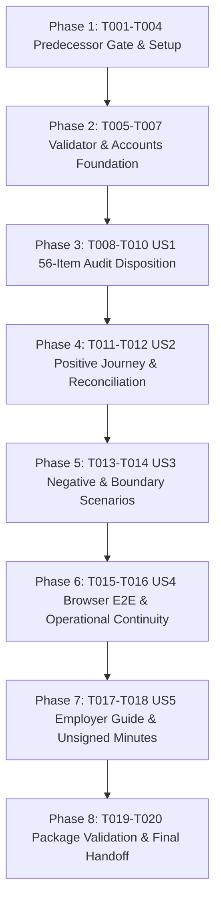

# Tasks: Integrated Acceptance and Employer Delivery Package (A.7-P6)

**Input**: Design documents from `/specs/056-a7-p6-delivery-acceptance/`  
**Prerequisites**: `plan.md` (required), `spec.md` (required for user stories), `research.md`, `data-model.md`, `contracts/delivery-acceptance.md`, `quickstart.md`  
**Tests**: Included as mandatory acceptance verification suites (`apps/api/core/schedule/tests/test_a7_p6_delivery_acceptance.py`, `e2e/tests/a7-p6-delivery-acceptance.spec.ts`, and `specs/056-a7-p6-delivery-acceptance/evidence/validate_package.py`) per `FR-001`–`FR-010` and `SC-001`–`SC-006`.  
**Organization**: Tasks are grouped by user story (`US1`–`US5`) to enable ordered, traceable execution and verification.

## Format: `[ID] [P?] [Story] Description`

- **[P]**: Can run in parallel (different files, no dependencies on incomplete tasks)
- **[Story]**: Which user story this task belongs to (`[US1]`–`[US5]`)
- Exact file paths and verbatim `data-model.md` constraints are included in task descriptions.

---

## Phase 1: Setup (Shared Infrastructure)

**Purpose**: Verify predecessor handoffs (`051`–`055`), snapshot candidate version identity, and initialize package evidence structure.

- [x] T001 Verify predecessor gate readiness across `specs/051-a7-p1-project-reference/handoff.md`, `specs/052-a7-p2-import-safety/handoff.md`, `specs/053-a7-p3-import-fidelity/handoff.md`, `specs/054-a7-p4-import-experience/handoff.md`, and `specs/055-a7-p5-import-operations/handoff.md` (confirming P5 `T049` second-operator reproduction in `specs/055-a7-p5-import-operations/evidence/reproduction.md`) and record the gate audit in `specs/056-a7-p6-delivery-acceptance/evidence/verification.md` (`FR-001`).
- [x] T002 Record candidate version identity (`git rev-parse HEAD`, `git status --short`, `schedule_tree_sha256`, `acceptance_image_digest`, Django `4.2.11` pin, and `real-data/plan.mpp` SHA-256 `3a4f800f0f57e408be52095117f1a53887f653ac07f720621b3e22aa67765553` / `777216` bytes) in `specs/056-a7-p6-delivery-acceptance/evidence/package.json` (`FR-004`, `FR-008`).
- [x] T003 [P] Backfill standalone predecessor traceability matrix in `specs/052-a7-p2-import-safety/traceability.md` for `P08`, `W04`, `S05`, `I06`, `I07`, `I08`, `I11`, `I14`, and `I18` from `specs/052-a7-p2-import-safety/handoff.md` and `specs/052-a7-p2-import-safety/evidence/verification.md` (`FR-001`, `FR-002`).
- [x] T004 [P] Backfill standalone predecessor traceability matrix in `specs/053-a7-p3-import-fidelity/traceability.md` for `W07`, `S01`–`S04`, `S06`–`S08`, `I01`, `I03`–`I05`, `I12`, `I13`, `I21`, and `I22` from `specs/053-a7-p3-import-fidelity/handoff.md` and `specs/053-a7-p3-import-fidelity/evidence/verification.md` (`FR-001`, `FR-002`).

---

## Phase 2: Foundational (Blocking Prerequisites)

**Purpose**: Create the deterministic package validator and secret-free 5-persona role provisioning reference before executing user story verification.

**⚠️ CRITICAL**: No user story verification or package sign-off work can conclude until this phase is complete.

- [x] T005 Implement deterministic delivery package validator in `specs/056-a7-p6-delivery-acceptance/evidence/validate_package.py` enforcing all `data-model.md` constraints: `AuditDispositionRecord` (`audit_id` matching `^(P0[1-9]|P1[01]|W0[1-7]|M0[1-4]|S0[1-8]|I0[1-9]|I1[0-9]|I2[0-2]|D0[1-4])$` for 56 unique IDs, `owning_phase` enum `A.7-P1`..`A.7-P6`, `source_requirement` non-empty string, `disposition` enum `تأیید فنی`|`ناقص`|`اجرانشده`|`نیازمند پاسخ کارفرما`, `employer_bucket` enum `قبلاً موجود و تأییدشده روی نسخه حاضر`|`در A.7 اصلاح/تکمیل شد`|`هنوز باز/اجرانشده`|`قابل تست توسط کارفرما`, non-empty `evidence_refs`, and `version_id`), `AcceptanceScenarioRecord` (`scenario_id` matching `^(POS-(0[1-9]|10)|NEG-(0[1-9]|1[0-4])|OPS-0[1-4])$` for 28 scenarios minimum, `category` enum `positive`|`negative`|`concurrency`|`access_boundary`|`bilingual_ux`|`operational`, non-empty `audit_ids`, `role_persona` enum `creator_planner`|`independent_approver`|`viewer`|`system_admin`|`org_reference_steward`|`multi_role`, `channel` enum `api_db`|`real_worker`|`browser_e2e`|`combined`, non-empty `input_ref`, `expected_outcome`, `observed_outcome`, `technical_result` enum `pass`|`fail`|`not_run`, `employer_result` enum `pending`|`accepted`|`rejected` remaining `pending`, nullable `defect_id`, and `evidence_ref`), `ReferenceScheduleReconciliationRecord` (`fixture_id` in `real_data_plan_mpp`|`valid_msp_xml`|`valid_p6_xer`|`valid_p6_xml`, `file_path`, 64-char hex `sha256`, positive integer `size_bytes`, `source_counts`, `preview_counts`, `stored_counts` `{"wbs_count": 6, "activity_count": 72, "relation_count": 72}` for `real-data/plan.mpp`, `repeat_append_result` with `nothing_changed: true` and zero duplicates/baselines, and `expected_warning_codes`), `EmployerDeliveryPackage` (`version_id`, `environment_id`, 5 `role_personas`, 4 `summary_buckets`, `technical_readiness` enum `ready_for_acceptance`|`blocked`, `employer_decision` = `"pending"`, `employer_signer_role` = `""`, `employer_signed_at` = `""`), immutability of `output/a7-requirements-2026-11-10/requirements.json`, and secret-free / proprietary-text-free content (`FR-002`, `FR-004`, `FR-008`, `FR-009`, `SC-001`, `SC-006`).
- [x] T006 [P] Author the secret-free 5-persona role matrix (`creator_planner`, `independent_approver`, `viewer`, `system_admin`, `org_reference_steward`) and repeatable test-account setup/reset instructions in `specs/056-a7-p6-delivery-acceptance/evidence/accounts.md` (`FR-006`, `FR-008`, `SC-005`).
- [x] T007 [P] Initialize the defect triage and predecessor convergence log in `specs/056-a7-p6-delivery-acceptance/evidence/defects.md` per `FR-010`.

**Checkpoint**: Foundation ready — user story verification and evidence assembly can proceed.

---

## Phase 3: User Story 1 - Integrated 56-Item Audit Disposition and Predecessor Gate Verification (Priority: P1) 🎯 MVP

**Goal**: Reconcile all 56 A.7 audit items (`P01`–`P11`, `W01`–`W07`, `M01`–`M04`, `S01`–`S08`, `I01`–`I22`, `D01`–`D04`) against the integrated candidate codebase and current-version test/runtime evidence.

**Independent Test**: Run `python3 specs/056-a7-p6-delivery-acceptance/evidence/validate_package.py` and inspect `specs/056-a7-p6-delivery-acceptance/traceability.md` and `specs/056-a7-p6-delivery-acceptance/evidence/audit-disposition.json` to confirm all 56 items have current-version evidence and valid dispositions.

### Implementation for User Story 1

- [x] T008 [US1] Execute the integrated P1–P5 non-regression backend test suite (`projects/tests/test_project_registration_api.py`, `test_charter_lifecycle.py`, `test_project_lifecycle.py`, `test_wbs_api.py`, `test_wbs_move_api.py`, `test_wbs_DragDrop_integration.py`, `project_templates/tests.py`, and `schedule/tests/test_a7_p2_import_safety.py`, `test_a7_p3_import_fidelity.py`, `test_a7_p4_import_experience.py`, `test_a7_p5_*.py`) on an isolated PostgreSQL test database and export JUnit results to `specs/056-a7-p6-delivery-acceptance/evidence/p1-p5-regression-junit.xml` (`FR-001`, `FR-002`, `SC-001`).
- [x] T009 [US1] Generate machine-readable 56-item audit disposition inventory in `specs/056-a7-p6-delivery-acceptance/evidence/audit-disposition.json` conforming to `AuditDispositionRecord` constraints (`audit_id` matching `^(P0[1-9]|P1[01]|W0[1-7]|M0[1-4]|S0[1-8]|I0[1-9]|I1[0-9]|I2[0-2]|D0[1-4])$`, `owning_phase`, `source_requirement`, `disposition`, `employer_bucket`, `evidence_refs`, `version_id`) (`FR-002`, `SC-001`).
- [x] T010 [US1] Reconcile `specs/056-a7-p6-delivery-acceptance/traceability.md` with `specs/056-a7-p6-delivery-acceptance/evidence/audit-disposition.json` so all 56 audit items (`P01`–`D04`) link to current candidate verification evidence (`FR-001`, `FR-002`, `SC-001`).

**Checkpoint**: All 56 audit items are mapped to owning phases, source requirements, and current candidate verification artifacts.

---

## Phase 4: User Story 2 - End-to-End Positive Reference Project Journey Across Roles (Priority: P1)

**Goal**: Execute and evidence the 10-step positive reference project journey (`POS-01`–`POS-10`, `D03`) across separated roles, including `real-data/plan.mpp` and XML/XER figure reconciliation, repeat append idempotency, safe replacement guards, 4-way dates/CPM/delay views, and full lifecycle transitions.

**Independent Test**: Run `pytest schedule/tests/test_a7_p6_delivery_acceptance.py -k positive` and the positive Playwright journey in `e2e/tests/a7-p6-delivery-acceptance.spec.ts`, verifying `POS-01`–`POS-10` pass and `evidence/reconciliation.json` matches all expected figures.

### Tests & Execution for User Story 2

- [x] T011 [US2] Author and execute integrated positive journey tests (`POS-01`–`POS-10`) in `apps/api/core/schedule/tests/test_a7_p6_delivery_acceptance.py` covering: draft creation with governed org/contract/measurement references + 6-section charter (`POS-01`), charter submission + SoD self-approval block + activation gates (`PM`, `scope`, `budget > 0`) + independent approval (`POS-02`), post-approval `ProjectChangeRequest` workflow (`POS-03`), >=3-level WBS with `responsible_user` & `completion_criterion` + move/renumber + decoupled template copy (`POS-04`), schedule preview (`POS-05`), `append` import of `real-data/plan.mpp` (`6` WBS, `72` activities, `72` relations, `activity_without_parent`, `predecessor_is_summary` on `8055`/`8084`/`8102`/`8120`, `calendar_not_applied`) and XML/XER fixtures (`POS-06`), repeat `append` idempotency (`nothing_changed = true`, `0` duplicates, `0` extra baselines) (`POS-07`), `replace` guard (`baseline_replace_forbidden` when protected history exists; soft-delete replacement when unprotected) (`POS-08`), 4-way dates + milestones + delay variance + CPM validity gate (`POS-09`), and lifecycle transitions (`suspended` ↔ `active` with reason, `completed` → `undo-complete` by system admin, `archived` → `restore` by system admin with 100% data preservation) (`POS-10`) (`FR-003`, `FR-004`, `SC-002`, `SC-003`).
- [x] T012 [US2] Generate the reference schedule reconciliation ledger in `specs/056-a7-p6-delivery-acceptance/evidence/reconciliation.json` and `specs/056-a7-p6-delivery-acceptance/evidence/reconciliation.md` conforming to `ReferenceScheduleReconciliationRecord` constraints (`fixture_id` in `real_data_plan_mpp`|`valid_msp_xml`|`valid_p6_xer`|`valid_p6_xml`, `file_path`, 64-char hex `sha256` `3a4f800f0f57e408be52095117f1a53887f653ac07f720621b3e22aa67765553`, `size_bytes` `777216`, `source_counts`, `preview_counts`, `stored_counts` `{"wbs_count": 6, "activity_count": 72, "relation_count": 72}`, `repeat_append_result` with `nothing_changed: true` and `0` duplicates/baselines, and `expected_warning_codes` `["activity_without_parent", "predecessor_is_summary", "calendar_not_applied"]`) (`FR-004`, `SC-002`).

**Checkpoint**: Positive 10-step reference project journey and `real-data/plan.mpp` / XML / XER reconciliations are verified and recorded.

---

## Phase 5: User Story 3 - Independent Negative, Adverse, Concurrency, and Access-Boundary Journeys (Priority: P1)

**Goal**: Execute and evidence all 14 negative, adverse, concurrency, and role-boundary scenarios (`NEG-01`–`NEG-14`, `D03`), proving zero unintended mutations on invalid or unauthorized operations.

**Independent Test**: Run `pytest schedule/tests/test_a7_p6_delivery_acceptance.py -k negative` and verify `NEG-01`–`NEG-14` pass with unchanged pre-existing project, WBS, activity, relationship, and baseline counts.

### Tests & Execution for User Story 3

- [x] T013 [US3] Author and execute negative, adverse, concurrency, and access-boundary tests (`NEG-01`–`NEG-14`) in `apps/api/core/schedule/tests/test_a7_p6_delivery_acceptance.py` covering: duplicate/normalized project & WBS codes (`NEG-01`), cross-project parent WBS (`NEG-02`), WBS & dependency cycles (`NEG-03`), `finish < start` & manual zero-duration non-milestone rejection (`NEG-04`), missing/summary predecessors & atomic rollback (`NEG-05`), empty/corrupt XML (`msp_invalid_xml`)/wrong extension (`invalid_file_type`)/truncated OLE (`mpp_unsupported`)/password-protected (`mpp_password_protected`)/oversized (`> 50 MB`) uploads (`NEG-06`), preview cancellation without import (`NEG-07`), connection drop / reload same-attempt recovery (`NEG-08`), concurrent submit & in-flight drag/drop lock (`import_already_active`) (`NEG-09`), mid-queue permission revocation & project archival before worker execution (`NEG-10`), cross-project isolation between Project A and Project B (`NEG-11`), Viewer (`view_only`) mutation/import denial (`NEG-12`), non-member System Admin read-only observation & lifecycle recovery (`NEG-13`), and archived project strict read-only lock across all surfaces including schedule import (`NEG-14`) (`FR-005`, `FR-006`, `SC-003`).
- [x] T014 [US3] Export the complete P6 acceptance pytest JUnit report (covering `POS-01`–`POS-10` and `NEG-01`–`NEG-14`) to `specs/056-a7-p6-delivery-acceptance/evidence/p6-pytest-junit.xml` (`FR-003`, `FR-005`, `FR-006`, `SC-003`).

**Checkpoint**: All 14 negative, concurrency, and access-boundary scenarios are verified with zero unintended data mutations.

---

## Phase 6: User Story 4 - Bilingual, Responsive, Keyboard, and Operational Continuity Verification (Priority: P1)

**Goal**: Verify real-stack browser interactions (`POS`, `NEG`, `OPS-01`–`OPS-03`) in Persian (`fa`, RTL) and English (`en`, LTR), across desktop (`1280x800`) and mobile (`390x844`) viewports, and via keyboard navigation—including P1 carry-over lifecycle buttons (`complete`/`undo-complete`, `archive`/`restore`) and P4 carry-over account/project-switch observation—and bind P5 operational continuity (`OPS-04`).

**Independent Test**: Run `pnpm exec playwright test e2e/tests/a7-p6-delivery-acceptance.spec.ts` and `pnpm typecheck` against the live backend/frontend stack, confirming all browser tests pass and screenshots are saved under `specs/056-a7-p6-delivery-acceptance/evidence/screenshots/`.

### Tests & Execution for User Story 4

- [x] T015 [US4] Author and execute real-stack Playwright end-to-end acceptance suite in `e2e/tests/a7-p6-delivery-acceptance.spec.ts` (and save screenshots to `specs/056-a7-p6-delivery-acceptance/evidence/screenshots/`) covering: positive project/charter/WBS/import flow, P1 carry-over browser clicks for `complete` → `undo-complete` (`P07`) and `archive` → `restore` (`P09`), P4 carry-over live account/project-switch browser observation (`I10`), invalid upload recovery & in-flight lock (`I02`, `I15`, `I16`), keyboard-only navigation (`Tab`, `Shift+Tab`, `Enter`, `Escape`) (`OPS-03`), and Persian (`fa`, RTL) + English (`en`, LTR) rendering at desktop (`1280x800`) and mobile (`390x844`) viewports (`OPS-01`, `OPS-02`), then run `pnpm typecheck` (`FR-003`, `FR-005`, `FR-006`, `FR-007`, `SC-003`, `SC-004`).
- [x] T016 [US4] Verify operational continuity (`OPS-04`) between the candidate `apps/api/core/schedule/` source tree SHA-256 (`52669f25e2271f43a8fdd93501a7175d8bb695faa697618bcccdfe0a58b26e70`) and P5's independent second-operator runtime artifacts (`specs/055-a7-p5-import-operations/evidence/runtime/independent-complete-matrix.json`, `broker-outage.json`, `concurrent-delivery.json`, and `specs/055-a7-p5-import-operations/evidence/reproduction.md`), and record all 28 `AcceptanceScenarioRecord` entries (`POS-01`–`POS-10`, `NEG-01`–`NEG-14`, `OPS-01`–`OPS-04`) in `specs/056-a7-p6-delivery-acceptance/evidence/scenarios.json` and `specs/056-a7-p6-delivery-acceptance/evidence/scenarios.md` (`FR-003`–`FR-007`, `SC-003`, `SC-004`).

**Checkpoint**: Real browser E2E (`fa`/`en`, `1280x800`/`390x844`, keyboard, lifecycle clicks, account/project switch) and operational continuity (`OPS-01`–`OPS-04`) are verified and recorded across all 28 scenarios.

---

## Phase 7: User Story 5 - Self-Contained Employer Delivery Package and Honest Acceptance Record (Priority: P1)

**Goal**: Assemble the complete, secret-free Employer Delivery Package (`D04`), including the concise Persian Employer Test Guide (`guide.md`), the 4-category status summary, and the unsigned acceptance minutes (`evidence/minutes.md`).

**Independent Test**: Hand `specs/056-a7-p6-delivery-acceptance/guide.md` and `evidence/minutes.md` to an independent reviewer and run `python3 specs/056-a7-p6-delivery-acceptance/evidence/validate_package.py` (confirming exit code `0`).

### Implementation for User Story 5

- [x] T017 [P] [US5] Author the concise Persian Employer Test Guide (`راهنمای کوتاه تست کارفرما`) in `specs/056-a7-p6-delivery-acceptance/guide.md` containing: candidate version & environment ID, isolated startup/reset commands, 5-role login instructions (`evidence/accounts.md`), hashed reference files (`real-data/plan.mpp` SHA-256 `3a4f800f0f57e408be52095117f1a53887f653ac07f720621b3e22aa67765553` and XML/XER fixtures) with control figures (`6` WBS, `72` activities, `72` relations), step-by-step positive/negative test scenarios (`POS-01`–`POS-10`, `NEG-01`–`NEG-14`, `OPS-01`–`OPS-04`), and the 4-category executive summary (`قبلاً موجود و تأییدشده روی نسخه حاضر`, `در A.7 اصلاح/تکمیل شد`, `هنوز باز/اجرانشده`, `قابل تست توسط کارفرما`) (`FR-008`, `SC-005`, `SC-006`).
- [x] T018 [P] [US5] Author the unsigned employer acceptance minutes (`صورت‌جلسه پذیرش کارفرما`) in `specs/056-a7-p6-delivery-acceptance/evidence/minutes.md` and finalize `specs/056-a7-p6-delivery-acceptance/evidence/package.json` conforming to `EmployerDeliveryPackage` constraints (`technical_readiness = "ready_for_acceptance"`, `employer_decision = "pending"`, `employer_signer_role = ""`, `employer_signed_at = ""`, with explicit separation between technical readiness and human employer approval) (`FR-008`, `FR-009`, `SC-005`, `SC-006`).

**Checkpoint**: Self-contained Employer Delivery Package and unsigned acceptance minutes are complete.

---

## Phase 8: Polish & Cross-Cutting Concerns

**Purpose**: Final package validation, verification report consolidation, handoff closure, and knowledge/graph synchronization.

- [x] T019 Run `python3 specs/056-a7-p6-delivery-acceptance/evidence/validate_package.py` to validate all 56 `AuditDispositionRecord` items, 28 `AcceptanceScenarioRecord` items, 4 `ReferenceScheduleReconciliationRecord` items, `EmployerDeliveryPackage` fields, immutability of `output/a7-requirements-2026-11-10/requirements.json`, and secret-scan cleanliness, and record the output in `specs/056-a7-p6-delivery-acceptance/evidence/verification.md` (`FR-002`, `FR-004`, `FR-008`, `FR-009`, `SC-001`–`SC-006`).
- [x] T020 Finalize `specs/056-a7-p6-delivery-acceptance/handoff.md` with final candidate commit/tree identity, summary of all verified channels (API/DB pytest, P5 real worker/containment + second-operator reproduction, P6 real browser Playwright E2E, package validator), residual non-blocking limits (native OS file picker, human employer sign-off pending), and confirmation that `output/a7-implementation/phase-map.json` preserves all 6 phase entries (`a7-p1-project-reference` through `a7-p6-delivery-acceptance`) (`FR-001`, `FR-008`, `FR-009`, `FR-010`).

---

## Dependencies & Execution Order

### Phase Dependencies

- **Setup (Phase 1, `T001`–`T004`)**: Immediate entry — verifies P1–P5 handoffs and backfills standalone P2/P3 `traceability.md` files.
- **Foundational (Phase 2, `T005`–`T007`)**: Depends on Phase 1 — establishes `validate_package.py`, `accounts.md`, and `defects.md`.
- **User Story 1 (Phase 3, `T008`–`T010`)**: Depends on Phase 2 — runs P1–P5 non-regression baseline and populates the 56-item disposition matrix.
- **User Story 2 (Phase 4, `T011`–`T012`)**: Depends on Phase 3 — executes the 10-step positive journey (`POS-01`–`POS-10`) and reference schedule reconciliation ledger.
- **User Story 3 (Phase 5, `T013`–`T014`)**: Depends on Phase 4 (shares `test_a7_p6_delivery_acceptance.py`) — executes the 14 negative, concurrency, and access-boundary scenarios (`NEG-01`–`NEG-14`).
- **User Story 4 (Phase 6, `T015`–`T016`)**: Depends on Phases 4 & 5 — runs real browser Playwright E2E (`OPS-01`–`OPS-03`), verifies P5 operational continuity (`OPS-04`), and writes `scenarios.json` / `scenarios.md`.
- **User Story 5 (Phase 7, `T017`–`T018`)**: Depends on Phases 3–6 — assembles `guide.md`, `minutes.md`, and `package.json`.
- **Polish (Phase 8, `T019`–`T020`)**: Depends on Phase 7 — runs `validate_package.py` and finalizes `verification.md` and `handoff.md`.

### Dependency Graph



### Parallel Opportunities

- **Phase 1**: `T003` (`specs/052-a7-p2-import-safety/traceability.md`) and `T004` (`specs/053-a7-p3-import-fidelity/traceability.md`) touch disjoint files and can run in parallel.
- **Phase 2**: `T006` (`evidence/accounts.md`) and `T007` (`evidence/defects.md`) touch disjoint files and can run in parallel alongside `T005` (`evidence/validate_package.py`).
- **Phase 7**: `T017` (`guide.md`) and `T018` (`evidence/minutes.md` & `evidence/package.json`) touch disjoint files and can run in parallel once scenario evidence (`T016`) is complete.

---

## Parallel Example: Phase 1 & Phase 7

```bash
# Phase 1 parallel predecessor traceability backfill:
Task T003: "Backfill standalone predecessor traceability matrix in specs/052-a7-p2-import-safety/traceability.md"
Task T004: "Backfill standalone predecessor traceability matrix in specs/053-a7-p3-import-fidelity/traceability.md"

# Phase 7 parallel employer package authoring:
Task T017: "Author the concise Persian Employer Test Guide in specs/056-a7-p6-delivery-acceptance/guide.md"
Task T018: "Author the unsigned employer acceptance minutes in specs/056-a7-p6-delivery-acceptance/evidence/minutes.md"
```

---

## Implementation Strategy

### MVP First (User Story 1)

1. Complete Phase 1 (`T001`–`T004`) and Phase 2 (`T005`–`T007`).
2. Complete Phase 3 (`T008`–`T010`, `US1`): Verify the P1–P5 non-regression baseline and produce the 56-item audit disposition matrix.

### Incremental Delivery

1. Add `US2` (`T011`–`T012`): Verify the 10-step positive reference project journey and `real-data/plan.mpp` figure reconciliation.
2. Add `US3` (`T013`–`T014`): Verify all 14 negative, adverse, concurrency, and access-boundary scenarios.
3. Add `US4` (`T015`–`T016`): Verify real browser E2E (`fa`/`en`, `1280x800`/`390x844`, keyboard, lifecycle clicks, account/project switch) and P5 operational continuity.
4. Add `US5` (`T017`–`T018`) and Polish (`T019`–`T020`): Assemble the Persian Employer Test Guide and unsigned acceptance minutes, and pass `validate_package.py`.
